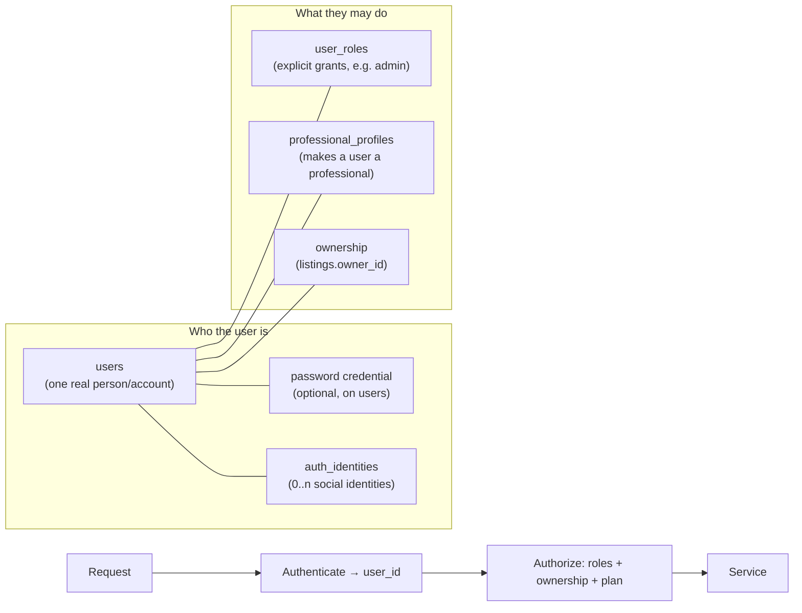

# B-17 Portal — Authentication, Authorization & Roles

**Status:** direction frozen by Phase 10A — **design only; nothing is implemented** and several choices are deliberately left to Phase 11 after a security review.
**Owns:** the identity model, roles and permissions, social-login direction, token/session options, admin-role rules, and what the frontend must change.
**Does not own:** table design beyond identity columns → [`DATA_MODEL.md`](DATA_MODEL.md) · HTTP shapes → [`API_CONTRACT.md`](API_CONTRACT.md) · CORS/security checklist → [`BACKEND_ARCHITECTURE.md`](BACKEND_ARCHITECTURE.md).

> **Authentication = who the user is. Authorization = what the user may do.** They are separate mechanisms with separate failure modes (`401 unauthenticated` vs `403 forbidden`). Authorization is decided by the **backend's own data** (roles, ownership, plan), never by what an identity provider says.

## 1. Where we are today (frontend prototype)

- `DemoUser { name }` — a free-text name, no password, no session, no id; resets on reload.
- A **separate in-memory admin login** (`/admin/login`, "Continue as Admin (Demo)").
- Resident and Professional are **the same login**: any signed-in user can open `/provider` and list. "Professional" is simply "has listings"; ownership is `submittedBy === user.name`.
- Route guards (`useRequireAuth`, `useRequireAdminAuth`) and Free/Premium capability checks are **UX only** — `DECISIONS.md` already records that the backend will be authoritative.
- Explicit Log Out clears the resident store and plan (the demo's privacy boundary).

## 2. Identity model

Text form: `request → authenticate (user id) → authorize (roles + ownership + plan) → service`.

**`users`** — `id uuid`, `email` (case-insensitively unique), `email_verified_at`, `display_name` (2–60; the only profile field the frontend collects today), `password_hash` (nullable: a social-only account has none), `status` (`active|suspended|deleted`), `created_at`, `updated_at`, `last_login_at`.
**`auth_identities`** — `id`, `user_id → users`, `provider` (`google|facebook|apple`), `provider_user_id` (the provider's stable subject id), `provider_email` (informational), `created_at`; `UNIQUE(provider, provider_user_id)`. One user may have several identities plus a password.
**`user_roles`** — `(user_id, role)` explicit grants only (`admin` now; room for `moderator`/`support`), with `granted_by`/`granted_at`.
**Sessions/refresh tokens** — a store of refresh-token records (hashed) for revocation, if the Phase 11 decision uses them (§6). Email-verification and password-reset tokens are single-use, hashed, expiring records.

Email is required in V1 (all three providers can supply it with the right scope); a provider that withholds it triggers a "complete your account" step in Phase 11 rather than a nullable email.

## 3. Roles and capabilities (RBAC)

| Role | How a user has it | Notes |
|---|---|---|
| **Resident** | Every authenticated account (baseline) | Not a row — being signed in *is* being a resident. |
| **Professional** | A `professional_profiles` row exists | Created self-service the first time a user uses the professional workspace — **preserving today's behavior** (any signed-in user can list; no admin gate). A **verification** state is a future seam on the profile, not a V1 gate. |
| **Admin** | An explicit `user_roles` row `admin` | Granted **only by backend/ops** (CLI/migration/seed, later an admin tool by an existing admin). Never self-service, never derived from an OAuth provider or email domain. |

A user can be resident + professional + admin at once; roles **add** capabilities and never remove public ones. **Public modules are never role-restricted:** a "Property professional" browses Food, News and Services exactly like a resident; there is no "professional-only" public content.

| Capability | Anonymous | Resident | Professional (owner) | Admin |
|---|---|---|---|---|
| Browse/search/read public content (approved listings, published news) | ✔ | ✔ | ✔ | ✔ |
| Save / unsave a listing | — | ✔ | ✔ | ✔ |
| Submit a service request | — | ✔ (not to own listing) | ✔ (not to own) | ✔ |
| View own requests | — | ✔ | ✔ | ✔ |
| Create a listing (quota by plan) | — | — | ✔ (creates profile on first use) | ✔ |
| Edit / archive **own** listing | — | — | ✔ | — (moderates instead) |
| View own listings in all statuses | — | — | ✔ | — |
| View/advance leads for **own** provider listings | — | — | ✔ | — |
| Approve / reject listings (`pending` only) | — | — | — | ✔ |
| Feature a listing (`is_featured`) | — | — | — | ✔ |
| Create/edit/publish News & Updates | — | — | — | ✔ |
| Manage categories (create/edit/activate/reorder) | — | — | — | ✔ |
| View users, grant/revoke roles | — | — | — | ✔ (role grants: ops/admin tool only) |

**Enforcement:** coarse checks in FastAPI dependencies (`require_user`, `require_role("admin")`); **data-dependent checks in services** ("is this the owner of this listing?", "is the plan quota exhausted?", "is the listing visible?"). Permissions are a small **code-defined role→permission map** in V1; a database-driven permission model is deferred until roles multiply. An endpoint without an authorization-matrix test (`BACKEND_ARCHITECTURE.md` §8) does not merge.

**Plan / entitlements** are backend-authoritative: `professional_profiles.plan_code` plus a code-level map mirroring `config/plans.ts`. The frontend `useCapability` stays as UX gating fed by `GET /users/me`. Billing is out of scope; until it exists the plan is set administratively.

## 4. Authentication methods

- **Email + password** (first-party). Hashing: a modern memory-hard algorithm — **Argon2id** preferred (scrypt/bcrypt acceptable fallback) — with per-password salts, tuned work factors, constant-time verification, transparent rehash on login. Minimum length and breached/common-password screening; no composition-rule theater. Never log or return hashes.
- **Google** (OpenID Connect) — first social provider. **Facebook** — where appropriate for the audience. **Apple** — needed if/when native iOS ships with any third-party login (App Store policy), so keep the identity model provider-agnostic from day one. Use the **authorization-code flow with PKCE**, verify `iss`/`aud`/`exp`/`nonce`, and map the provider's stable **subject id** (not email) to `auth_identities`.
- **Email verification** and **password reset**: single-use, hashed, short-lived tokens delivered by email (an email-sending seam is required in Phase 11; no provider chosen here). Reset and login responses must not reveal whether an email exists (anti-enumeration), and are rate-limited.

**Account linking rules** (account-takeover is the main risk): (1) a social login for a *known* `(provider, subject)` signs that user in; (2) an unknown identity whose provider-verified email matches an **existing verified** account is linked **only after** the user proves control of the existing account (sign in with it, or confirm via email) — never silently on an unverified email; (3) an authenticated user can explicitly link/unlink identities, but cannot remove their last way to sign in; (4) a brand-new identity with no matching account creates a new user with the provider's verified email and `email_verified_at` set. Linking and user creation are single transactions.

## 5. Admin specifics

- The admin **role comes only from `user_roles`**. OAuth identity, email domain or a client claim never grants it.
- The frontend keeps a separate `/admin/login` *screen* (it is a distinct entry point and unlinked from the public UI) but it authenticates through the **same** identity system; the backend checks the role on every admin request. There is no second user table.
- Admin sessions may have **stricter policy** (shorter lifetime, re-authentication for sensitive actions, MFA as a documented future seam).
- Sensitive admin actions (approve/reject, role changes, category changes, content publishing) are **audited** (`listing_status_history` today; a general audit table is added when a second consumer appears).
- Initial admin accounts are provisioned out-of-band by operators (documented runbook), never by a public registration path.

## 6. Token / session direction — to be decided in Phase 11

Not frozen on purpose; Phase 11 must evaluate against a security review and the hosting topology.

| Option | Strengths | Risks / costs |
|---|---|---|
| **Short-lived access token + rotating refresh token** (refresh in an `HttpOnly; Secure; SameSite` cookie for web, secure storage for native) | Works for SPA/PWA **and** future native clients; revocable via stored refresh records | More moving parts; careful rotation and reuse detection needed |
| **Server-side session cookie** (opaque id) | Simplest and safest for a pure web app; trivial revocation | Cookies are awkward for native clients; needs CSRF protection |
| Long-lived bearer JWT in `localStorage` | Easy | **Rejected:** XSS-readable, hard to revoke |

Constraints already known: (1) **never** store tokens in `localStorage`; (2) if cookies are used, the SPA and API should be **same-site** (e.g. `app.example.org` + `api.example.org`, or a reverse proxy mapping `/api`) — a cross-site API turns the cookie into a third-party cookie that browsers increasingly block; (3) if cookies are used, `SameSite` + CSRF defenses (double-submit/origin checks) are required and CORS must list exact origins with credentials; (4) the PWA service worker must not cache authenticated API responses; (5) future native clients (store packaging, a later phase) must be able to use the same API.

## 7. Frontend impact (Phase 11/12, recorded now)

- `DemoUser {name}` → a real user object (`id`, `displayName`, `roles`/capabilities, plan). Ownership stops being "name equals".
- `useRequireAuth` / `useRequireAdminAuth` keep their redirect UX but read real sessions; **they remain UX, not security**.
- `AuthProvider.logout` still clears resident-local data; with server-side Saved/requests the stores become caches.
- The Login/Register screen gains email, password and social buttons; the single-name form is a demo artifact.
- Playwright E2E guard tests (`e2e/guards.spec.ts`) are rewritten against real auth and seeded accounts.

## 8. Deferred to Phase 11 (explicitly)

Token/session mechanism and lifetimes · OAuth library/provider setup and consent-screen verification · email delivery provider · MFA · account-deletion and data-export flows (policy sketched in `DATA_MODEL.md` §11) · rate-limit numbers · session management UI (devices, revoke all) · professional verification workflow · a database-driven permission model.
