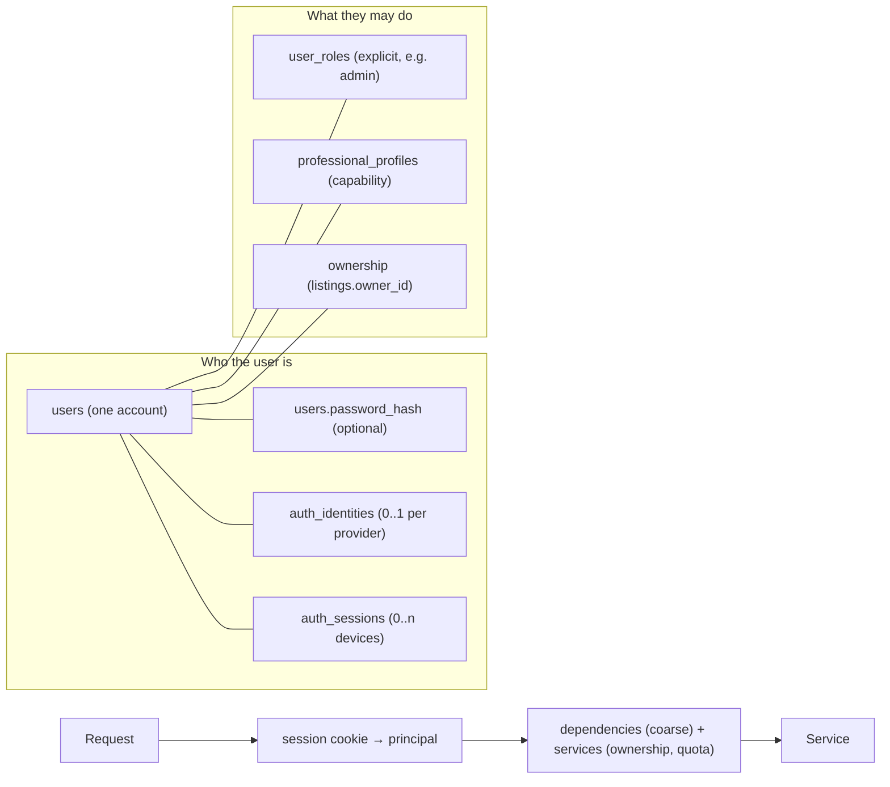

# B-17 Portal — Authentication, Authorization & Roles

**Status:** **frozen by Phase 11A; email/password authentication, sessions, CSRF and the RBAC foundation are IMPLEMENTED in Phase 11B** (§20 lists exactly what was built and the few as-built refinements). **Google OAuth, account linking/claiming (Connect/Disconnect) and the OAuth schema (§10, migration `0004`) are IMPLEMENTED in Phase 11C** (§21 lists exactly what was built and the few as-built refinements; the real-Google smoke test is a documented manual step). Phase 12A adds §22 (the authorization matrix for the write APIs and the frontend integration contract; Phase 11 behaviour is unchanged). Where a number is marked *tunable*, 11B/11C may adjust it inside the stated bounds; every other statement is binding. **Phase RBAC-0 (2026-11-19, documentation only) adds §27: a design freeze for a Super Admin + Scoped Moderator model that is NOT IMPLEMENTED. §11, §22, §24, §25 and §26 remain the description of the running system.**
**Owns:** the identity model, session/cookie/CSRF design, password and token handling, email verification and reset, Google OAuth and account linking, roles and authorization architecture, the auth API contract, the auth schema plan, the threat review and the security test matrix.
**Does not own:** general table design → [`DATA_MODEL.md`](DATA_MODEL.md) · HTTP conventions/envelopes → [`API_CONTRACT.md`](API_CONTRACT.md) · layering/logging/CORS baseline → [`BACKEND_ARCHITECTURE.md`](BACKEND_ARCHITECTURE.md) · hosting/secrets/ops → [`DEPLOYMENT.md`](DEPLOYMENT.md).

> **Authentication = who the user is. Authorization = what the user may do.** Separate mechanisms, separate failures (`401` vs `403`). Authorization is decided by the **backend's own data** (roles, ownership, plan), never by an identity provider, a client claim, or frontend state. **Public browsing stays public:** no role restricts a public module — a Professional or Admin browses Food, Property, Services and News exactly like a Resident.

## 1. Decision summary (what 11B/11C implement — both now built)

| # | Decision | Section |
|---|---|---|
| D1 | **Opaque server-side sessions in PostgreSQL**, carried by one `HttpOnly` cookie. No JWTs, no refresh tokens, no tokens in `localStorage`/response bodies. | §4 |
| D2 | Session secret = 256-bit random token; **only its SHA-256 hash is stored**. New session id on login/register/privilege change (no fixation). | §4 |
| D3 | Cookie `__Host-b17_session` (staging/prod) / `b17_session` (dev): `HttpOnly; Secure; SameSite=Lax; Path=/`; host-only (no `Domain`). | §5 |
| D4 | CSRF = **layered**: `SameSite=Lax` + a mandatory exact `Origin` check (plus `Sec-Fetch-Site` as defence in depth) + a **session-bound `X-CSRF-Token`** on authenticated unsafe requests. JSON bodies for normal endpoints; multipart only on explicit upload endpoints, with **no weaker** protection. | §6 |
| D5 | Sessions: idle 14 days (sliding), absolute 30 days, multiple devices (cap 10), admin actions need a recent session (idle 2 h, max 12 h). No remember-me. | §4.4 |
| D6 | **Argon2id** (`argon2-cffi`), central parameters, rehash on login; password policy is **length-based** (10–128, denylist screening, no composition rules). | §7.3 |
| D7 | Email is stored **trimmed + lower-cased** (DB `CHECK` + existing `lower(email)` unique index); Gmail-style dot/plus folding is **not** applied. | §7.2 |
| D8 | Registration creates a **Resident** account and signs in immediately; unverified users may log in/browse/save, but **listing writes and service requests require a verified email**. | §7.1, §9 |
| D9 | Verification/reset tokens live in **one purpose-tagged table**: 256-bit random, hashed, single-use (atomic consume), expiring (24 h / 1 h). Delivered in the URL **fragment**, redeemed by `POST`. | §8 |
| D10 | Password reset/change revokes sessions; `forgot-password`, `resend-verification` and `login` never reveal whether an email exists. Registration returns an **explicit `409 email_already_registered` — an intentional UX/security trade-off**, rate-limited. | §8, §7.4, §13.1 |
| D11 | **Google OAuth** = backend-driven authorization-code flow + PKCE + `state` + `nonce`, flow state in PostgreSQL bound to the browser by a short-lived cookie; identity key = `(provider, sub)`, never the email. | §10 |
| D12 | **No automatic linking by email.** A verified existing account requires sign-in then *Connect Google*. The **only** email-match exception is the narrow, fully-specified *unverified-account claim* (account recovery / pre-hijacking defence). | §10.4 |
| D13 | Roles: **Resident** = every account, **Professional** = a `professional_profiles` row (a capability, not a role), **Admin** = an explicit `user_roles` row granted only out-of-band. | §11.1 |
| D14 | Authorization is centralized in dependencies (`get_optional_user`, `get_current_user`, `require_verified_user`, `require_professional`, `require_admin`) plus service-level ownership policies. Frontend guards are UX only. | §11 |
| D15 | `401` unauthenticated / `403` authenticated-but-not-allowed / `404` for resources the caller may not know exist. | §11.5 |
| D16 | PostgreSQL only: sessions, tokens, OAuth flows, audit events and identity-keyed rate-limit counters. **No Redis.** | §4.2, §13 |
| D17 | Phasing (**approved**): **11A** design freeze · **11B** email/password + PostgreSQL sessions + CSRF + authorization/RBAC foundation (migration `0003`) · **11C** Google OAuth + linking + authentication hardening (migration `0004`) · then **12** write APIs + frontend integration · **13** media + production deployment. | §19 |

> **RBAC-0 note (2026-11-19):** D13 and D14 describe the system as built. A later design freeze (§27; only its RBAC-A foundation — schema and primitives, §28 — is implemented, and it changes no route) refines them: the stored value `admin` keeps its name and takes Super Admin semantics, a second role `moderator` is added with scope assignments, and the authorization dependencies gain scope-aware, Super Admin-only and recent-authentication variants. Until the phases in §27.16 ship, D13 and D14 are unchanged.

## 2. Current state (audited in Phase 11A)

**Frontend (prototype, unchanged by 11A):**
- `AuthProvider` holds `DemoUser { name }` in React state — no password, session, id or persistence; `logout` also clears `residentStore` and `planStore` (the demo's privacy boundary). `AdminAuthProvider` is a **separate** in-memory context with a fixed `Demo Admin` and a "Continue as Admin (Demo)" button.
- `useRequireAuth` / `useRequireAdminAuth` redirect to `/login` / `/admin/login` immediately when the context is empty and preserve `location.state.from`. They have **no "loading" state** (state is synchronous today).
- Resident ≠ Professional login: any signed-in user can open `/provider`; ownership is `submittedBy === user.name`.
- `residentStore` (saved items, requests) and `planStore` persist to **`localStorage`** — acceptable for demo data, never for credentials.
- E2E `guards.spec.ts` pins the redirect/return UX, "a resident is still sent to Admin Login", and "an admin session does not open the Professional workspace". The last two are properties of the *demo's two contexts*; with real accounts the rule becomes "authorization decides" (§15).
- The service worker (`pwa/sw.template.js`) handles only same-origin GETs: navigations are network-first with an offline shell fallback; `/assets/*` cache-first; **everything else is untouched**. No API response is cached.

**Backend (Phases 10B–10D):**
- Schema exists, behavior does not: `users` (`email` + unique `lower(email)`, `email_verified_at`, `display_name`, nullable `password_hash`, `status active|suspended|deleted`, `last_login_at`), `user_roles(user_id, role)` with `RoleName = {admin}`, `auth_identities` (`provider google|facebook|apple`, `provider_subject`, `provider_email`; `UNIQUE(provider, provider_subject)`), `professional_profiles(user_id, plan_code)`.
- CORS: explicit origins, `allow_credentials=False`, headers `Authorization, Content-Type, X-Request-ID, If-Match, Idempotency-Key`.
- Errors: `unauthenticated` (401) and `forbidden` (403) already exist; validation errors never echo input values (`validation_details` keeps only field/type/message).
- Request log: method, path template, status, duration — **no body, no query string**. Uvicorn's own access log (not configured by the app) *does* print query strings (§13.4).
- No auth dependency, hashing, session, cookie, token or email code exists.

**Schema sufficiency:** `users`, `user_roles`, `professional_profiles` and `auth_identities` are **sufficient in shape**; Phase 11B/11C add *new* tables and three constraints (§16). Published migrations `0001`/`0002` are never edited.

## 3. Identity model



- **One credentials system.** `password_hash` lives **on `users`** (nullable): a social-only account has none. A separate credential table was rejected — there is exactly one password per account, the table would add a join to every login for no gain, and `auth_identities` already models "other ways in". Professionals and Admins use the same account and login; there is **no second credentials table and no second login system** (the `/admin/login` *screen* is just a different entry point to the same endpoint, §15).
- **Login identifier = email.** No usernames. `display_name` (2–60) is a label, never an identifier.
- **A user's sign-in methods** = password (if `password_hash`) + 0..1 identity per provider. A user must always keep at least one (§10.6).

## 4. Session architecture

### 4.1 Strategy: server-side session cookie (D1)

| | **A. HttpOnly cookie + server-side session** | **B. JWT access + refresh, both in HttpOnly cookies** |
|---|---|---|
| Revocation / logout | Immediate (delete/mark the row) | Access tokens live until expiry; revocation needs a denylist or refresh-token rotation with reuse detection |
| Multi-device | One row per device; revoke one/all trivially | Same, but only through the refresh-token store (i.e. a session table anyway) |
| Moving parts | One cookie, one table | Two cookies, signing keys + rotation, refresh endpoint, reuse detection, clock skew |
| Per-request cost | One indexed PostgreSQL lookup (the request already hits PostgreSQL) | Signature check, but role/status changes (suspend, role revoke) are not seen until expiry unless looked up anyway |
| CSRF | Needed (cookie) | Needed (cookie) |
| OAuth | Callback sets the same cookie | Same |
| Native app later | Needs a bearer form — the same table can back an opaque bearer token (§15.3) | Natural |
| XSS token theft | `HttpOnly` blocks reads | Same |

**Chosen: A.** B's only real advantage — stateless verification — buys nothing for a single modular monolith that queries PostgreSQL on every request anyway, and it makes suspension, role change and logout slower and more complex. A future native client is served by an opaque bearer token backed by the same session table, not by distorting the browser model today.

### 4.2 Storage (D2, D16)

PostgreSQL table `auth_sessions` (no Redis — one indexed lookup per request is far below any threshold that would justify a second datastore):

| Column | Notes |
|---|---|
| `id uuid PK` | internal id (UUIDv4), safe to show/log; **not** the secret |
| `user_id → users` `ON DELETE CASCADE` | |
| `token_hash bytea(32)` **UNIQUE** | SHA-256 of the cookie token. The token is 256 bits of `secrets.token_urlsafe(32)` randomness, so a plain SHA-256 is sufficient (no pepper, no password-style KDF, **no signing secret to manage or rotate**). The raw token exists only in the cookie. |
| `created_at`, `last_seen_at` | `last_seen_at` is updated at most once per **5 minutes** per session (one write, not one per request) |
| `expires_at` | *idle* expiry, slid forward from `last_seen_at`, never beyond `absolute_expires_at` |
| `absolute_expires_at` | `created_at` + absolute lifetime |
| `revoked_at`, `revoke_reason` | `logout · logout_all · password_reset · password_change · admin_action · suspended · role_change · session_cap · account_claimed` |
| `user_agent varchar(200)` | truncated, informational — recognises a device in a future "your sessions" list. **No IP address is stored** (PII, and meaningless behind proxies). |

A session is valid iff the row exists, `revoked_at IS NULL`, `now() < expires_at`, `now() < absolute_expires_at` **and** the joined user is `status = 'active'`. The principal (user + roles + professional summary) is loaded by **one** query/join — no lazy loading in the dependency.

### 4.3 Creation, rotation, fixation (D2)

- A **new** token and row are created at register, login (password or OAuth) and after any privilege elevation (admin role granted → all that user's sessions are revoked; the user signs in again). The server never accepts a client-chosen session identifier, and pre-auth requests carry no session, so there is nothing to fix.
- On login the server also deletes that user's long-expired sessions (opportunistic cleanup, §13.5) and enforces the **cap of exactly 10 active sessions per user** (see below).
- Password change rotates the current session (new token) and revokes the user's other sessions.
- **Active-session cap = 10 per user (frozen).** A valid login is **never rejected** because the cap was reached. Creating a session runs in one transaction that first locks the user's row (`SELECT … FOR UPDATE`, which serializes concurrent logins for that user), counts the user's active sessions (not revoked, not expired), and — if the count is ≥ 10 — revokes the **oldest** active sessions (by `created_at`) with `revoke_reason = 'session_cap'` until at most 9 remain, then inserts the new session. The automatic revocation is atomic with the insert and each revoked session is recorded as an `auth_events` `session_revoked` event (`details.reason = session_cap`). No session-management UI is part of 11B.

### 4.4 Lifetimes (D5)

| | Value | Why |
|---|---|---|
| Idle timeout (sliding) | **14 days** | Residents open the PWA irregularly; a few-hours expiry would be hostile, an unlimited one risky |
| Absolute lifetime | **30 days** | Bounds a stolen cookie; forces a periodic fresh login |
| Admin recency (`require_admin`) | session `last_seen` within **2 h** and `created_at` within **12 h**, else `401 session_expired` | Stricter handling for the highest-privilege role without a second session type (a resident action by the same admin keeps the normal lifetime) |
| Remember-me | **Deferred** — one policy for everyone | Avoid a second lifetime class without a requirement |

Renewal: when `last_seen_at` is refreshed the server also slides `expires_at` and re-sends `Set-Cookie` with the new `Max-Age` (only then, not on every response). A missing/unknown token → `401 unauthenticated`; a known but expired/revoked token → `401 session_expired` **and** the cookie is cleared. All tunables are settings (§14).

### 4.5 Multi-device and revocation (D5)

Multiple concurrent sessions per user are supported (one row per device). Revocation triggers:

| Trigger | Sessions revoked |
|---|---|
| `POST /auth/logout` | the current one (row marked + cookie cleared — deleting the cookie alone is never sufficient) |
| `POST /auth/logout-all` | all of the user's |
| password **reset** | all |
| password **change** | all others (current is rotated) |
| account suspended / deleted | all; and a suspended user's sessions are unusable even before they are marked (status is part of validity) |
| admin role granted/revoked | all of that user's |
| email change (future) | all others |

Future (no UI now): `DELETE /auth/sessions/{id}` and a list endpoint — the table already supports them (`id`, `user_agent`, `last_seen_at`).

## 5. Cookie contract (D3)

| Attribute | Value |
|---|---|
| Name | `__Host-b17_session` in `staging`/`production`; `b17_session` in `development`/`test` |
| Value | the raw random token — nothing else (no user id, no role, no JSON) |
| `HttpOnly` | **always** — never readable from JavaScript |
| `Secure` | always in `staging`/`production` (a setting that may not be disabled there; the `__Host-` prefix makes browsers enforce it); off only for plain-HTTP local development |
| `SameSite` | **`Lax`** |
| `Path` | `/` (required by `__Host-`) |
| `Domain` | **never set** (host-only, which `__Host-` requires): the cookie belongs to the API host and is sent only to it |
| `Max-Age` | seconds until idle expiry (persistent cookie; re-issued when the session slides) |
| Clearing | `Set-Cookie` with an empty value, `Max-Age=0`, identical name/path/flags |

**Why `Lax`, not `Strict`:** `Strict` withholds the cookie on top-level navigations arriving from other sites (an email link to the frontend, the OAuth callback), which breaks nothing important here but buys little beyond what the CSRF layers already give, and `Lax` is the browser default users' tools expect. **Why never `None`:** `SameSite=None` is only needed when the frontend and API are **cross-site** (different registrable domains) or embedded in third-party frames — exactly the topology §5.1 forbids; browsers increasingly block such third-party cookies, and `None` removes the very protection layer D4 relies on.

Summary by environment:

| | Development / test | Staging / production |
|---|---|---|
| Name | `b17_session` | `__Host-b17_session` |
| `HttpOnly` | yes | yes |
| `Secure` | **no** (plain `http://`) | **yes** (cannot be disabled) |
| `SameSite` | `Lax` | `Lax` |
| `Path` | `/` | `/` |
| `Domain` | none | none (host-only) |

A second short-lived cookie is used only by the OAuth flow (§10.2): `__Host-b17_oauth` / `b17_oauth`, `HttpOnly; Secure; SameSite=Lax; Path=/; Max-Age=600`.

### 5.1 Topology (cookie-relevant; no host chosen)

**Same-site** = same registrable domain (scheme + eTLD+1); **same-origin** = same scheme + host + port. `SameSite` is evaluated on *site*, CORS on *origin*.

| Topology | Verdict |
|---|---|
| **Preferred:** `https://b17portal.pk` (frontend) + `https://api.b17portal.pk` (API) — *same-site, cross-origin* | ✔ Lax cookie is sent on the SPA's credentialed `fetch`; needs CORS with credentials + the CSRF layers (§6) |
| **Equally valid:** one origin, a reverse proxy mapping `/api` to the API — *same-origin* | ✔ no CORS needed; the SW must exclude `/api` (§15.2); CSRF layers still apply |
| ✘ Frontend and API on different registrable domains (e.g. `b17portal.pk` ↔ `b17-api.example.net`) | Would force `SameSite=None` third-party cookies — not supported |
| ⚠ Default provider domains (`*.vercel.app`, `*.onrender.com`, `*.herokuapp.com`, …) are on the Public Suffix List, so two such subdomains are **cross-site** | A **custom domain** that makes both sides same-site is a prerequisite for enabling auth in staging/production |

**Development (same-origin, since Phase 12S):** the browser calls `/api/v1/...` on the page's OWN origin and the Vite dev server (and `vite preview`) proxies `/api` to the API at `http://127.0.0.1:8000`, forwarding `Origin`, `Cookie`, `Set-Cookie` and `Sec-Fetch-Site` untouched. The page can therefore be opened at **either `http://localhost:5173` or `http://127.0.0.1:5173`**: each is its own same-origin world with a host-only `Lax` cookie, `Sec-Fetch-Site: same-origin`, and an `Origin` that is in `FRONTEND_ORIGINS` (both are in the development default; the preview origins `:4173` belong in `FRONTEND_ORIGINS` too). Nothing in §6 is loosened, and no `SameSite=None` is used. *Why:* until 12S the page called `127.0.0.1:8000` directly, so a page at `localhost:5173` was **cross-site** — `Sec-Fetch-Site: cross-site` is refused by design (`csrf_failed`) and the session cookie would not have been sent: register and login dead-ended with "We couldn't verify that request". The cross-site call is still refused (real-stack test `e2e-real/11-origin.spec.ts`). The API itself stays on `127.0.0.1:8000`; **OAuth is the one flow that still touches the API origin directly** (the Google callback URL is `http://127.0.0.1:8000/api/v1/auth/oauth/google/callback`, DEPLOYMENT.md §10) and is `disabled` until a developer configures it. **Consequence (GOOGLE-AUTH-1): a Google round trip works only from `127.0.0.1:5173`.** Cookies are host-only and ignore ports, so `127.0.0.1:5173` and `127.0.0.1:8000` share them, while a flow started at `localhost:5173` stores its binding cookie for `localhost` and the callback arrives without it (always `oauth_failed`). Two guards, neither loosening anything: the sign-in button, on seeing that the host it called and the `redirect_uri` host are two *different loopback names*, links to the working address instead of navigating (never true for a deployed site); and settings refuse to start with Google enabled when `FRONTEND_BASE_URL` and `API_PUBLIC_BASE_URL` are different loopback names (the callback would set the session on a host the redirect never reaches).

## 6. CSRF and CORS (D4)

Cookie authentication makes state-changing requests CSRF-able. Defence in depth, all enforced centrally (a middleware/dependency, never per route):

1. **`SameSite=Lax` cookie** — cross-site `POST/PUT/PATCH/DELETE` subrequests and forms do not carry the cookie.
2. **`Origin` validation on every unsafe method** (`POST/PUT/PATCH/DELETE`) that is cookie-authenticated or targets a pre-session auth endpoint: the `Origin` header **must be present** (browsers always send it on cross-origin requests and on same-origin unsafe requests) and **must exactly match** an entry of `FRONTEND_ORIGINS`; a missing, `null` or unlisted `Origin` → `403 csrf_failed` (no `Referer` fallback). **`Sec-Fetch-Site` is defence in depth only:** if the header is present its value must be `same-origin` or `same-site`, otherwise reject; if it is absent (older browsers, proxies) nothing changes — correctness never depends on its presence, it rests on `Origin` + the token. Requests authenticated only by a future bearer token are not cookie-CSRF-able and are exempt from this layer.
3. **Session-bound CSRF token** on every *authenticated* unsafe request: header `X-CSRF-Token` must equal `base64url(HMAC-SHA256(key = session token, msg = "b17-csrf-v1"))`, compared in constant time. Stateless (no storage, no extra secret), unforgeable without the session token, and immune to cookie-injection from sibling subdomains. The token is returned in the JSON body of `register`, `login` and `GET /auth/me`; the SPA keeps it **in memory** (never `localStorage`) and re-fetches it from `/auth/me` on load. A cross-origin attacker cannot read those responses (CORS). Failure → `403 csrf_failed`.
4. **Content types.** Normal authentication and application mutation endpoints accept **`application/json` request bodies only** (anything else → `415`, mapped to `bad_request`), so a cross-origin request needs a CORS preflight that the allow-list refuses. **Explicit media/file-upload endpoints (Phase 13) may additionally accept `multipart/form-data`**, declared per route and nowhere else. Multipart is a CORS "simple" content type that skips the preflight, so such endpoints get **no weaker protection**: they require exact `Origin` validation, session authentication, the `X-CSRF-Token` **header** (never a form field) when cookie-authenticated, the normal authorization rules, and the file validation in `MEDIA_STORAGE.md`. The CSRF layers 1–3 are mandatory and tested for them.

Pre-session unsafe endpoints (`register`, `login`, `forgot-password`, `reset-password`, `verify-email`, `oauth/*/start`) have no session to bind a token to; they rely on layers 1, 2 and 4 (this is also the login-CSRF defence). `resend-verification` is authenticated and therefore also takes the token. `GET`/`HEAD`/`OPTIONS` are safe/idempotent and never change state (the OAuth callback is the single, state-bound exception, §10).

**CORS change in 11B:** `allow_credentials=True` is switched on **in the same change that ships the first cookie-authenticated endpoint**, only with a non-empty exact `FRONTEND_ORIGINS` list (startup fails otherwise; wildcards are already rejected by config validation, and `*` with credentials is forbidden). Add `X-CSRF-Token` to `allow_headers`. `Authorization` stays allowed only as the reserved seam for a future bearer form (§15.3). Responses already carry `Vary: Origin`.

## 7. Email/password

### 7.1 Registration — `POST /api/v1/auth/register`

Input `{ email, password, displayName }`. **No** `role`, `plan`, `status`, `emailVerified` or any other field is accepted (unknown fields are rejected `422`). Output: `201` with the `/auth/me` shape, a session cookie, and a verification email queued (§8). If the normalized email already exists the answer is the **explicit `409 email_already_registered`** — an *intentional UX/security trade-off*: registration signs the user in, so a neutral reply is impossible and the user needs to be told to log in or reset; the exposure is bounded by registration rate limiting (§13.1) while `login`, `forgot-password` and `resend-verification` stay strictly neutral. The new account is a **Resident** (no `user_roles` row, no professional profile). The professional workflow is separate (§11.4).

### 7.2 Email normalization (D7)

`email` = NFKC-normalized, trimmed, **lower-cased**; validated with `email-validator` (syntax + length ≤ 254, no DNS lookup); stored in `users.email`. Uniqueness is guaranteed by the existing `uq_users_email_lower` unique index, and migration `0003` adds `CHECK (email = lower(btrim(email)))` so even a buggy writer cannot store a non-normalized address. No separate "display email" is kept. Gmail-style dot/`+tag` folding is **not** applied (it would merge distinct mailboxes on other providers and surprise users); `a+tag@x.org` is a distinct account.

### 7.3 Passwords and hashing (D6)

- **Policy (length-based, per NIST SP 800-63B):** 10 ≤ length ≤ **128** Unicode code points (NFKC-normalized before hashing; spaces allowed; no trimming; no composition rules). Rejected: entries on a **bundled common-password denylist** — the SecLists `10k-most-common.txt` corpus (10,001 entries, MIT, stored byte-identical under `app/core/security/data/` with its pinned commit, checksum and license in `data/README.md`), read from disk on first use, **NFKC-normalized and case-folded on both sides before lookup**, with no network call — and passwords equal to the email or its local part or the display name. A breached-password online check (k-anonymity API) is a deferred option — it adds an external call. The 128 cap (and a request-size limit) bounds hashing cost.
- **Hash: Argon2id** via `argon2-cffi` (new runtime dependency in 11B). Parameters are defined **in one module** (`app/core/security/passwords.py`), starting from RFC 9106's low-memory profile (`t=3, m=64 MiB, p=4`); 11B benchmarks them on the production container size and may lower `p`/`m`, **never below** the OWASP floor (`m=19 MiB, t=2, p=1`). PHC-format hashes carry their own parameters, so verification keeps working when parameters change.
- **Rehash on login:** after a successful verification, if `check_needs_rehash` is true the hash is recomputed and stored in the same transaction.
- **Capacity:** hashing is CPU- and memory-heavy and the API is synchronous (threadpool). A process-wide semaphore bounds concurrent hashes (default 4) so a login burst cannot exhaust memory.
- **Constant-ish timing:** a login for an unknown email still verifies against a precomputed dummy hash.
- Never logged, never returned, never in an exception message; auth request schemas use `SecretStr`.
- bcrypt/scrypt were considered: both are acceptable, but Argon2id is the current OWASP first choice and `argon2-cffi` is a single well-maintained dependency; no reason to prefer an older default.

### 7.4 Login — `POST /api/v1/auth/login`

Input `{ email, password }`. Success: `200`, new session cookie, the `/auth/me` shape; `users.last_login_at` updated; hash upgraded if needed. Failure for **any** of unknown email, wrong password, or a social-only account: `401 invalid_credentials` with one fixed message, equal work (dummy hash) and no distinguishing detail. A suspended account that supplied the **correct** password gets `403 account_disabled` (the wrong-password case stays `invalid_credentials`, so this reveals nothing to someone who does not know the password). An unverified email is **allowed to log in** (§9). Per-account failure throttling: §13.1.

### 7.5 Logout, change password

- `POST /auth/logout` — requires CSRF; marks the current session revoked, clears the cookie; `204`. `POST /auth/logout-all` — all sessions, `204` (reserved in the contract, ships with 11B because it is trivial and is the "compromised account" lever).
- `POST /auth/change-password` `{ currentPassword, newPassword }` — authenticated + CSRF; verifies the current password, applies the policy, stores the new hash, **revokes all other sessions and rotates the current one**, sends a "password changed" notice email. A social-only user who wants a password uses **forgot-password** (proof of mailbox control).

## 8. Email verification and password reset (D9, D10)

**Table `auth_tokens` (one table, purpose-tagged — chosen over per-purpose tables because the lifecycle, hashing, expiry, single-use rule and cleanup are identical):** `id`, `user_id → users` (cascade), `purpose` (`email_verification | password_reset`), `token_hash bytea(32)` UNIQUE, `email` (snapshot of the address the token is for — a verification token for an old address cannot verify a changed one), `expires_at`, `consumed_at`, `created_at`.

- **Token:** `secrets.token_urlsafe(32)`; only the SHA-256 is stored; never logged (not even in development logs outside the console email backend); **JWT tokens are not used** (they cannot be single-use or revoked without the very table we have).
- **TTL:** verification **24 h**, reset **60 min**. Issuing a new token of a purpose invalidates that user's older unconsumed tokens of the same purpose.
- **Single-use, race-safe:** redeem with one atomic statement `UPDATE auth_tokens SET consumed_at = now() WHERE token_hash = :h AND purpose = :p AND consumed_at IS NULL AND expires_at > now() RETURNING …`; zero rows → `token_invalid` (unknown/used/wrong purpose, indistinguishable) or `token_expired` (known but past `expires_at`).
- **Delivery (fragment-token policy, frozen):** the email link points at the **frontend** and carries the token in the **URL fragment** (`https://b17portal.pk/reset-password#token=…`): fragments are never sent to servers, proxies or `Referer`, so they cannot reach access logs; the token is redeemed by `POST` (a `GET` that consumes a token is triggered by email scanners and link prefetchers).
- **Future frontend requirement (Phase 12):** the verification/reset route must (1) read the token from `location.hash`; (2) **immediately remove the fragment with `history.replaceState`** — before analytics, error-reporting or any unrelated third-party script can run (so the app must not load such scripts ahead of this route's first effect, and the token is held only in a local variable/React state); (3) `POST` the token to the backend; (4) **never persist the token** in `localStorage`, `sessionStorage`, cookies or a URL; (5) send `Referrer-Policy: no-referrer` for the page and keep the token out of any logged error context.

**Verify:** `POST /auth/verify-email { token }` — no session needed; sets `email_verified_at = now()`; `204`. **Resend:** `POST /auth/resend-verification` — authenticated (+CSRF); no-op `204` if already verified; throttled (§13.1). **Forgot:** `POST /auth/forgot-password { email }` — **always** `202` with the same body and a similar code path whether or not the account exists; the message is handed to the dispatcher without waiting for the provider (§14.2), so the provider's response time does not reveal it. Only `active` accounts get an email. **Reset:** `POST /auth/reset-password { token, newPassword }` — applies the password policy, stores the hash, consumes the token and all other outstanding reset tokens, **revokes all sessions**, sets `email_verified_at` if null and the token's email equals the current email (the mailbox was just proven), writes audit events, sends a "password changed" notice. It does **not** log the user in.

## 9. Verification policy (frozen)

| Capability | Anonymous | Unverified user | Verified user |
|---|---|---|---|
| Browse/search public content | ✔ | ✔ | ✔ |
| Register, log in, `GET /auth/me`, log out, resend verification | — | ✔ | ✔ |
| Save / unsave listings (`/saved`) | — | ✔ | ✔ |
| Change own password; connect/disconnect a provider | — | ✔ | ✔ |
| Create the Professional profile; create/edit/resubmit/archive a listing | — | ✘ `403 email_not_verified` | ✔ |
| Submit a service request (it reaches a real provider) | — | ✘ `403 email_not_verified` | ✔ |
| Any Admin capability | — | ✘ (an admin must be verified) | ✔ + role |

Enforced centrally by `require_verified_user`; a service never re-implements it. A Google account whose provider asserts `email_verified: true` is created verified; if the provider does **not** assert it, the account is created unverified and a verification email is sent (never assume a provider email is verified).

## 10. Google OAuth and account linking (11C; frozen here)

### 10.1 Controls (D11)

OpenID Connect **authorization-code flow with PKCE (S256)**, run **entirely by the backend** (a confidential client; the client secret never leaves the server); `state` (≥ 128-bit random, one-time) and `nonce` (in the ID token); scopes `openid email profile`; the redirect URI is a single pre-registered exact value `{API_PUBLIC_BASE_URL}/api/v1/auth/oauth/google/callback`. The callback verifies, in order: the flow cookie matches a live, unconsumed `oauth_flows` row for the `state`; the code exchange (server-to-server, with the PKCE verifier and client secret) succeeds; the **ID token** signature (Google JWKS, cached), `iss`, `aud` = our client id, `exp`, `nonce`; and the `email_verified` claim. The B-17 session is then created; **Google's access/ID/refresh tokens are discarded** — never stored, never sent to the SPA (B-17 uses Google only to learn *who*; no Google API is called). Provider errors are mapped to fixed codes and never relayed.

### 10.2 Flow

1. SPA → `POST /auth/oauth/google/start { purpose: "login" | "link", returnTo? }` (Origin + CSRF as applicable). The server creates an `oauth_flows` row (`state_hash`, `nonce`, PKCE `code_verifier`, `purpose`, `user_id` for `link`, validated `return_to`, `expires_at` = 10 min, `consumed_at`), sets the short-lived **flow cookie** (random value whose hash is stored in the row — this binds the flow to *this browser*, defeating login-CSRF where an attacker feeds the victim the attacker's callback), and returns `{ authorizationUrl }`. The SPA does `window.location.assign(authorizationUrl)`.
2. Google authenticates the user and redirects the browser to `GET /auth/oauth/google/callback?code&state`. The flow cookie (`SameSite=Lax`, top-level GET) arrives; the row is consumed atomically (single use).
3. Account resolution (§10.4) → session created → `302` to `{FRONTEND_BASE_URL}{returnTo}` with the session cookie set. On any failure: `302` to `{FRONTEND_BASE_URL}/login?error=<code>` with `code ∈ {oauth_denied, oauth_failed, identity_conflict, email_not_verified, account_disabled}` — a fixed list, never provider text.

### 10.3 Redirect safety (open-redirect protection)

The post-login destination is never taken from the callback request. `returnTo` is supplied at **start**, stored server-side, and must be a **relative path** matching `^/[A-Za-z0-9._~!$&'()*+,;=:@%/-]*$`, not starting with `//` or `/\`, with no scheme/host, ≤ 200 chars, and not under `/api` or `/admin/login`. **A missing or blank `returnTo` means `/`; an explicitly supplied unsafe value is rejected with `422 validation_error` (`details[].field = returnTo`, the value is never echoed) — it is never silently converted to `/`, no flow row is created and no authorization URL is returned** (decided in the 11C final review; the 11A draft said "replaced by `/`"). The redirect target is always `FRONTEND_BASE_URL` (a configured exact origin that must be in `FRONTEND_ORIGINS`) + that path.

### 10.4 Account resolution and linking rules (D12)

Identity key is **`(provider, provider_subject = sub)`** — never the email. `auth_identities.provider_email` is informational only.

| Case | Situation | Result |
|---|---|---|
| **A** | `(google, sub)` unknown, **no** account with that email | Create a user (`email` from Google, `email_verified_at` set **only if** `email_verified=true`, `display_name` from the profile, no password) + identity, new session |
| **B** | `(google, sub)` already linked | Log that user in (status must be `active`) |
| **C1** | `(google, sub)` unknown; an account with the same normalized email exists and its email is **verified** (`email_verified_at` set) | **Do not link, do not claim.** Redirect with `identity_conflict`. The user signs in with their existing method, then chooses *Connect Google* (case D). Disclosing that the account exists is acceptable: the caller just proved control of that mailbox via Google |
| **C2** | **Unverified-account claim** — see the conditions below | Link, verify, clear the password, revoke sessions, new Google session (below) |
| **C3** | Google did **not** assert `email_verified: true` and an account with that email exists | Reject (`email_not_verified`); never link, claim or create on an unverified provider email that collides |
| **C4** | Same-email account exists but is **`suspended`** (a `deleted` tombstone has its email scrubbed and never matches), or already holds a **different** Google identity | Reject: `account_disabled` / `identity_conflict`; never claimed |
| **D** | Authenticated user runs *Connect Google* (`purpose: link`) | The flow row carries `user_id`; on callback the same user must still hold a valid session; link `(google, sub)` to **that** user. If `(google, sub)` belongs to another user → `identity_conflict` (never moved silently). One identity per provider per user |

#### The unverified-account claim (C2) — the ONLY email-match exception

It is an **account-recovery / pre-hijacking defence**, not normal email linking: someone may have registered *your* email address (and set a password) without ever proving they own the mailbox; when you then prove ownership through Google, the squatted account must not lock you out or remain controlled by them. It is allowed **only when ALL of these hold**:

1. an account with the same **normalized email** exists;
2. that account's `email_verified_at IS NULL`;
3. the account's `status` is `active`;
4. Google **explicitly asserts the same email as verified** (`email_verified: true` in the validated ID token);
5. there is **no conflicting provider identity** (the account has no different Google identity, and `(google, sub)` belongs to no other user).

On success — one transaction that locks the user row (`FOR UPDATE`) and **re-checks conditions 2–3 under the lock** (so a concurrent legitimate verification wins and the flow falls back to C1):

- link the Google identity `(google, sub)` to that account;
- set `email_verified_at = now()`;
- **clear the existing `password_hash`** (set by an unverified party);
- **revoke all existing sessions** of the account (`revoke_reason = account_claimed`) and consume its outstanding `auth_tokens`;
- create a **new** session for the Google login and set the cookie;
- write the audit event `account_claimed` (plus `session_revoked` rows for the revoked sessions).

It is **never** applied to: suspended or deleted accounts; accounts whose email is already verified (those always require authenticated *Connect Google*, case C1/D); accounts with a conflicting provider identity; or any case where Google did not assert verification (C3). Because an unverified account cannot own listings or requests (§9), nothing of value changes hands. **No other path links an identity to an account by email.**

Unlinking: `DELETE /auth/oauth/google` (authenticated + CSRF) is refused unless the user keeps another sign-in method (a password, or another identity). Linking/unlinking are single transactions and audited.

### 10.5 Other providers (compatibility, not promises)

`auth_identities.provider` already allows `facebook` and `apple`. Adding one later means a provider adapter (endpoints, scopes, claim mapping) behind the same flow/linking rules — no schema change. Notes: Apple returns the email only on first authorization (and may be a private relay address), requires a JWT client secret, and is **required by App Store policy** if a native iOS app offers any third-party login; Facebook is not fully OIDC-compliant (check the Limited Login/ID-token path). **Instagram is not an identity provider and is not promised.**

### 10.6 Provider library

**Decided in 11C: `PyJWT[crypto]` + `httpx`** (no Google SDK, no OIDC framework). Authlib was evaluated and rejected: its `httpx` integration relied on a deprecated shim that fails under the project's `filterwarnings = error`, and it pulls in a second JOSE implementation (`joserfc`). PyJWT performs the RS256 verification (signature, `exp`, `iss`, `aud`, required claims, with an explicit algorithm allow-list) against Google's JWKS, which the adapter caches; `httpx` makes the two server-to-server calls. We write **no** JWT/OIDC cryptography ourselves. See DECISIONS.md. The provider boundary is an interface (`OAuthProvider`: build the authorization URL, exchange the code, return validated claims) so tests inject a **mock provider** and normal CI never calls Google.

## 11. Authorization architecture

### 11.1 Roles (D13)

| Role | How a user has it |
|---|---|
| **Resident** | Every authenticated account. Not stored. |
| **Professional** | A `professional_profiles` row exists — a **capability**, not a `user_roles` value, so there is no role/profile duplication. Created self-service by a *verified* user on first use of the workspace (preserving today's "any signed-in user can list"); a professional-verification state is a future seam on the profile. |
| **Admin** | An explicit `user_roles` row `admin`. **Never** inferred from an email domain, OAuth provider, frontend state, query parameter, `localStorage`, or any client-supplied field. |

`RoleName = {admin}` and the `user_roles` table are **sufficient as built** (no change). A user can be Resident + Professional + Admin; roles only add capabilities. The capability matrix of the 10A design (who may save, list, moderate, feature, publish news, manage categories) is unchanged and is the specification for the Phase 12 authorization tests. *(RBAC-0 freeze, 2026-11-19: "sufficient as built" stays true of the running system. The planned model adds a second role value, `moderator`, with scope assignments, and gives the `admin` value Super Admin semantics, with no rename — §27.2; not implemented.)*

### 11.2 Dependencies (D14) — `app/dependencies/auth.py`

| Dependency | Returns / raises |
|---|---|
| `get_optional_user()` | the `Principal` or `None`; never raises for a missing session; used by endpoints whose answer may differ for signed-in users |
| `get_current_user()` | the `Principal`, else `401 unauthenticated` / `401 session_expired` |
| `require_verified_user()` | as above + `403 email_not_verified` |
| `require_professional()` | verified user with a `professional_profiles` row, else **`403 professional_profile_required`** (changed from `forbidden` in Phase 12D; the profile is created explicitly with `PUT /users/me/professional-profile`, which needs only `require_verified_user`) |
| `require_admin()` | verified + `admin` role + the admin recency rule (§4.4), else `403 forbidden` / `401 session_expired` |
| `csrf_protected` | applied once, centrally, to all unsafe methods (§6) |

`Principal` is a frozen dataclass: `user_id`, `display_name`, `email`, `email_verified`, `roles: frozenset[RoleName]`, `professional: ProfessionalSummary | None` (`plan_code`), `session_id`, `session_created_at`, `session_last_seen_at`. Routers **declare** a dependency; no router contains `if user.role == …`. A small code-defined role→permission map (`app/core/permissions.py`) backs the dependencies and the tests; a database-driven permission model stays deferred.

### 11.3 Ownership (N)

Ownership is a **service-level policy** (`app/services/authorization.py`), never read from the client: services receive the `Principal`, load the resource, and call e.g. `ensure_can_edit_listing(principal, listing)`. `ownerId`/`submittedBy` in a request body are rejected. Visibility decides the failure: a resource the caller may not even know exists (someone else's `pending`/`rejected`/`archived` listing, a non-existent id) → **`404`**; a resource the caller can see but may not change (another owner's *approved* listing) → **`403 forbidden`**. Admin moderation uses separate `/admin/...` endpoints, never an owner-endpoint bypass.

### 11.4 Professional onboarding

Register/log in (Resident) → later `POST` to create the Professional profile (Phase 12; requires a verified email, creates `professional_profiles` with `plan_code = free`) → Professional capabilities. One account, one login, one credentials store.

### 11.5 Status codes (D15)

| Code | When |
|---|---|
| **401** `unauthenticated` | no / unknown / unparseable session cookie |
| **401** `session_expired` | the session existed but is expired, revoked, or the admin recency rule failed (cookie cleared) |
| **401** `invalid_credentials` | login failed (only on `/auth/login`) |
| **403** `forbidden` | authenticated, not allowed (wrong role, not the owner of a *visible* resource) |
| **403** `email_not_verified` · `account_disabled` · `csrf_failed` | the specific, safe-to-reveal reasons |
| **404** `not_found` | resource not visible to the caller (existing 10D/10A rule) |
| **409** `email_already_registered` · `identity_conflict` | conflicts |
| **429** `rate_limited` | with `Retry-After` |

The frontend treats **any** `401` as "anonymous / sign in again" and **any** `403` as "show a not-allowed state" — it never infers security from them.

### 11.6 Admin security

Backend-only grants (`python -m app.cli.admin grant <email>` / `revoke`, requiring an existing, active, **verified** account; every grant/revoke is audited and revokes that user's sessions); **no public admin signup, no endpoint that lets a user change roles** (an admin role-management tool is a later admin-only feature); shorter effective session (§4.4); every admin write is audited (listing moderation already writes `listing_status_history`; role/status changes write `auth_events`); `require_admin` is the single seam where **step-up auth / MFA** will be added later (the session row can gain `mfa_verified_at`) without touching routers. *(RBAC-0 freeze, 2026-11-19: Super Admin promotion and demotion stay operator-CLI-only in v1 — there is no web endpoint for them before MFA exists — and a Super Admin-only moderator-management API is planned instead of the "admin role-management tool" mentioned above; MFA becomes mandatory for Super Admin and Moderator before public production — §27.6, §27.7, §27.13; none of it implemented.)*

### 11.7 Account status

`users.status` (`active | suspended | deleted`) is **sufficient** — no schema change. `suspended`: cannot log in (`account_disabled`), existing sessions invalid. `deleted`: tombstone per `DATA_MODEL.md` §11. Status changes are admin/ops actions that revoke all sessions and write an audit event. No richer suspension lifecycle now.

## 12. API contract (Phase 11B/11C)

All under `/api/v1/auth`; request/response bodies use the standard `{data}` / `{error}` envelopes, camelCase, null-omitted. Every response from these routes — and any response that sets or clears a cookie — carries **`Cache-Control: no-store`** (public read APIs are *not* touched: they stay cacheable).

| Endpoint | Auth | CSRF token | Result |
|---|---|---|---|
| `POST /register` | — | — (Origin) | `201` me-shape + cookie; `409 email_already_registered`; `422` |
| `POST /login` | — | — (Origin) | `200` me-shape + cookie; `401 invalid_credentials`; `403 account_disabled`; `429` |
| `POST /logout` | session | ✔ | `204`, cookie cleared |
| `POST /logout-all` | session | ✔ | `204` |
| `GET /me` | session | — | `200` me-shape; `401` |
| `POST /verify-email` `{token}` | — | — | `204`; `400 token_invalid\|token_expired` |
| `POST /resend-verification` | session | ✔ | `204`; `429` |
| `POST /forgot-password` `{email}` | — | — | always `202 {data:{status:"accepted", emailDelivery}}` (the same for every address, §14); `429` |
| `POST /reset-password` `{token,newPassword}` | — | — | `204`; `400 token_*`; `422` |
| `POST /change-password` | session | ✔ | **`200` me-shape with the rotated cookie and the new `csrfToken`** (as built; the 11A draft said `204`); `401 invalid_credentials` (wrong current password); `429`; `422` |
| `POST /oauth/google/start` `{purpose, returnTo?}` | none / session for `link` | ✔ for `link` | `200 {data:{authorizationUrl}}` + flow cookie; `401` (`link` without a session); `503 service_unavailable` (Google not configured); `422` |
| `GET /oauth/google/callback` | flow cookie | — (state-bound) | always `302` to the frontend: `{returnTo}` (+ session cookie on sign-in) or `/login?error=<code>` |
| `DELETE /oauth/google` | session | ✔ | `204`; `404` (no Google identity); `409 conflict` if it is the last sign-in method |

Not frozen (YAGNI): session list/revoke-one endpoints, email change, display-name update (`/users/me`, Phase 12), account deletion.

**Me-shape (`/auth/me`, and the body of register/login):**

```json
{ "data": {
    "id": "…uuid…", "displayName": "Ayesha Khan", "email": "ayesha@example.org", "emailVerified": true,
    "roles": ["admin"],
    "staffScopes": [],
    "professional": { "planCode": "free" },
    "authMethods": { "password": true, "providers": ["google"] },
    "emailDelivery": "console",
    "session": { "expiresAt": "2026-11-14T10:00:00Z" },
    "csrfToken": "…"
} }
```
`roles` lists explicit grants only (a Resident has `[]`); `staffScopes` (RBAC-A, additive; §28) is a Moderator's effective scopes, sorted, and `[]` for everyone else — a Super Admin included, whose authority is the `admin` role itself; `professional` is omitted unless a profile exists. **Never present:** password hash, provider subjects, audit fields, session token/id. The session token is **only** ever in the `Set-Cookie`.

**Error codes** (stable; the first two reuse the existing 10A/10B names — `authentication_required`→`unauthenticated`, `permission_denied`→`forbidden`): `unauthenticated`, `forbidden`, `invalid_credentials`, `session_expired`, `email_not_verified`, `account_disabled`, `csrf_failed`, `email_already_registered`, `identity_conflict` (11C; delivered as `/login?error=` by the callback), `token_invalid`, `token_expired`, `rate_limited`, plus the existing `validation_error`, `bad_request`, `not_found`, `internal_error`, `service_unavailable` (OAuth not configured). Provider and internal errors never leak.

## 13. Abuse resistance, audit, logging, retention

### 13.1 Enumeration policy and the rate-limit seam

| Surface | Policy |
|---|---|
| `login` | one generic failure for unknown email / wrong password / social-only; equal work |
| `forgot-password`, `resend-verification` | identical response regardless of account existence |
| `register` | **explicit** `409 email_already_registered` (intentional, frozen). Accepted trade-off: the user needs feedback and registration signs in immediately, so an always-neutral response is impossible; the leak is bounded by rate limiting (below) and by the fact that login/forgot stay neutral. |
| OAuth callback | reveals an existing account only to someone who just proved control of that mailbox |

**Seam:** `app/core/rate_limit.py` defines `RateLimiter.hit(key, policy) -> Decision` and an `Depends(rate_limit(policy))` helper. 11B ships a **PostgreSQL-backed fixed-window limiter** (`auth_rate_limits`, atomic `INSERT … ON CONFLICT DO UPDATE`) used for **identity-keyed** limits — correct across any number of workers/processes. **IP-based limits are an edge responsibility** (reverse proxy/CDN/WAF, `DEPLOYMENT.md`): the app does not trust `X-Forwarded-For` unless a trusted-proxy setting says so, and an in-process in-memory limiter is **not** used (it is wrong with more than one worker). Redis arrives only if measured load makes PostgreSQL counters insufficient.

Initial limits (*tunable*, key = hash of the normalized email): login **10 failures / 15 min** per email (then `429` until the window passes — an accepted lock-out trade-off at this scale, backed by edge IP limits); register 5 / hour per email; forgot-password 3 / hour per email; resend-verification 1 / min and 5 / day per account; sign-in **notices** (not sign-ins) 10 / hour per account (EMAIL-1, §14.3); `oauth/start` limited at the edge. Every `429` carries `Retry-After`.

### 13.2 Audit events (table `auth_events`, 11B)

`register · login_success · login_failure (user known) · logout · logout_all · session_revoked · password_changed · password_reset_requested · password_reset_completed · email_verification_sent · email_verified · identity_linked · identity_unlinked · account_claimed · role_granted · role_revoked · account_suspended · account_reactivated`. Columns: `occurred_at`, `user_id` (SET NULL), `actor_user_id` (for admin actions), `event_type`, `request_id`, and a tiny `details` JSONB limited to an allow-listed set of keys (`provider`, `reason`, `session_id`). **Never stored:** passwords, hashes, tokens, OAuth codes, emails of unknown accounts, IP addresses, user-agents. Retention 400 days (purged by the maintenance command).

### 13.3 Logging and redaction

Auth routes never log request/response bodies. The app request log already omits bodies and query strings. 11B additionally: (1) auth schemas use `SecretStr`/custom validation messages so **no validation error echoes a password, token or email** (tested); (2) no log call receives a token, code or cookie; (3) the `Cookie`/`Set-Cookie`/`Authorization` headers are never logged; (4) the console email backend (dev/test only) prints links with tokens and is **forbidden** outside development/test by a settings validator.

### 13.4 Access-log caveat

`uvicorn`'s access log prints the request line **including the query string** — the OAuth callback carries `code` and `state` there. Production runs uvicorn with `--no-access-log` (the app's own request log replaces it) or a log filter that strips the query on `/auth/`; reverse-proxy logs must also drop the query for `/api/v1/auth/oauth/`. Email links use fragments (§8), so verification/reset tokens never appear in any URL log.

### 13.5 Retention and cleanup

No scheduler or background-job system is introduced. **One interpretation (frozen):**

* **Expired sessions have no retention guarantee.** An `auth_sessions` row is only a live credential; once its idle or absolute expiry has passed it is garbage and may be deleted at any time. The durable security record is `auth_events`, never an expired session row.
* **Opportunistic deletion:** creating a session (register, login, and later OAuth login) deletes *that user's* already-expired sessions in the same transaction. Expired (and revoked) sessions never count toward the 10-session cap.
* **The sweep:** `python -m app.cli.auth_maintenance purge` (run from the host's cron/scheduled task, `DEPLOYMENT.md`) is a **safety net for rows nobody's login ever cleaned up**. Its 7-day threshold is a sweep threshold, not a retention promise: it deletes sessions whose idle/absolute expiry — or whose revocation — is more than 7 days old, one-time tokens expired or consumed more than 7 days ago, expired `oauth_flows` (11C), rate-limit windows older than 2 days, and audit events older than 400 days. A revoked-but-unexpired session is simply kept until it expires or the sweep reaches it.
* **Correctness never depends on cleanup:** validity is always checked against `expires_at`/`absolute_expires_at`/`revoked_at`/`consumed_at`, so an expired row that is still present authenticates nothing.

## 14. Email seam and configuration

**Transactional email seam (as built in 11B, completed by EMAIL-1).** `app/services/email.py` defines `EmailMessage` (recipient, subject, plain text, HTML, kind, one-time link, idempotency key) and `EmailSender.send(message)`; returning means the backend **accepted** the message, never that it was delivered. Backends (`EMAIL_BACKEND`): `console` (development default; dev/test only, §13.3), `memory` (tests), `resend` (the real provider, `app/services/email_resend.py`, the only module that knows a provider exists) and `disabled` (the staging/production default). Hosted environments allow only `resend` or `disabled`. **A configured provider is not a demonstrated one: real delivery is a manual check** (`DEPLOYMENT.md` §13; accepted locally through the Resend sandbox, owner-reported 2026-11-26, with a tracking redirect still open, §13.7). `ENVIRONMENT=test` refuses `resend` at startup.

**What the screens are told (`emailDelivery`).** The `/auth/me` shape (also returned by register, login, change-password and the professional-profile `PUT`) and the `forgot-password` reply carry `emailDelivery`: `email` (a real provider is configured), `console` (printed in the API terminal; nothing is sent) or `off`. It is derived from configuration alone, so the forgot-password reply is **identical for known and unknown addresses**, and it names no provider and no secret. It never means a message was delivered. With `email` the screens say to check the inbox and spam folder; in a development build `console` / `off` say that nothing is e-mailed; a production build otherwise says only what was requested. A client that receives no value keeps that cautious wording. There is no frontend setting that could disagree with the server.

### 14.1 Messages (`app/services/email_templates.py`)

| Kind | Sent when | Not sent when |
|---|---|---|
| `email_verification` | registration; resend; a Google account created with an unverified Google e-mail | the account is already verified |
| `password_reset` | forgot-password for an **active** account | unknown or non-active account (the public answer is identical) |
| `password_changed` | a completed reset; a password change | |
| `login_notice` | a password sign-in; a Google sign-in to an **existing** account (including the §10.4 C2 claim) | `/auth/me` or any other use of a session, a session slide or rotation, registration, Google **creating** an account, *Connect Google*, a failed or replayed attempt, an **unverified** address, past the cap |

One layout builds every message as plain text **and** HTML (`lang="en"`, one `h1`, a 560 px fluid column, a button with the same address in text). All text and URLs are HTML-escaped. **The display name is deliberately not used** (anyone can register another person's address, so free text in a greeting would let them write into mail sent by B-17 Portal). Links come from the configured `FRONTEND_BASE_URL` (plus Google's fixed security page); one-time tokens stay in the fragment. No images, remote content, tracking or marketing. A sign-in notice states the account, the date and time in Pakistan Standard Time (a fixed UTC+5, shown as such), the method (*Email and password* / *Google*) and what to do if it was not you (reset the password, which signs out every device; for Google, secure the Google account first). It carries no password, token, device or IP address.

### 14.2 Delivery

Services return messages; the router hands them to the **dispatcher after the commit** (`app/services/email_dispatch.py`). EMAIL-1 replaced FastAPI `BackgroundTasks`, which ran while the request's database session was still open (measured: one connection *idle in transaction* during the verification and password-changed sends) and on the request thread pool. `BackgroundEmailDispatcher`: **2** worker threads that never touch the database, at most **100** pending messages (a full queue drops the message and logs `email not queued`), the request id preserved, and a **15 s** drain at shutdown (what remains is logged). The `memory` backend alone is sent inline.

**Resend adapter.** `POST https://api.resend.com/emails` over `httpx`; `EMAIL_TIMEOUT_SECONDS` (10) bounds each network operation; at most **2** attempts, only for a network error, a `5xx`, `429 rate_limit_exceeded` or `409 concurrent_idempotent_requests` (a short pause, `Retry-After` honoured up to 2 s). Every attempt carries the same `Idempotency-Key` (Resend keeps it 24 h), so a retry of an accepted request is not sent twice; a sign-in notice's key is `login-notice/<session id>`. Bad key, unverified domain, invalid input and an exhausted daily/monthly quota are final.

**Not durable (accepted trade-off).** The queue is process memory. A crash, or a shutdown outlasting the drain, loses unsent mail; there is no later redelivery. Verification and reset mail can be requested again; a lost security notice is not re-sent. The smallest durable design is an `email_outbox` table written in the same transaction as the event (a migration), a worker process that claims rows with `FOR UPDATE SKIP LOCKED`, retries with back-off and reuses the idempotency key, plus retention and encryption of the rows, since they would hold live one-time links. **Not built: it needs the owner's approval.**

**Failure behaviour and logs.** A delivery failure never fails or rolls back the request. `app.email` logs one event: `email refused`, `email delivery unconfirmed` (no usable answer: it may or may not have arrived), `email delivery unavailable` (disabled), `email delivery failed` (unexpected; class name only, no traceback), `email not queued`, `email unfinished at shutdown`, or `email accepted by provider` (with the provider's message id; **never** "delivered"). Fields are limited to the kind, outcome, HTTP status, an error name from a closed list, an exception class name, the attempt count, the message id and the request id: never a recipient, subject, body, link, token, API key or provider text. Bounces and complaints are visible only in the provider's dashboard (no webhook yet).

### 14.3 Sign-in notice rules (`app/services/login_notices.py`)

Prepared after the sign-in transaction committed, and it **never raises**: a login cannot fail because of a notification. Only to a **verified** address. At most **10 per account per hour** (`LOGIN_NOTICE`, the PostgreSQL limiter, shared by both methods): the cap suppresses mail, never a sign-in, and each suppression is logged. It protects the sending quota that verification and reset mail depend on.

**Settings introduced by 11B/11C** (typed `Settings`; placeholders only in `.env.example`; real values from the host's secret store; startup validation fails fast in staging/production):

| Variable | Phase | Notes |
|---|---|---|
| `AUTH_COOKIE_SECURE` | 11B | defaults true; **cannot be false** when `ENVIRONMENT` is `staging`/`production` |
| `SESSION_IDLE_DAYS` (14), `SESSION_ABSOLUTE_DAYS` (30), `ADMIN_SESSION_IDLE_MINUTES` (120), `ADMIN_SESSION_MAX_HOURS` (12), `MAX_SESSIONS_PER_USER` (10) | 11B | tunable |
| `FRONTEND_BASE_URL` | 11B | exact origin used in email links and OAuth redirects; must be one of `FRONTEND_ORIGINS` |
| `EMAIL_BACKEND` (`console` · `memory` · `resend` · `disabled`) | 11B / EMAIL-1 | hosted: only `resend` or `disabled` |
| `RESEND_API_KEY` (`SecretStr`), `EMAIL_FROM`, `EMAIL_SUPPORT_ADDRESS`, `EMAIL_TIMEOUT_SECONDS` (10, 1–30) | EMAIL-1 | `resend` needs the key and a sender on a real domain (and an `https` `FRONTEND_BASE_URL` when hosted), or the API does not start; startup errors never quote input values (`hide_input_in_errors`) |
| `PASSWORD_HASH_TIME_COST` / `PASSWORD_HASH_MEMORY_COST_KIB` / `PASSWORD_HASH_PARALLELISM` / `MAX_CONCURRENT_PASSWORD_HASHES` | 11B | optional overrides; staging/production refuse values below the OWASP floor (memory ≥ 19456 KiB, time ≥ 2) |
| `API_PUBLIC_BASE_URL` | 11C | builds the exact OAuth redirect URI |
| `GOOGLE_OAUTH_CLIENT_ID`, `GOOGLE_OAUTH_CLIENT_SECRET` (`SecretStr`) | 11C | OAuth endpoints answer `503 service_unavailable` if unset |

**Deliberately absent:** a session secret, token pepper or JWT signing key — session/CSRF/token security derives from per-token randomness and hashes, so there is **no signing secret to leak, rotate or mismanage**. Nothing is added to `.env.example` in 11A.

## 15. Frontend integration, PWA, native clients

### 15.1 React (Phase 12; recorded now)

- **Auth state comes from the server.** On app load: `GET /auth/me` (`credentials: "include"`) → `status: loading | anonymous | authenticated` (+ user, `csrfToken` held in memory). Never reconstruct auth from stored tokens; the frontend may cache non-sensitive display data, never credentials.
- **Guards wait for `loading`** before redirecting (today's guards redirect synchronously — they must gain a loading state or a reload would flash `/login`). They remain **UX only**; the backend is the authority and every guarded call still handles `401/403`.
- Replace the demo name-login with email/password + (11C) *Continue with Google*; `/admin/login` stays as a separate screen that posts to the **same** `/auth/login`, then checks `roles.includes("admin")`.
- On logout and on any change of authenticated user id, clear `residentStore`/`planStore` and any user-scoped caches (they currently persist to `localStorage`); once Saved/requests are server-side these stores become caches keyed by user id.
- E2E `guards.spec.ts` is rewritten against seeded accounts and the real cookie flow.

### 15.2 PWA

Login, registration, reset and every mutation require the network; **no offline login** is attempted. An installed PWA uses the same cookie. The offline shell may keep showing already-loaded, read-only data. Service-worker rules (Phase 12): API responses are never cached; if the API is **same-origin** (`/api` proxy) the worker must exclude `/api/` from its navigation handler (network-only, **no shell fallback**) so OAuth callbacks and API navigations are never replaced by the app shell; with the preferred cross-origin `api.` host the worker already ignores it (`url.origin !== self.location.origin`).

### 15.3 Future native clients

Cookies are a web mechanism. A native app (store packaging is a later phase) would use a dedicated flow: system-browser OAuth (PKCE) against the same backend, ending in an **opaque bearer token backed by the same `auth_sessions` table** (a `client` discriminator and `Authorization: Bearer` support in `get_optional_user`). Nothing needed for it is built or exposed now, and the web model is not weakened for it (Apple sign-in rules apply to iOS, §10.5).

## 16. Schema plan (no migration in 11A)

**Migration `0003` (Phase 11B)** — `0001`/`0002` are never edited:
1. `users`: `CHECK (email = lower(btrim(email)))` and `CHECK (char_length(email) <= 254)`. (`password_hash`, `email_verified_at`, `status`, `last_login_at` already exist; **no new `users` columns**.)
2. `auth_sessions` (§4.2) — indexes: unique `token_hash`; `(user_id) WHERE revoked_at IS NULL`; `expires_at` for cleanup.
3. `auth_tokens` (§8) — unique `token_hash`; `(user_id, purpose)`.
4. `auth_events` (§13.2) — `(user_id, occurred_at)`, `(event_type, occurred_at)`.
5. `auth_rate_limits` — `(key_hash, policy, window_start)` PK, `count`.
All new tables use the `pk_/fk_/uq_/ck_/ix_` naming, VARCHAR+CHECK for closed sets, `timestamptz`, and are covered by the model-drift test.

**Migration `0004` (Phase 11C, implemented):** `oauth_flows` (§10.2) and `UNIQUE(user_id, provider)` on `auth_identities` (`uq_auth_identities_user_id_provider`). The upgrade fails loudly if existing data already has two identities of one provider for one user (none can exist yet: nothing created identities before 11C). `0001`–`0003` are untouched.

Pre-check for `0003`: every existing `users.email` must already be lower-case and trimmed (true for all fixtures; there are no production users yet).

## 17. Test plan (written before implementation)

**Unit (no database):** password policy and denylist; hash/verify/needs-rehash wrapper; dummy-hash path; token generation/hashing; CSRF token derivation and constant-time comparison; Origin/Sec-Fetch-Site decision function; email normalization; redirect-path validator; role→permission map and `Principal` decisions; cookie attribute builder per environment.

**PostgreSQL integration:** email case-insensitive uniqueness and the normalization CHECK; session create/validate/expire/revoke/absolute cap/10-session cap; token atomic single-use under concurrent redemption; expiry; replaced-token invalidation; cascade on user delete; (11C) identity uniqueness and per-provider uniqueness; rate-limit window atomicity; audit rows; purge command.

**API:** register / login / logout / logout-all / me / verify / resend / forgot / reset / change-password happy paths and errors; suspended and unverified rules; every dependency × {anonymous, unverified, verified resident, professional, other professional, admin}; CSRF failures (no token, wrong token, wrong Origin, cross-site `Sec-Fetch-Site`); `401` vs `403` vs `404` semantics.

**OAuth (11C):** a mock provider only — never Google in CI: state mismatch, missing/foreign flow cookie, replayed state, nonce mismatch, wrong `aud`/`iss`, expired/unsigned ID token, unverified provider email, cases A / B / C1 / C2 / C3 / D, identity belonging to another user, last-method unlink refusal, open-redirect attempts.

**Security matrix (each is a named test):**

| # | Assertion |
|---|---|
| S1 | session cookie is `HttpOnly`; `Secure` in staging/production settings; `SameSite=Lax`; `Path=/`; no `Domain`; `__Host-` prefix |
| S2 | no token/secret in any response body; `Cache-Control: no-store` on auth routes; public reads stay cacheable |
| S3 | only the SHA-256 hash is stored (the raw token is not in the database) |
| S4 | CSRF: unsafe authenticated request without/with a wrong token → `403 csrf_failed`; bad Origin → `403`; token from another session rejected |
| S5 | expired and revoked sessions → `401 session_expired` and the cookie is cleared; logout really revokes (replaying the old cookie fails) |
| S6 | new session id after login/register; old pre-login cookie never becomes authenticated |
| S7 | login: unknown email, wrong password and social-only are byte-identical failures; comparable work |
| S8 | forgot-password / resend: identical response and status for existing and unknown emails |
| S9 | reset/verify token: second use rejected, expired rejected, wrong purpose rejected; reset revokes all sessions; change revokes others |
| S10 | validation errors never echo password/token/email values; no secret in logs (log capture test) |
| S11 | a Resident gets `403` on admin endpoints; a user without a professional profile gets `403` on professional endpoints; an unverified user gets `403 email_not_verified` on writes |
| S12 | the registration payload cannot set role/plan/status/verified; no endpoint lets a user become admin; admin recency (stale session → `401`) |
| S13 | CORS: credentials enabled only with exact origins; an unlisted origin gets no `Access-Control-Allow-Origin`; `*` is impossible |
| S14 | (11C) every OAuth item in the OAuth list above |
| S15 | (Phase 12) owner A cannot edit/see-private owner B's listing (`404`/`403` per §11.3) |

Full-stack Playwright against real auth is Phase 12.

## 18. Threat review

| Threat | Mitigation | Enforced in |
|---|---|---|
| XSS → token theft | `HttpOnly` cookie, no tokens in `localStorage`/bodies, CSP/escaping in the SPA; XSS can still act as the user (so CSRF token and short admin recency limit the blast radius) | 11B |
| CSRF | `SameSite=Lax` + mandatory exact `Origin` (+ `Sec-Fetch-Site` defence in depth) + session-bound token + JSON bodies (multipart only on equally protected upload endpoints) | 11B |
| Session fixation | server-issued random tokens only; new token on login/register/privilege change | 11B |
| Stolen session cookie | `HttpOnly`/`Secure`/`__Host-`, idle + absolute expiry, hash-only storage, logout-all, admin recency, revocation on password change | 11B |
| Brute force | per-account PostgreSQL counters + edge IP limits; Argon2id cost | 11B + deployment |
| Credential stuffing | denylist + breached-password check (deferred option), edge limits, generic failures, audit of failures | 11B |
| Account enumeration | generic login/forgot/resend; registration trade-off documented and rate-limited | 11B |
| Password-reset abuse | 60-min single-use hashed tokens, neutral response, per-email throttle, notice email, all-session revoke | 11B |
| OAuth state/CSRF/replay | `state` + `nonce` + PKCE + browser-bound flow cookie + one-time flow row | 11C |
| OAuth account-linking takeover | link by `(provider, sub)`; no email auto-link (C1); authenticated *Connect* only; C2 claim only for never-verified accounts | 11C |
| Pre-hijacking | C2 claim + unverified accounts cannot write listings/requests | 11C |
| Open redirects | server-stored relative `returnTo`, strict validator, fixed frontend origin | 11C |
| Privilege escalation | admin only via out-of-band grant; no client role fields (extra fields rejected); roles read live per request; sessions revoked on role change | 11B |
| IDOR / ownership | service-level ownership policies, 404 concealment, never trust `ownerId` | Phase 12 |
| Admin-role spoofing | role only from `user_roles`; not from email/provider/client | 11B |
| Sensitive logging | no bodies/query logged; `SecretStr`; no token in logs; uvicorn access log disabled | 11B / deployment |
| CORS mistakes | exact origins, credentials only with them, startup validation, `Vary: Origin` | 11B |
| Email-scanner token burn | tokens redeemed by `POST`, delivered in the fragment | 11B |
| Hash DoS | 128-char cap, hashing semaphore | 11B |

## 19. Phasing, deferrals, open questions

**11B — Authentication + sessions (email/password):** migration `0003`; `argon2-cffi` and `email-validator` (and `httpx` becoming a runtime dependency only in 11C); password/token/CSRF/cookie modules; `auth_sessions` service; register, login, logout, logout-all, me, verify-email, resend-verification, forgot/reset/change-password; the `get_*`/`require_*` dependencies and permission map; central CSRF + Origin enforcement and the CORS credentials switch; email seam with console/memory backends; PostgreSQL rate limiter; `auth_events`; `app.cli.admin grant|revoke`; `app.cli.auth_maintenance purge`; auth config and `.env.example` placeholders; the full 11B tests above; backend CI stays green. **No frontend change.**
**11C — OAuth + RBAC hardening (implemented):** migration `0004`; Google provider behind `OAuthProvider`; start/callback/link/unlink; the flow/linking cases A–D and the narrow unverified-account claim (C2); mock-provider tests; admin-recency and authorization-matrix tests across all dependencies. **No frontend change.**
**Phase 12** then adds write APIs (with ownership policies), the frontend integration (§15), service-worker changes and full-stack E2E.

**Deferred on purpose:** MFA/step-up · remember-me · session-management UI · email change · account deletion/export flows · professional verification workflow · breached-password API · Facebook/Apple adapters · native bearer tokens · Redis · a database-driven permission model · admin role-management UI.

**Confirmed in the Phase 11A review:** the narrow unverified-account claim (§10.4), the explicit `email_already_registered` registration conflict (§7.1, §13.1), fragment-delivered tokens (§8), the 11A/11B/11C split, and the 127.0.0.1 development topology (§5.1). **Still required before auth is enabled outside development:** a production email provider and a custom domain that makes frontend and API same-site (§5.1).

*(RBAC-0 freeze, 2026-11-19, refining the deferrals above: **MFA/step-up** is now a hard requirement before public production, for Super Admin and Moderator alike — §27.13; an **admin role-management UI** is planned only as a Super Admin-only moderator-management screen (Super Admin promotion stays CLI-only) — §27.7; a general **database-driven permission model** stays deferred, because the freeze adds only a `moderator` role plus scope assignments. None of it is implemented.)*

## 20. Implementation notes — Phase 11B as built

Source: `backend/app/{core/security,models/auth.py,repositories/auth.py,services/auth*.py,services/email.py,services/rate_limit.py,dependencies/auth.py,middleware/auth_security.py,api/v1/auth.py,cli}/` and migration `0003_auth_sessions_tokens_events_rate_limits`. Everything in §1–§19 that is marked 11B is implemented; this section records the *as-built* detail and the few refinements. Nothing frozen was changed.

**Refinements and clarifications**

1. **`change-password` returns `200` with the me-shape** (rotated session cookie + new `csrfToken`), not `204`, because the rotated session needs a new CSRF token. Wrong current password → `401 invalid_credentials`, and counts against the same per-email failure budget as login (a stolen session cannot guess it); a password-less (social-only) account → the same `401`.
2. **`resend-verification` is authenticated + CSRF** (11A §12) — not a pre-session endpoint (the 11B brief listed it among them; the frozen contract wins). Throttled 1/min and 5/day per account; a no-op `204` for a verified account.
3. **Active-session cap:** `SessionService.create` locks the user row (`SELECT … FOR UPDATE`), deletes that user's already-expired sessions, and if the user already has 10 active sessions revokes the oldest (`created_at`, then `id` for ties) with reason `session_cap` and one `session_revoked` audit event each — in the same transaction as the insert.
4. **`last_seen_at`** is written at most every 5 minutes inside `SessionService.authenticate`, which owns that one tiny, explicit transaction; the cookie is re-issued only when the session slid.
5. **Admin freshness** (`require_admin`) evaluates the session's *pre-touch* `last_seen_at`, and a request refused as stale **restores** the previous `last_seen_at` — a refused attempt must not count as activity, otherwise a retry would pass. The session stays valid for ordinary use.
6. **Token redemption** locks the token row (`FOR UPDATE`) and then performs the guarded `UPDATE … WHERE consumed_at IS NULL AND expires_at > now RETURNING`: exactly one concurrent redeemer wins (covered by a multi-thread PostgreSQL test). A weak new password on reset raises *before* consuming (the error rolls back), so it never burns the token.
7. **CSRF is one ASGI middleware** (`AuthSecurityMiddleware`) over every route under the API prefix: mandatory exact `Origin` on unsafe methods (no `Referer` fallback), `Sec-Fetch-Site` as defence in depth, `X-CSRF-Token` for cookie-carrying requests except the five pre-session endpoints (`register`, `login`, `forgot-password`, `reset-password`, `verify-email`), `415` for non-JSON bodies on `/auth/` only, and `Cache-Control: no-store` on every `/auth/` response. It sits inside CORS and the request log, so a browser can read the 403 and it is logged.
8. **Sessions** are looked up by `SHA-256(cookie)`; an unknown/malformed cookie is `401 unauthenticated` (cookie left alone), a known-but-dead one (expired, revoked, or the account no longer `active`) is `401 session_expired` and the cookie is cleared.
9. **Rate limiter:** `PostgresRateLimiter` writes each count in its own small transaction (so a failed login still counts). Login failures are keyed by the normalized email and are checked *before* verifying the password (`429` even for a correct one while the window is exhausted).
10. **Email:** `EmailSender` with `memory` (tests), `console` (development) and `disabled` (staging/production; a message is dropped with a logged *event*, never its content). Settings refuse `console`/`memory` when hosted. Messages are sent after the commit via a background task; a failure is logged without the link. *(As built in 11B; delivery and backends were completed by EMAIL-1, §14.)*
11. **Audit:** `AuthAuditService` writes inside the caller's transaction and keeps only `provider`, `reason`, `session_id` (≤ 64 chars) in `details`; `occurred_at` and every session/token timestamp come from the application clock (`app.state.clock`).
12. **Common-password list:** exactly the frozen requirement — the upstream SecLists top-10k file, unmodified (an earlier 11B draft shipped a ~210-entry hand-curated list instead; that deviation was corrected before commit). Honest note: with a 10-character minimum only **51** of its 10,001 entries have 10+ characters and can ever be the deciding reason (the rest are already refused by the length rule), so a larger corpus — e.g. SecLists' `100k-most-used-passwords-NCSC.txt` — would be a separate, data-only decision. A breached-password API remains deferred.
13. **Account status comparisons** use `==` against `UserStatus` (robust to plain-string values).
14. **No Google/OAuth, no `oauth_flows`, no account claiming, no `auth_identities` changes** are present; `authMethods.providers` simply lists any existing identity rows.

**Operator commands** (standard library only): `python -m app.cli.admin grant|revoke EMAIL` (requires an existing, active, verified account for `grant`; audited; revokes all of the user's sessions; idempotent) and `python -m app.cli.auth_maintenance purge` (a safety-net sweep, §13.5: sessions/tokens expired, revoked or consumed more than 7 days ago, rate-limit windows > 2 days, audit events > 400 days; never required for correctness, and expired sessions have no retention guarantee).

**Security matrix (§17) status:** S1–S13 are implemented and tested in 11B (cookie flags, no secrets in bodies, hash-only storage, CSRF/Origin, expiry/revocation, fixation, enumeration, one-time tokens, redaction, role/verification guards, escalation, CORS credentials). **S14 (OAuth) was Phase 11C — see §21; S15 (owner A vs owner B) is Phase 12.**

## 21. Implementation notes — Phase 11C as built

Source: `backend/app/services/oauth/{provider,google,fake,flow,__init__}.py`, `app/core/security/redirects.py`, `app/services/auth_tokens.py`, the OAuth routes in `app/api/v1/auth.py`, `OAuthFlow` in `app/models/auth.py`, `IdentityRepository`/`OAuthFlowRepository` in `app/repositories/auth.py`, and migration `0004_oauth_flows`. §10 is implemented as frozen; nothing frozen was weakened. This section records the as-built detail.

**Architecture.** `OAuthProvider` is a two-method interface (`authorization_url(...)`, `exchange(...) -> OAuthIdentity`). `GoogleOAuthProvider` is the real adapter; `FakeOAuthProvider` is an in-process stand-in (development/test only; the settings validator refuses it in staging/production). `OAuthService` is the only orchestrator: it never sees a provider token, only the validated `OAuthIdentity(provider, subject, email, email_verified, name, nonce)`. Every successful sign-in ends in the existing `SessionService.create` → PostgreSQL session → `HttpOnly` cookie → session-derived CSRF token. No JWT session, no refresh token, nothing from Google in `localStorage`, the response body or the database; Google's tokens are discarded inside the adapter.

**The flow, as built.**

1. `POST /auth/oauth/google/start` (JSON-only, exact `Origin`; `link` additionally needs the session and `X-CSRF-Token`). Creates the `oauth_flows` row — `state_hash`, `flow_cookie_hash` (SHA-256 of two independent 256-bit secrets), `nonce`, PKCE `code_verifier`, `purpose`, `user_id` (link only), validated `return_to`, `expires_at` = now + 10 min — and sets the flow cookie (`b17_oauth`; `__Host-b17_oauth` when hosted): `HttpOnly`, `SameSite=Lax`, host-only, `Path=/`, `Max-Age=600`, `Secure` per settings. `nonce`/`code_verifier` are stored in clear (needed to verify/redeem; ≤ 10 min, single use); the raw `state` and flow-cookie secret are never stored.
2. Google redirects to `GET /auth/oauth/google/callback?code&state`. The flow is consumed by **one guarded `UPDATE … WHERE state_hash AND flow_cookie_hash AND provider AND consumed_at IS NULL AND expires_at > now RETURNING`, committed on its own before any provider I/O**: of any number of replayed or concurrent callbacks at most one proceeds; an expired, foreign or replayed one fails with `oauth_failed`. A request that matches no flow does **not** touch the genuine flow or clear its cookie (`CallbackOutcome.flow_spent`), so a stray or forged hit cannot cancel the user's real attempt.
3. Code exchange (server-to-server, `client_secret_post`, `code_verifier`), then ID-token validation: RS256 only (an algorithm allow-list, so `none`/`HS256` downgrades are refused), `kid` looked up in the cached JWKS (a known `kid` uses the cache; an **unknown `kid` refreshes the key set once and retries the lookup**, so a rotated key verifies immediately and a still-unknown `kid` fails; the cache also expires after 1 h; only `RSA`/`RS256`/`sig` entries are accepted and one malformed entry never poisons the rest of the set), `iss` ∈ {`https://accounts.google.com`, `accounts.google.com`}, `aud` **a single string equal to our client id** (a multi-audience list is refused), `exp`, `iat`, `iss`, `aud` and `sub` required (30 s clock-skew leeway on `exp`/`iat`), `sub` a non-empty string ≤ 255 (the stable identity key — never the email), `nonce` equal to the flow's (constant-time, and re-checked by `OAuthService`), `email` a required non-empty string (the `email` scope is always requested), and `email_verified` a real JSON boolean (absent → unverified; any non-boolean such as `"true"`, `1` or `"yes"` → `oauth_failed`). Every adapter failure (network, timeout, non-2xx, bad JSON, missing `id_token`, bad signature, …) collapses to the fixed `oauth_failed`; provider text, the client secret, the code, the verifier and every token are never logged or relayed.
4. Resolution (cases A, B, C1–C4, D) runs in **one transaction** with the user row locked (`FOR UPDATE`) and **one retry on `IntegrityError`** (a lost race on `(provider, subject)` or the email re-resolves against the winner; no raw 500).
5. The callback always answers `302` to `FRONTEND_BASE_URL` + the stored, validated `returnTo` (session cookie set on a sign-in), or to `/login?error=<code>`, `code ∈ {oauth_denied, oauth_failed, identity_conflict, email_not_verified, account_disabled}`. The redirect origin is configuration, never the request.

**`returnTo`** is validated at start by `app/core/security/redirects.py` (the §10.3 character class, ≤ 200, no `//` or backslash start, no control characters, no dot segments, no `/api…` or `/admin/login…` — checked again after percent-decoding, twice, so `%2F%2F`, `%5C` and `%2e%2e` variants fail). Absent or blank → `/`; explicitly unsafe → `422 validation_error` (schema validator, with the service re-checking as defence in depth). The `oauth_flows.return_to` CHECK (`left(return_to,1)='/'`) is a database backstop.

**Cases as built.** A: new Resident, no password, no roles, no professional profile; `email_verified_at` only when Google said verified; an *unverified* Google email creates the account unverified **plus** the normal verification email (frozen §9). B: sign in by `(google, sub)` — authoritative even if the Google email changed (it only refreshes `provider_email`); a non-`active` account → `account_disabled`. C1 (verified local account with that email): **no link, no claim** → `identity_conflict`. C2 (the claim): only when the locked row is `active`, `email_verified_at IS NULL`, Google asserts the same email verified, and no conflicting identity — then identity linked, email verified, **password cleared**, **all sessions revoked** (`account_claimed`, one `session_revoked` per session), outstanding verification/reset tokens retired, one fresh session. C3: unverified Google email + colliding account → `email_not_verified`. C4: suspended account or one holding a different Google identity → `account_disabled` / `identity_conflict`. D (Connect): the flow carries `user_id`; the callback requires the *same* B-17 session still to be valid (a different or missing session → `oauth_failed`); an identity owned by someone else is **never moved** (`identity_conflict`); linking an identity the account already holds is an idempotent success; one identity per provider per user. A successful connect keeps the current session. The account's email and password are never changed by Connect.

**Disconnect** (`DELETE /auth/oauth/google`, authenticated + CSRF, no client-supplied identifiers) locks the user, counts sign-in methods (`password_hash` present ? 1 : 0, plus identities) and refuses to remove the last one (`409`); it deletes only the caller's own identity and audits `identity_unlinked`. Sessions are not revoked by a disconnect.

**Sessions, cap, audit.** Google sign-ins go through `SessionService.create` — the same 10-session cap (oldest revoked, `session_cap`), lifetimes and cookie contract as a password login; `last_login_at` is updated. Audit events reuse the existing types with `details` restricted to `provider`/`reason`/`session_id`: `register`, `identity_linked`, `login_success`, `account_claimed`, `session_revoked`, `identity_unlinked`, `email_verification_sent` — never an email, subject, code or token.

**Rate limiting.** The OAuth endpoints inherit the Origin/CSRF middleware but add **no** application-level OAuth throttle: every callback needs an unguessable, single-use, browser-bound `state` (a flood of guesses costs one indexed lookup and never reaches a write), the only unauthenticated write (`start`) inserts one small row that expires in 10 minutes and is swept by `auth_maintenance purge` (flows expired > 1 day), and per-IP limiting belongs to the edge (DEPLOYMENT.md) until a trusted-proxy policy exists. This is a recorded trade-off (DECISIONS.md), not an omission.

**Settings** (`app/core/config.py`): `GOOGLE_OAUTH_PROVIDER` = `disabled` (default; start answers `503`, the callback redirects `oauth_failed`) | `google` | `fake`; `GOOGLE_OAUTH_CLIENT_ID`; `GOOGLE_OAUTH_CLIENT_SECRET` (`SecretStr`, never in repr/dumps/logs); `API_PUBLIC_BASE_URL` (defaults to `http://127.0.0.1:8000` in development). Enabling Google requires the public API URL; `google` requires id + secret and an `https` callback when hosted; `fake` is refused when hosted. Empty strings count as unset. The redirect URI is derived, never read from a request: `{API_PUBLIC_BASE_URL}/api/v1/auth/oauth/google/callback`.

**`/auth/me`** is unchanged in shape: `authMethods.providers` now lists `google` for a connected account and `authMethods.password` is false for a Google-only Resident.

**Maintenance.** `python -m app.cli.auth_maintenance purge` additionally deletes OAuth flows (consumed or not) that expired more than a day ago and prints the count. Correctness never depends on it: expiry and consumption are checked against the row itself.

**Security matrix S14 — implemented and tested** (`tests/test_oauth_unit.py`, `tests/db/test_oauth_flow_api.py`, `tests/db/test_oauth_services.py`): state required/unknown/expired/replayed/cross-browser; missing or wrong flow cookie; PKCE verifier/challenge pairing; nonce mismatch/missing; ID-token signature, `iss`, `aud`, `exp`, `alg` downgrade, unknown `kid`; `email_verified` handling; every provider/network failure → a fixed code; the redirect-hygiene matrix; no secret/code/token in logs, redirects, responses or the database; the whole A/B/C1–C4/D/Disconnect matrix including the claim's side effects; concurrency on committed rows (two callbacks for one flow → one winner; the same new subject twice → one user and one identity, no raw `IntegrityError`; one identity linked by two users → one owner; a claim racing an email verification never leaves a half-claimed account). The normal test run, CI and Docker never contact Google (a mock `httpx` transport and genuinely RS256-signed test tokens exercise the real adapter).

**Not done in 11C (deliberate).** No frontend integration (Phase 12: the SPA calls `start`, navigates to `authorizationUrl`, and reads `/login?error=`); no Facebook/Apple/Instagram; no MFA, Redis, background jobs or real email provider; no write APIs. A **real-Google smoke test** needs a Google Cloud OAuth client and cannot run in CI — the checklist is in DEPLOYMENT.md ("Google sign-in").

**Failure diagnostics (GOOGLE-AUTH-1; behaviour unchanged).** The browser still receives only the fixed codes. The server now logs one `app.oauth` warning naming the failing stage — `flow` (`reason`: `missing_flow_cookie` | `no_matching_flow`), `token_exchange`, `jwks`, `id_token`, `nonce`, `claims`. The only other fields are the HTTP status, Google's `error` value **if it is one of a closed set of standard codes** (`invalid_client`, `invalid_grant`, `redirect_uri_mismatch`, …; never `error_description` or any other provider text) and the exception class name. No code, state, nonce, verifier, token, secret, subject or email is logged. Operator table: DEPLOYMENT.md §10.3.
## 22. Phase 12 authorization matrix and frontend integration (frozen in Phase 12A — frontend authentication built in 12C, see §23)

Phase 11 behaviour (opaque PostgreSQL sessions, `HttpOnly` cookie, session-derived CSRF token, Origin check, Argon2id, Google OAuth, rate limiter, audit) is **unchanged**. This section only (a) assigns the existing dependencies to the Phase 12 mutations and (b) fixes how the React app replaces its demo auth. Endpoint detail: [`API_CONTRACT.md`](API_CONTRACT.md) §10.

### 22.1 Guard per mutation

| Mutation | Dependency | Also |
|---|---|---|
| Create professional profile | `VerifiedUser` | idempotent `PUT` |
| Create / edit / archive own listing | `ProfessionalUser` (= verified + profile; the missing-profile case answers `403 professional_profile_required`) | ownership check in the service → `404`; quota lock; `revision` guard; rate limit (listing create 10/hour/user, tunable) |
| Approve / reject / category writes | `AdminUser` (verified + `admin` role + fresh session: idle ≤ 2 h, age ≤ 12 h) | a stale admin session answers `401 session_expired` and does **not** count as activity (11B behaviour) |
| Save / unsave | `CurrentUser` | email verification is not required (low-risk, per the product rule that browsing and low-risk actions stay available) |
| Create a service request | `VerifiedUser` | not to own listing; rate limits (`API_CONTRACT.md` §10.8) |
| Advance / cancel a request | `CurrentUser` + ownership (provider owner, or requester for `cancel`) | guarded status `UPDATE`; `404` for non-parties |
| Read own listings / requests / leads | `CurrentUser` (`ProfessionalUser` for leads) | `Cache-Control: no-store` |

An account whose status stops being `active` loses its session immediately (11B), so a suspended owner can neither write nor read. Roles and the professional capability are re-read from the database on every request; nothing is trusted from a client.

### 22.2 Replacing demo auth in React (slice 12C)

- **One identity system.** `/admin/login` is only a different screen that posts to the same `/auth/login`; the separate `AdminAuthProvider` and the name-only `AuthProvider` are removed. Admin access is `roles.includes("admin")` from `/auth/me` and is **UX only** — the API is the authority.
- **`AuthProvider` has three states: `loading` → `anonymous` | `authenticated`.** On mount it calls `GET /auth/me` (`credentials: "include"`). While `loading`, guards render a neutral skeleton and **never redirect** (a refresh must not bounce a signed-in user to `/login`). `useRequireAuth` / `useRequireAdminAuth` become status-aware.
- **CSRF:** the `csrfToken` from `/auth/me` and from login / register / change-password lives **only in memory** (module state / React context). A single `apiClient` wrapper adds `credentials: "include"` to every call and `X-CSRF-Token` to every unsafe call. The browser sets `Origin`. On `403 csrf_failed` the client refetches `/auth/me` once and retries once; a second failure surfaces as an error.
- **Never** read the session cookie (it is `HttpOnly`), and **never** store session data, the CSRF token, a one-time token or any provider value in `localStorage`, `sessionStorage`, IndexedDB or the service worker cache. The service worker does not cache API responses (unchanged).
- **Per-user client state:** Saved, requests and plan become server-authoritative. The `localStorage`-persisted `residentStore` / `planStore` are removed (or reduced to a non-authoritative cache that is keyed by user id and cleared on logout and on `401`), closing the shared-browser privacy gap noted in `CURRENT_STATE.md`.
- `401 session_expired` anywhere → clear in-memory auth, go to `/login` preserving the intended path (`from`), show "Your session ended".

### 22.3 Google sign-in in the SPA (frozen)

1. The "Continue with Google" button calls `POST /auth/oauth/google/start` with `{purpose: "login", returnTo: <intended relative path>}` (the `returnTo` is validated by the server too; an unsafe value is `422` — the client sends only paths it built itself).
2. On `200`, `window.location.assign(authorizationUrl)`. Google redirects to the **backend** callback; the backend sets the session cookie and redirects the browser to the frontend `returnTo` (or `/login?error=<code>`).
3. The frontend lands on `returnTo`, `AuthProvider` runs `GET /auth/me`, and the user is signed in. React never sees a Google token, code or state.
4. On `/login?error=<code>` the page reads **only** the fixed set `oauth_denied · oauth_failed · identity_conflict · email_not_verified · account_disabled`, shows fixed copy for it (unknown values show the generic failure), and immediately removes the query string with `history.replaceState`.
5. *Connect Google* (profile page) calls `start` with `purpose: "link"` plus the CSRF token; *Disconnect* is `DELETE /auth/oauth/google` with the CSRF token and surfaces `409` as "add a password or another sign-in method first".

### 22.4 Verification / reset pages and error handling

- **Routes:** `/verify-email` and `/reset-password` (the backend e-mail links are `{FRONTEND_BASE_URL}/verify-email#token=…` and `…/reset-password#token=…`). The component reads `location.hash`, **immediately** calls `history.replaceState` to drop the fragment (before any analytics or third-party script — none is loaded ahead of this route's first effect), keeps the token in a local variable only, `POST`s it, and never persists or logs it. `Referrer-Policy: no-referrer` applies to these two routes (`LOCATION_MAP.md` §10.2 explains why it is per route, not site-wide).
- **Status handling** (one shared `ApiError` with `status`, `code`, `details`):

| Response | Frontend behaviour |
|---|---|
| `401 unauthenticated` | not signed in → `/login` with `from` |
| `401 session_expired` | clear auth, notify, `/login` with `from`; for admin pages "sign in again to continue" |
| `403 email_not_verified` | show the verify-email banner with "resend" (`POST /auth/resend-verification`) |
| `403 professional_profile_required` | route to the professional onboarding step |
| `403 plan_limit_reached` | show the plan-limit state (no silent retry) |
| `403 csrf_failed` | refetch `/auth/me`, retry once |
| `404 not_found` | the standard not-found view (also what a non-owner sees) |
| `409 listing_conflict` | **never overwrite.** Dialog: "This listing changed since you opened it." Actions: *Reload latest* (refetch the owner detail and replace the form, discarding local edits) or *Cancel* (keep the form open, unsaved, so the user can copy their text). There is no "overwrite anyway" in V1. |
| `409 invalid_state_transition` | refetch and show the current status |
| `422 validation_error` | map `details[].field` (camelCase paths) onto form fields; focus the first invalid field |
| `429 rate_limited` | show a retry-later message honouring `Retry-After` |

### 22.5 No client-owned security state

The frontend never decides the authoritative `owner`, `status`, `role`, `emailVerified`, professional capability, moderation outcome, `revision` increment, or the privacy serialization of a location. Capability checks (`useCapability`, route guards) only shape the UI; every one is re-enforced by the API.

### 22.6 Write-security test matrix (extends §17; PostgreSQL + real app)

For every Phase 12 write endpoint: {anonymous, unverified, verified resident, professional-owner, professional-other, admin (fresh), admin (stale session), suspended} × expected status; plus — **IDOR** (owner B reading / patching / archiving owner A's listing, request, saved item → `404`, nothing changed); **injection** (`ownerId`, `status`, `revision`-as-field, `featured`, `roles`, `emailVerified`, `kind` change on `PATCH`, `userId` on Saved → `422 not_allowed`, nothing persisted); **lifecycle** (every cell of the §10.3 table, valid and invalid, including archived → anything, double approve, approve of `rejected`); **concurrency** (two edits with the same `revision` → one `200`, one `409 listing_conflict`; approve racing an edit → `409`; two concurrent creates at quota 2/3 → exactly one succeeds; concurrent saves → one row; concurrent request `accept` → one winner); **category misuse** (module change, slug change, cross-module parent, cycle, inactive category in a new listing, Food listing with a `directory` category, 4 Food categories); **Food constraints** (Food block on a General business, > 8 menu items, `category` on a Food business); **location** (the `LOCATION_MAP.md` §16 matrix, including that a non-owner never receives exact coordinates, and `range`-only coordinate validation); **moderation-bypass via narrowing** — on an `approved` listing, a request that narrows visibility *and* changes anything else (a moved pin, `area`, `block`, `address`, `landmark` or clearing one of them, title, description, tags, image, categories, a price or subtype field, Food data, a future contact field) MUST end `pending` with exactly one `resubmitted` history row (`approved → pending`), while a *pure* narrowing (`exact → approximate`, `exact → area_only`, `approximate → area_only`, nothing else different, only the point cleared for `area_only`) MUST stay `approved` with `revision`+1 and no history row; every widening (`area_only → approximate`, `area_only → exact`, `approximate → exact`) MUST end `pending`; the same requests on `pending` / `rejected` listings never change their status; a stale `revision` is `409 listing_conflict` and a non-owner gets `404`, both writing nothing; **legacy rows** (a pre-`0005` Property edited or resubmitted without a valid location → `422`; archive and admin approve / reject of a legacy row still work); **CSRF / Origin** (missing or wrong token, missing or foreign `Origin` → `403`, nothing persisted); **sessions** (revoked or suspended session mid-flow; admin freshness boundary at exactly 2 h / 12 h); **rate limits** (the documented budgets return `429` with `Retry-After`).

## 23. Implementation notes — Phase 12C as built (frontend)

The frontend half of §22.2–§22.4 is implemented; the backend is unchanged. Only deviations and additions to the freeze are listed.

- **Code map:** `src/lib/api/{client,session,errors,auth}.ts` (HTTP boundary, in-memory CSRF, typed auth calls) · `src/features/auth/AuthProvider.tsx` (state machine) · `src/hooks/useAuth.ts` (the only public hook) · `src/components/access/AuthGate.tsx` (route guard) · `src/lib/{safePath,fragmentToken,navigation}.ts` · `src/features/auth/*` (login/register/forgot/reset/verify pages, forms, Google button, verification notice).
- **A fourth state, `unavailable`.** A network error or `5xx` during bootstrap shows a retry notice instead of pretending the user is logged out. Everything else follows §22.2.
- **Stale-answer protection.** `/auth/me` requests carry an epoch and a sequence number; late answers are dropped. `refreshMe({ fresh: true })` is used after verification, password reset and CSRF recovery.
- **CSRF.** Token from `/auth/me`, login or register, in module memory only; sent on authenticated unsafe requests; pre-session endpoints (register, login, forgot/reset password, verify-email, OAuth start) send none. One retry after `403 csrf_failed`. Bodiless requests send no `Content-Type` (the middleware only requires JSON for bodies).
- **Session loss.** `401 unauthenticated | session_expired` or `account_disabled` clears auth (and the demo resident/plan stores — also when the 401 is the bootstrap answer; a network / 5xx failure is `unavailable` and clears nothing) and shows a notice ("Your session ended" / "account disabled") on `/login`. Logout tolerates a `401` and keeps the session on a network error so the user can retry.
- **Fragment tokens.** Captured by `src/lib/fragmentBootstrap.ts`, the first import of `main.tsx`, i.e. before the router is created and before any other application module is evaluated (idempotent under StrictMode; only the two token routes; the `#token=` of any other route is untouched), read once by the page, never persisted or logged. Invalid, used or expired tokens show fixed copy.
- **Open-redirect safety.** `safeLocalPath` for `from`/`returnTo` (rooted local paths only; rejects `//`, backslashes, control characters, dot segments, double-encoded variants and `/api…`); `backendReturnTo` sends a path matching the backend's own validator.
- **Admin:** one identity system; `AdminLoginPage` reuses the login form; an authenticated non-admin sees "Admin access only" with "Log out to switch account". **Professional:** gated on `professional` from `/auth/me`; absent → "Professional profile needed".
- **Service worker:** `/api` requests are returned untouched (never cached, never answered offline). No offline authentication exists.
- **Not built (no existing account-security UI):** change password, log out everywhere, Connect / Disconnect Google. The API supports them; they are scheduled with an account-security screen. The `409` copy for Disconnect in §22.3 is therefore not implemented yet.
- **Tests:** see `docs/development/TESTING.md` (mock auth backend for Playwright; real-API smoke performed manually with the fake Google provider; real Google remains a manual DEPLOYMENT.md §10 checklist item).

## 24. Implementation notes — Phase 12D (backend write guards)

Phase 11 behaviour (sessions, cookie, CSRF, Origin, rate-limit seam) is unchanged; the Phase 12D endpoints use the existing dependencies and middleware.

- **Guards as built** (§22.1): `PUT /users/me/professional-profile` → `VerifiedUser`; create / edit / archive → `ProfessionalUser` (so a verified user without a profile gets `403 professional_profile_required`, an unverified one `403 email_not_verified`); `GET /users/me/listings[/{id}]` → `CurrentUser`. Ownership is a query predicate (`owner_id = :principal`); a non-owner and a missing listing are the same `404`. Professional is a profile row: the `PUT` writes no role and grants no Admin power (an admin keeps exactly their roles); the plan is server-owned (`free`) and the body accepts no field.
- **CSRF / Origin:** nothing route-specific was added; the central middleware covers every unsafe method (tested for `PUT`, `POST`, `PATCH` with a missing / foreign / `null` Origin and a missing / wrong / another session's CSRF token). The `Cache-Control: no-store` rule now covers `/auth/*` **and** `/users/me/*`, errors included.
- **Rate limit:** `listing_create` 10 per user per hour (§22.1), identity-keyed in PostgreSQL like the auth policies; checked before the work and counted after the commit. Edits and archives are not throttled (no frozen number).
- **Matrix (§22.6) as tested:** anonymous · unverified · unverified professional · verified resident · professional-owner · professional-other · admin without / with a profile · suspended × every endpoint; plus IDOR (read / patch / narrow / archive of another owner's listing → `404`, nothing changed, byte-identical error bodies), mass assignment (`ownerId`, `status`, `revision`, `featured`, `roles`, `planCode`, `publicLatitude`, nested keys), and the write → read regression (only `approved` is public).

## 25. Implementation notes — Phase 12E (admin authorization as built)

Phase 11 mechanics (cookie, CSRF, Origin, session store) are unchanged; the eight `/admin/*` operations (`API_CONTRACT.md` §12) hang off one router-level `require_admin` dependency, so a future admin route cannot forget it.

- **Authority comes only from `user_roles`.** `require_admin` loads the principal's roles from the database on every request: it is not derived from the professional profile, the plan, the e-mail address, the route, a header, a query parameter, `localStorage` or anything the SPA holds. A professional (even Premium) is never an admin; an admin role is granted only by the operator CLI (`python -m app.cli.admin grant EMAIL`, §20), never over HTTP.
- **Check order:** authenticated, active account (`401`) → verified e-mail (`403 email_not_verified`) → `admin` role (`403 forbidden`) → session recency (`401 session_expired`). A non-admin therefore learns nothing about listings or categories: every admin route, including a read of a real listing id, answers the same `403`.
- **Fresh session (as built):** the admin's session must have been created ≤ 12 h and last seen ≤ 2 h ago (the `ADMIN_SESSION_IDLE_MINUTES` / `ADMIN_SESSION_MAX_HOURS` settings, injected clock in tests). A stale session gets `401 session_expired` **before** any write or read happens, and the refused request does not count as activity (it cannot keep a stale session alive). Signing in again restores access. The absolute 30-day session lifetime is unchanged.
- **CSRF / Origin** are the central middleware's: every admin `POST` / `PATCH` needs an allowed `Origin` and the session's CSRF token (`403 csrf_failed` otherwise, nothing written). `GET` is exempt as everywhere.
- **Caching:** `/admin/*` joins `/auth/*` and `/users/me/*` in the middleware's `Cache-Control: no-store` prefix list, errors included.
- **Admin may moderate their own listing.** No rule forbids it (no multi-admin roles exist yet); the audit trail records the actor. Granular roles (Master Admin, Property Moderator, …) remain deferred. *(Superseded as the TARGET design by the RBAC-0 freeze, 2026-11-19: self-moderation will be denied, with one temporary, approval-only, audited override for Service / Professional listings, and the `admin` value will mean Super Admin beside a scoped `moderator` role — §27.2, §27.8. This bullet stays true of the running system until RBAC-B ships.)*
- **Matrix as tested** (`tests/db/test_admin_security_api.py`): {anonymous, unverified, unverified admin, verified resident, professional, Premium professional, suspended, admin with stale session, fresh admin} × all eight operations; Origin / CSRF tampering on every mutation; the stale-session boundary on each side of both limits.


## 26. Implementation notes — Phase 12F (guards for Saved items and service requests)

Phase 11 mechanics are unchanged; the new routes use the existing dependencies and the central middleware (`/saved` and `/requests` join `/auth/`, `/users/me/` and `/admin/` in the `Cache-Control: no-store` list, errors included).

- **Guards as built** (§22.1): Saved list / `PUT` / `DELETE` → `CurrentUser` (verification not required); `POST /requests` → `VerifiedUser` (unverified = `403 email_not_verified`, no forced logout; no professional profile needed); `GET /requests`, `GET /requests/{id}` and the four actions → `CurrentUser` plus **party membership checked in the service**; `GET /users/me/leads` → `ProfessionalUser` (verified + profile: `403 email_not_verified` / `403 professional_profile_required`). **Revised by RBAC-D (§31): the provider side of a request to a portal-managed Provider is the staff surface `/admin/requests` (a Super Admin or a `services` Moderator); the party check on `/requests` is requester-only; `GET /users/me/leads` is the legacy owner inbox and is always empty, because nobody owns a Provider.**
- **Party, not capability.** The actions are authorised by being the requester or the **owner of the target listing**; the professional profile is not consulted (a provider who lost the profile can still work requests they own, but cannot open the inbox). Admin is not a party: there is no admin request surface, so an admin gets the same `404` as any outsider.
- **Refusal order for an action:** CSRF / Origin (central, before any lookup, so a tampered write cannot be used to probe) → authentication `401` → non-party `404` (byte-identical to a missing or malformed id) → no authority over the action `403` → wrong status `409`.
- **Rate limits** (identity-keyed in PostgreSQL like the others): request create 5 / hour / user and 1 / provider listing / day / user. Counted in the create transaction (`record`), serialised per requester by an advisory lock; actions, saves and reads are not throttled.
- **Suspended accounts** lose Saved, requests and the inbox at once (the session is dead, `401`); roles and the professional capability are re-read from the database on every request.
- **Matrix as tested** (`test_service_request_lifecycle_api.py`, `test_service_request_security_api.py`): {requester, provider, stranger, other professional, admin, anonymous} × {accept, start, complete, cancel} × {the five statuses}; Origin / CSRF tampering (six forms) on every new write; no request or contact data on any public surface.

### Development e-mail verification (Phase 12S)

In development the e-mail backend is `console`: **nothing is sent**; the verification link is printed in the API terminal. Because verification gates the Professional profile, listings and requests (§22), a new local account needs a way to get its link without hunting through logs:

```bash
cd backend
python -m app.cli.dev_verify someone@example.org                              # link for http://127.0.0.1:5173
python -m app.cli.dev_verify someone@example.org --origin http://localhost:5173   # link for the origin you actually use
```

It prints a fresh link; opening it in the browser runs the normal `POST /auth/verify-email` (the session stays valid and `/auth/me` is re-read). It is **not** a bypass and **not** auto-verification:

- it issues a genuine one-time token through the normal token service (hashed at rest, 24 h, single use, older unconsumed ones retired) and records an `email_verification_sent` audit event with `reason: dev_verify_cli` (never the token);
- it **refuses unless `ENVIRONMENT` is `development` or `test`** (exit 2; hosted configuration that cannot even load is also a refusal, with no traceback and no connection), and refuses a **non-local database host** (only `localhost`, `127.0.0.1`, `::1`, `db`);
- the link's origin must be one of `FRONTEND_ORIGINS`; an unknown or already-verified account is refused (exit 1);
- there is **no HTTP endpoint** and **no setting** that verifies anyone automatically, and the raw token is never logged. The development-only copy (`src/config/devMail.ts`, `import.meta.env.DEV`, compiled out of production builds) names this command on the profile page and never claims an e-mail was sent (verification notice, resend confirmation, post-registration toast, the not-verified error, forgot-password); production wording is unchanged.

Tests: `backend/tests/test_dev_verification_guard.py` (environment / database-host guard, CLI exit codes, no HTTP surface) and `backend/tests/db/test_dev_verification.py` (real PostgreSQL: the issued token is accepted by the real endpoint exactly once and verifies nobody by itself).

## 27. Super Admin + Scoped Moderator RBAC — design freeze (Phase RBAC-0)

**Status: DESIGN FREEZE — only its RBAC-A foundation (schema and authorization primitives, §28) is implemented; everything else in this section is NOT.** Phase RBAC-0 (2026-11-19) changed documentation only: no code, migration, test or dependency. RBAC-A then added migration `0007` and the primitives of §28 without changing any route: the running behaviour of every endpoint is still exactly what §11, §22, §24, §25 and §26 describe, and no Moderator can use any current `/admin/*` route. The statements below that use **MUST / MUST NOT** bind the implementation phases in §27.16; they record the product owner's approved decisions (compact record: `DECISIONS.md`, "RBAC-0"). What genuinely remains undecided — implementation details that cannot safely be fixed before the code is inspected — is listed in §27.17 instead of being silently assumed. The *proposed* schema is `DATA_MODEL.md` §17 and the *planned* effect on the existing admin endpoints is `API_CONTRACT.md` §14; neither is a contract until its phase ships, and no new endpoint path is defined anywhere in the freeze.

### 27.1 Current state (as built at `079cd6a`; unchanged by RBAC-0)

- **One privileged tier.** `RoleName = {admin}` (`user_roles`, `CHECK role IN ('admin')`). Every `/admin/*` route sits behind one router-level `require_admin`: verified e-mail, the `admin` role read from the database on every request, and a fresh session (§4.4). There is no scope: any admin reads and decides any listing, and the queue, the per-status counts and the detail are global.
- **Admin detail carries the exact stored location** (`LOCATION_MAP.md` §7.3).
- **Self-moderation is allowed** and only recorded (`listing_status_history` actor); a test pins it (`test_an_admin_may_moderate_their_own_listing`). Taxonomy writes are open to any admin.
- **Roles are granted only by the operator CLI** (`python -m app.cli.admin grant|revoke`): no HTTP endpoint; `grant` needs an active, verified account; both commands revoke the target's sessions and write an `auth_events` `role_granted` / `role_revoked`. The CLI takes no reason and has **no last-admin guard**.
- **Service / Professional (`provider`) listings are portal-managed since Task 2** (commit `5d1e638`): only an admin may create, edit or archive them (anyone else: `403 forbidden`, detail code `provider_admin_only`); they never count against the plan quota. Authoring is still **owner-bound**: it runs through the owner endpoints, so the author needs `ProfessionalUser` (verified e-mail + a professional profile), only the author can edit or archive (another admin gets `404`), and an author who stops being an admin gets `provider_admin_only` on their own provider listings. **Superseded by RBAC-D (2026-11-21, §31): authoring is no longer owner-bound — a Provider has no owner and is authored through `/admin/providers` by a Super Admin or a `services` Moderator; the owner endpoints refuse it for everyone.**
- **News** has a table (`news_articles`, `created_by`) and public reads only; there is no news administration API (the admin screen says so).
- **Audit:** `listing_status_history` (append-only by application convention; `actor_role` is `owner` or `admin`) and `auth_events` (closed vocabulary, allow-listed `details`, **purged after 400 days** — §13.5). There is no durable staff audit.
- **Demo data:** `scripts/dev_fixtures.py` refuses only `ENVIRONMENT=production`; its fixture admin has no password and an unverified e-mail.
- **Frontend:** six sites check `roles.includes("admin")`; the Task 3B Admin Dashboard shortcut on `/profile` and `/provider` is gated by `useIsAdmin()`.

### 27.2 Roles and terminology

| Term | Meaning in the target model | Stored as |
|---|---|---|
| Resident | every account | not stored |
| Professional | a profile / capability — **not** a staff role and never privileged | `professional_profiles` row |
| **Super Admin** | full portal authority, every scope | the existing `user_roles.role = 'admin'` — **the value is not renamed** |
| **Moderator** | limited staff; authority only through assigned scopes | a new `user_roles.role = 'moderator'` **plus** scope assignments (proposed shape: `DATA_MODEL.md` §17) |
| Staff | a Super Admin, or a Moderator with at least one active scope | — |

- **Moderator authority requires BOTH the role and at least one active scope.** A Moderator with no scope has no authority (deny by default).
- **Super Admin and Moderator are mutually exclusive.** An account holding `admin` MUST NOT also hold `moderator`: appointing a Moderator refuses a Super Admin target; promoting an account to Super Admin removes its `moderator` role and every scope assignment in the same transaction; and a scope assignment cannot exist without the `moderator` role. The shared authority service enforces this transactionally (§27.6, §27.7) and it is tested (§27.15).
- **Naming.** In existing code, columns, tests and docs, "admin" means Super Admin. Code introduced by later phases MUST use explicit names — `is_super_admin`, `require_super_admin`, `useIsSuperAdmin` — and bare "admin" MUST NOT be used to mean "any staff". Existing names (`require_admin`, `useIsAdmin`, the test helpers) keep their Super Admin meaning until the phase that touches them renames them; there is no rename for its own sake.
- Staff authenticate through the **same account, password / Google identity and session system** as everyone (§4); there is no separate credential store. Professional status neither grants nor is required for staff authority.
- Professional remains a capability (§11.1); public modules stay unrestricted for every role.

### 27.3 Scopes

The canonical scopes are the names of the code-defined taxonomy modules (`CategoryModule`); a scope is never created by inserting a row. **Superseded by §32 (GROCERY-1a):** staff scopes are now their own vocabulary, `StaffScope`; the table below is unchanged and describes the **listing** scopes and reserved `news`.

| Scope | Resource it covers | Derived from |
|---|---|---|
| `services` | Service / Professional (`provider`) resources | `listings.kind = provider` |
| `directory` | General Business listings | `kind = business` and `business_profiles.vertical = general` |
| `food` | Food Business listings | `kind = business` and `vertical = food` |
| `education` | Tutor listings | `kind = tutor` |
| `property` | Property listings | `kind = property` |
| `news` | News articles — a **separate resource model** (`news_articles`), not listing moderation | reserved |

1. A resource's scope MUST be derived **server-side from the authoritative database state of that resource**. It MUST NOT be taken from a category, a request-body field, a URL, a query parameter or any frontend state.
2. **Business splits by vertical.** Food is a vertical of Business (`DATA_MODEL.md` §5), so `directory` and `food` are separate scopes; a `kind = business` test alone is never a scope check.
3. **Deny by default.** A resource whose scope is unknown, unmapped or corrupt (for example a business listing with no business profile, or a future kind nobody mapped) MAY be acted on by a Super Admin and MUST NOT be acted on by a Moderator, whatever their scopes. The mapping from resource state to scope MUST be exhaustive and tested as such (§27.15).
4. **Scope follows the resource's current state.** A Business that its owner switches between General and Food moves between `directory` and `food`; scope MUST therefore be evaluated at decision time under the resource's lock, never cached.
5. **`news` is reserved.** It becomes assignable only once a News administration API actually exists; until then no Moderator can be given it. News MUST NOT be forced into listing moderation.
6. No per-section role names (`tutor_admin` and similar): the model is `moderator` + scope assignments.

### 27.4 Authorization rules

1. **The backend is the authority.** Frontend visibility is UX only and a hidden URL is never a control. Every authority decision is made from live backend state on each request, never from a cached claim (roles are already re-read from the database per request, §22.1).
2. **Responses.** A non-staff caller on any staff surface gets `403` (as non-admins do today). A Moderator on a Super Admin–only surface gets `403`. A Moderator who reads or mutates a resource outside their scopes gets **the same `404` as for a nonexistent resource** (indistinguishable body). A self-moderation refusal is `403` with a stable detail code (name frozen in RBAC-B).
3. **Queue filtering alone is insufficient.** The queue, the counts and any dashboard metric are scoped by the same rule, **and** the detail and every mutation MUST derive the resource's actual scope from the database under the appropriate lock and compare it with the actor's live authority. A Moderator MUST NOT be able to read, approve, reject or take down an out-of-scope item merely because they know its id.
4. **Revocation cannot be raced.** A decision either commits before a concurrent scope or role removal takes effect, or is refused; the mechanism (for example re-verifying the actor's live assignment inside the decision transaction) is chosen in RBAC-B.
5. **Taxonomy is Super Admin only in v1.** Moderators MUST NOT create, edit, reorder or (de)activate global categories.
6. **Fail closed.** The `/admin` surface stays privileged by default: a route that declares nothing finer is at least staff-only, never public. `require_staff` MUST admit only a Super Admin, or a Moderator with **at least one active scope** (§27.7); a Moderator with zero scopes is refused. *(Amended by §32: `require_staff` needs at least one **listing** scope.)*
7. **Route inventory.** Every privileged `/admin/*` backend route MUST have an explicit authority classification (for example Super Admin only, or staff with a scope check) recorded in one place, and a CI / security test MUST fail when any `/admin/*` route is unclassified (§27.15).

### 27.5 Permission matrix (target)

| Capability | Super Admin | Moderator, item in an assigned scope | Moderator, item outside every assigned scope | Non-staff |
|---|---|---|---|---|
| Queue and counts | all, global | assigned scopes only, counts scoped | not listed | `403` |
| Review detail | any | in scope, reduced location (§27.10) | `404` | `403` |
| Approve / reject / take down | any, except their own content (§27.8); the one temporary exception is *approving* their own Service / Professional listing, with an audited override | in scope, **never their own content** | `404` | `403` |
| Taxonomy (categories) | yes | `403` | `403` | `403` |
| Provider (Service / Professional) resources | any (staff-managed, §27.9) | `services` scope only | `403` | `403` |
| News administration (future API) | yes | `news` scope only | `403` | `403` |
| Appoint / remove Moderators, change scopes | yes, with recent authentication | `403` | `403` | `403` |
| Promote or demote a Super Admin | operator CLI only (v1) | no endpoint | no endpoint | no endpoint |
| Staff audit view | yes | `403` | `403` | `403` |
| Exact stored location | yes | no (reduced projection) | `404` | `403` |

### 27.6 Super Admin policy and invariants

- **Count.** The operational production target is **1–2** trusted Super Admin accounts. "At most 2" MUST NOT be a database invariant. Any count above 2 MUST produce a strong audit record and an operator warning. Because promotion is CLI-only in v1, a promotion that takes the count **above the normal target of 2** MUST require an **explicit CLI override with a reason**; a transient third Super Admin is allowed for safe credential or account rotation. A configurable **safety ceiling** (default: one transient extra account, so 3) bounds promotion in the application, and a promotion beyond it requires an explicit **break-glass** action. No limit may ever block a demotion or a recovery grant. The hard invariant is the opposite bound: never accidentally reach **zero** usable Super Admins (below).
- **Usable Super Admin** — the unit the invariant counts. A Super Admin is *usable* only while **all** of these hold: the account status is `active`; the e-mail is verified; the account holds the `admin` role; it has a valid, usable sign-in method (a password, or a linked identity that can actually sign in); and, once staff MFA ships (§27.13), it has a valid enrolled MFA factor of the required kind.
- **Last-Super-Admin invariant.** There MUST never be zero **usable** Super Admins by accident, and the invariant evaluates *usable* Super Admins, not merely `admin` role rows. Demotion, suspension, deletion / tombstone (`DATA_MODEL.md` §11) and any other removal of the privilege or of the account's usability MUST be refused, transactionally, when it would leave zero usable Super Admins. The check and the change run in one transaction, **serialized with the repository's established transaction-scoped PostgreSQL advisory-lock pattern** (the taxonomy lock and the per-requester request lock; a session-level lock was tried and rejected — `DECISIONS.md`, Phase 12F), taken before any user row lock. The rule applies to every application path including the CLI. Recovery from a zero state is always a *grant*, which is never refused.
- **Promotion and demotion are CLI-only in v1.** There is **no web endpoint** for them before MFA exists. They MUST go through one shared authority service — not raw database writes — and MUST: require an explicit reason, be audited (§27.11), revoke the target's sessions and, for a promotion, remove any `moderator` role and scopes the target holds in the same transaction (§27.2); a promotion that takes the count above 2 additionally needs the explicit override of the Count rule. **Break-glass recovery stays possible out of band**: an operator with database access can always run the CLI.
- No endpoint available to a Moderator may grant or alter the Super Admin role; Super Admin accounts are never modifiable through moderator-management surfaces.

### 27.7 Staff management and sessions

**Appointment.** A Super Admin may appoint an **existing, active, verified** account as Moderator and assign scopes. A Professional profile is **not** required. **Appointing a Super Admin as Moderator is refused** (the roles are mutually exclusive, §27.2). The staff-management API is added in RBAC-C; no path or schema is defined here.

**A Moderator MUST NOT:** manage staff, change their own scopes, change another Moderator's scopes, promote themselves, grant the Super Admin role, or modify any Super Admin account.

**Pause and remove.**
- **Pause Moderator:** the account **keeps** the `moderator` role, **all** of its scope assignments are removed, **all** of its active sessions are revoked, and a staff audit event is written. A Moderator with zero scopes has **zero staff authority**.
- **Remove Moderator:** the `moderator` role and every scope row are deleted, all sessions are revoked, and the action is audited.
- **`require_staff`** MUST admit only a Super Admin, or a Moderator with **at least one active scope** (§27.4, rule 6); a paused Moderator is not staff. *(Amended by §32: the scope must be a **listing** scope; `grocery` alone is not enough.)*

**Sessions on authority changes** (extends §4.5):

| Event | Effect |
|---|---|
| Appointed Moderator, or a scope added (any elevation) | all of the target's existing sessions are revoked; the new authority is usable only after a fresh login |
| Scope removed, Moderator paused, or Moderator removed | access ends immediately through the live per-request check; **all** of the target's sessions are also revoked (defence in depth) |
| Super Admin promoted or demoted | the target's sessions are revoked (as the CLI already does); a promotion also removes the target's `moderator` role and scopes in the same transaction |
| Account suspended or tombstoned | existing behaviour (sessions unusable / revoked) plus the last-Super-Admin guard (§27.6) |

**Staff freshness (every privileged staff action).** Staff authorization — Super Admin and Moderator alike — initially **reuses the existing strong admin freshness policy** (§4.4; today an idle limit of about 2 hours and a session-age limit of about 12 hours, both settings). A later MFA / re-authentication step-up strengthens it without changing role or scope semantics.

**Sensitive staff-management window.** Staff and role management mutations MUST **additionally** require recent authentication. The initial implementation is a **15-minute limit on session age** (the session was created no more than 15 minutes earlier). This is an **interim approximation** of recent authentication: it measures when the session was established, not when the person last proved their identity. Once explicit re-authentication / MFA step-up exists, sensitive authorization MUST use the dedicated re-authentication / MFA timestamp instead of session creation alone (§27.13).

### 27.8 Self-moderation and conflict of interest

1. A **Moderator MUST NEVER** approve, reject or take down their own listing or content.
2. A **Super Admin MUST NOT** self-moderate (approve, reject or take down) ordinary personally-owned Business, Food, Tutor or Property content either; another staff member decides it.
3. **[REMOVED in RBAC-D (2026-11-21) — see §31; kept as history.] Temporary exception — approval only, Service / Professional listings only.** While provider listings remain individually owner-bound (§27.1), a Super Admin may **approve their own portal-managed Service / Professional listing** only with **both** an **explicit, normalized override reason** and a **durable staff audit record** (§27.11). **No silent override, ever.** The exception is **approval-only**: rejecting or taking down one's own Service / Professional listing does **not** receive this override and stays denied (while provider authoring is owner-bound the author can still archive it through the owner path). It never extends to Business, Food, Tutor or Property.
4. **The exception is temporary.** It exists only because the provider model is currently individually staff-owned, and it MUST be removed when RBAC-D makes provider resources staff-managed rather than individually staff-owned (§27.9). **Done:** RBAC-D removed the override entirely (`overrideReason`, `override_required` and the `moderation_self_override` emission are gone; §31). Items 1, 2, 5 and 6 are unchanged and enforced.
5. Content with no owner has no owner conflict.
6. The rule is enforced in the backend, under the resource's lock. The existing test that pins today's behaviour is intentionally rewritten by RBAC-B.

### 27.9 Provider / Service resources

- **Today (§27.1): transitional.** Provider authoring is admin-only but owner-bound; this MUST be fixed early in the RBAC sequence (RBAC-D, immediately after RBAC-C). **Shipped in RBAC-D (§31): Providers are portal-managed — no owner, staff-authored through `/admin/providers`.**
- **Target.** Provider resources are **staff-managed portal resources**: a Super Admin can manage any of them; a Moderator with the `services` scope can manage them; ordinary Professionals stay forbidden from provider authoring. Provider authority MUST NOT depend on the staff user's Professional Profile, and demoting or removing the original author MUST NOT orphan a resource.
- **The security / product invariant is frozen now; the storage representation is not.** Service / Professional resources are portal-managed; authority never depends on an individual staff author's Professional Profile; demoting or removing the original author never orphans a provider; a Super Admin may manage every provider; a Moderator with the `services` scope may manage providers; ordinary users and Professionals remain forbidden. **How a portal-managed provider is represented in the database is intentionally not chosen here** — no candidate representation is proposed or ruled out. RBAC-D opens with a mini-design that inspects the schema and selects the safest representation before its migration (§27.17). Provider staff mutations are audited (§27.11).
- Until RBAC-D shipped, no Moderator authored providers, and the temporary approval-only override of §27.8 applied. Both are now historical: a Moderator with the `services` scope authors Providers, and the override no longer exists (§31).

### 27.10 Location privacy for Moderators

- Moderator-facing responses follow least privilege. A Moderator MUST NOT receive the raw precise stored latitude / longitude **by default**; they receive only the location information genuinely needed to moderate: the visibility mode, the area and block, and the location the public would see for that listing — nothing more precise than the public sees. The stored exact point, and the private address and landmark of a non-exact listing, remain **Super Admin only**; a Super Admin retains precise-location authority.
- If precise access is ever required for Moderators, it MUST be an **explicit, audited capability / reveal**, never a default exposure.
- **The reduced Moderator projection ships in RBAC-B, before RBAC-C can appoint any Moderator** (§27.16, invariant 1). RBAC-G verifies it; it does not introduce it. `LOCATION_MAP.md` §7.3 describes today's admin detail.

### 27.11 Audit

- **Listing decisions** (approve, reject, takedown) stay in `listing_status_history`. It will need to represent a Moderator as an actor role (`DATA_MODEL.md` §17).
- A **durable, append-only staff audit** records: Moderator appointment and removal; scope grant and revoke; Super Admin promotion and demotion; sensitive staff changes; provider staff mutations; taxonomy mutations; and any exceptional self-override. It is separate from `auth_events`, which is the account-security timeline and is purged after 400 days (§13.5) — so it MUST NOT be the only record of a change in staff authority.
- **When it exists, and who writes it.** The durable staff audit **infrastructure** — the table, its append-only enforcement and the writer — is **created in RBAC-A**. RBAC-B and RBAC-C each write the audit records their own security-sensitive features require: RBAC-B the Service / Professional approval override (§27.8); RBAC-C Moderator appointment, scope changes, pause, removal and Super Admin promotion and demotion, including those made through the CLI; and RBAC-D the provider staff mutations. **RBAC-G expands and hardens audit coverage (for example taxonomy mutations and a viewer); it does NOT introduce the first authoritative audit writer.**
- **No secrets, ever:** no password or hash, session / reset / CSRF token, cookie, or OAuth code, token or credential in any audit record.
- Records carry who acted, on whom or what, which action, the previous and new state, when, the request id and, where appropriate, the reason. They are written in the same transaction as the change they record and have no application update or delete path.

### 27.12 Staff login and frontend

- **Eventually `/admin/login` becomes the single Staff Login**, over the **same authentication backend and session system**. After authentication: a Super Admin goes to the global dashboard, a Moderator to the scoped moderation dashboard, a non-staff account is shown access denied. The normal `/login` remains valid for staff. A hidden URL is never a security control.
- The Moderator dashboard shows only the assigned scopes' queue and scope-limited metrics; global totals are for Super Admin (detail frozen in RBAC-F).
- **Task 3B stays as built:** the Admin Dashboard shortcut remains Super Admin–only (`useIsAdmin()` keeps meaning Super Admin until renamed `useIsSuperAdmin`); Moderators later get a separate Moderation / Staff shortcut.
- The scope list the SPA receives is UX only; the API re-enforces every request (§22.5). No staff secret is ever held in the frontend or in web storage.

### 27.13 MFA

- **Before PUBLIC production, every Super Admin and every Moderator MUST have MFA.** There is **no production staff bypass.** Any bypass MUST be explicit and development-only (a setting that staging and production refuse at startup, like the other hosted refusals in `Settings`).
- MFA is **not implemented during the RBAC phases.** The design keeps one enforcement seam — the staff dependencies of §27.4 — so MFA can be added without changing role semantics (§11.6). Until it exists, §27.7's recent-authentication window protects staff management, and MFA is a launch blocker.

### 27.14 Demo and production safety

- **Development fixtures and demo staff identities exist only in development / local environments** (`development`, and throwaway `test` databases) and MUST be refused in **both `staging` and `production`**. Today's loader refuses only `production`; enforcing the staging refusal is planned for RBAC-H, and until then it is an operational rule (`DEPLOYMENT.md` §1).
- **Staging seeds no staff identity automatically.** A staging Super Admin is **explicitly provisioned through the staff CLI** (§27.6) from an account that is active, has a verified e-mail, and belongs to an approved, controlled staging / test domain or account. There is no fixture admin, default account or seeded password in any hosted environment. The non-staff test data a staging run uses is an RBAC-H detail and is never the fixtures loader.
- **Hosted environments MUST reject known fixture, demo and reserved-TLD identities for privileged grants** (for example `@fixtures.example` and the reserved `.example`, `.test`, `.invalid` and `.localhost` domains).
- A demo staff account such as the local `B17 Demo User` is development / demo staff only: it may act as a demo Super Admin in a local database, and production MUST NOT rely on demo credentials. Hosted environments have no seeded or default staff accounts or passwords, no fake OAuth identity, and no shared staff credentials.
- Already in place: the `fake` Google provider is refused when hosted, `dev_verify` refuses outside development / test and against a non-local database, console / memory e-mail is refused when hosted, and `grant` requires an active, verified account.

### 27.15 Required security tests

The implementation phases MUST add, with positive and negative cases:

1. The scope matrix: Moderator scopes × resource kind and vertical × {queue, detail, approve, reject, takedown}.
2. IDOR: an out-of-scope id answers exactly like a nonexistent id; scope claims in a body, URL or query are ignored or refused.
3. `listing_scope` is exhaustive over every kind × vertical, including corrupt data (§27.3, rule 3), and a vertical flip moves a listing between scopes.
4. Self-moderation: Moderator denied for approve, reject and takedown; Super Admin denied for ordinary Business / Food / Tutor / Property content; Super Admin denied reject / takedown of an own provider listing; the approval override needs a normalized reason and writes a durable audit row; no silent override.
5. The last-Super-Admin invariant at every removal path, counting only **usable** Super Admins (a suspended, unverified or sign-in-less admin does not count), including concurrent mutual demotions and concurrent removal of the last usable admin (SQL-level, like the existing admin concurrency suite); a promotion above 2 needs the CLI override and a reason, one beyond the safety ceiling needs break-glass, and no ceiling ever blocks a demotion.
6. Revocation: a removed Moderator or removed scope loses access on the next request, across several sessions, and every session is revoked.
7. A Moderator cannot manage staff, scopes, themselves or a Super Admin, and nothing outside the shared authority service writes role or scope assignments.
8. CSRF / Origin on every staff mutation; the recent-authentication boundary.
9. **Route inventory:** a CI / security test fails when any `/admin/*` route has no explicit authority classification (decision 25).
10. Audit: written in the same transaction, no secrets, append-only.
11. Production safety: hosted refusal of fixtures, of the fake OAuth provider and of fixture / demo / reserved-TLD staff grants.
12. Frontend and end-to-end: Super Admin sees the global navigation, a Moderator only their scopes, a non-staff account neither, a stale permission fails safely; appoint → sign in → only the assigned queue → moderate in scope → a direct cross-scope attempt is refused → scope removed → access lost at once.
13. Mutual exclusivity: appointing a Super Admin as Moderator is refused; promotion removes the target's `moderator` role and scopes in the same transaction; a scope row cannot exist without the `moderator` role.
14. Pause and remove: pausing keeps the role, removes every scope, revokes every session and writes an audit event; a Moderator with zero scopes is refused by `require_staff`; removing deletes the role and scope rows, revokes sessions and audits.
15. Freshness: staff routes keep the existing admin recency policy; staff-management mutations additionally refuse a session older than 15 minutes (the interim window) until a dedicated re-authentication / MFA timestamp replaces it.
16. The Moderator location view carries no raw precise coordinates, and RBAC-C cannot appoint a Moderator before it exists.

These run in the existing CI gates (the backend job already runs the whole `pytest` suite including PostgreSQL; the frontend job runs the mock-contract lane). The real-stack lane stays local (`TESTING.md`).

### 27.16 Implementation order and dependency invariants

| Phase | Scope |
|---|---|
| **RBAC-A** | schema + authorization primitives |
| **RBAC-B** | scoped listing moderation backend |
| **RBAC-C** | staff management backend / Super Admin invariants |
| **RBAC-D** | staff-managed provider / service authoring |
| **RBAC-E** | Super Admin Staff & Roles UI |
| **RBAC-F** | Moderator dashboard and scoped navigation |
| **RBAC-G** | audit / privacy / security hardening |
| **RBAC-H** | full security / e2e / production hardening |

After RBAC: staff-login hardening, rate limits and MFA implementation. Per-phase detail is in `ROADMAP.md`. Dependency invariants:

1. **B before C.** No Moderator may be appointable before scope-checked moderation, the Moderator location projection (§27.10) and the self-moderation rule (§27.8) exist: **the reduced location projection ships in RBAC-B, before RBAC-C can appoint any Moderator.**
2. **D immediately after C.** The owner-bound provider model is transitional (§27.9).
3. **Audit infrastructure in RBAC-A.** The durable staff audit (table, append-only enforcement, writer) is created in RBAC-A. RBAC-B and RBAC-C write the audit records their own security-sensitive features require (§27.11); RBAC-G expands and hardens coverage and does **not** introduce the first authoritative audit writer.
4. **E and F need C** (accounts to manage and moderate with) **and B** (scoped reads).
5. Placement of the RBAC phases relative to Phase 13 is for the product owner; the MFA gate (§27.13) applies before public production regardless.

### 27.17 Superseded statements and remaining unresolved items

**Superseded as the TARGET design** (the as-built text stays true until the named phase ships; each is annotated in place): §11.1 "`RoleName = {admin}` … sufficient as built"; §11.6 "an admin role-management tool is a later admin-only feature"; §19 deferrals (MFA / step-up, admin role-management UI, database-driven permission model); §25 "Admin may moderate their own listing … granular roles remain deferred". The matching `DECISIONS.md` entries carry dated pointers.

**Decided in the RBAC-0 follow-up (2026-11-19) and now stated normatively above — no longer open:** Moderator location privacy ships in RBAC-B before RBAC-C can appoint a Moderator (§27.10, §27.16); the durable staff audit infrastructure is created in RBAC-A, with B and C writing their own records (§27.11, §27.16); the Super Admin self-moderation exception is approval-only and temporary (§27.8); fixtures are development / local only and a staging Super Admin is provisioned explicitly through the staff CLI (§27.14); the definition of a usable Super Admin (§27.6); the interim 15-minute sensitive window (§27.7); mutual exclusivity of Super Admin and Moderator (§27.2); pause and remove semantics and `require_staff` (§27.7); staff freshness reusing the existing admin policy (§27.7); the Super Admin count policy and its CLI override (§27.6); the portal-owned provider invariant (§27.9); the single Staff Login (§27.12); and the MFA production gate (§27.13).

**Remaining unresolved — each needs the code inspected before it can be decided safely:**

1. ~~**The RBAC-D provider storage representation.**~~ **Resolved in RBAC-D (§31):** a Provider has no owner (`owner_id IS NULL`, enforced by `ck_listings_provider_has_no_owner`); authorship is recorded in the append-only staff audit and listing history, never in a column.
2. **The exact future News administration API design**, and therefore when the `news` scope becomes assignable (§27.3, rule 5).
3. **Mobile staff-navigation overflow.** How the larger Super Admin navigation fits at 375 px — an RBAC-E / RBAC-F implementation detail.
4. **Implementation details recorded here by the phase that settles them:** the names of the settings (the Super Admin safety ceiling, the sensitive window) and of the stable `details[].code` values for self-moderation and override refusals; the exact fields of the Moderator location view within the §27.10 limit (the Super Admin / Moderator exclusivity backstop was settled in RBAC-A: a native partial unique index, §28); whether the existing session revoke reasons and `auth_events` vocabulary suffice unchanged (`DATA_MODEL.md` §17); and the non-staff test data a staging run uses (never the fixtures loader — RBAC-H).

## 28. Implementation notes — RBAC-A as built (schema and authorization primitives)

RBAC-A implements the foundation of §27 and **changes no route**: no endpoint grants a Moderator anything, `require_staff` is attached to nothing, and every current `/admin/*` route is still behind `require_admin` (now an unchanged alias of `require_super_admin`). A Moderator can exist in the database, be reported by `/auth/me`, and be recognised by `require_staff` — and is still refused (`403`) on every current admin route, which a test proves across all eight operations for a Moderator of one scope, of every scope and of none.

- **Migration `0007_staff_authority`.** Widens `user_roles.role` to `admin | moderator` and `listing_status_history.actor_role` to `owner | admin | moderator` (nothing writes `moderator` there until RBAC-B); creates `staff_scope_assignments` and `staff_audit_events` (shape: `DATA_MODEL.md` §17); and two triggers.
- **Scope assignments.** Primary key `(user_id, scope)`; `scope` is the closed `CategoryModule` set (one vocabulary — no second enum); a constant `role = 'moderator'` column and the composite foreign key `(user_id, role) → user_roles` make a scope row impossible without the Moderator role and remove it with the role (`ON DELETE CASCADE`). `granted_by` (`SET NULL`) and `granted_at` are captured. *(Superseded by §32: since migration `0010` it is the `StaffScope` set.)*
- **Mutual exclusivity is a native database invariant**, not only service code (settles §27.17's backstop question). The **partial unique index** `uq_user_roles_one_staff_role ON user_roles(user_id) WHERE role IN ('admin', 'moderator')` makes "at most one staff role per user" a PostgreSQL uniqueness guarantee that holds **under every transaction isolation level** — no `FOR NO KEY UPDATE` trick, no READ COMMITTED dependency, no application-side ordering. A concurrent INSERT or UPDATE that would duplicate the key blocks on the first writer's index-tuple lock and, once the first commits, raises `SQLSTATE 23505` with `constraint_name = 'uq_user_roles_one_staff_role'`. The scope-assignment composite FK still references `user_roles(user_id, role)` through its primary key, so the Moderator scope path is unchanged. Proven on committed rows over separate connections: a queued grant is refused (both directions), a rolled-back first grant lets the second succeed, and 60 hammered races never left both roles. An earlier design based on a `BEFORE INSERT OR UPDATE` trigger that locked the `users` row and read the other role was rejected because it relied on READ COMMITTED; the partial unique index is strictly stronger and simpler.
- **The staff audit.** `staff_audit_events` carries `occurred_at`, `actor_user_id` (null only for a CLI action), `source` (`web` / `cli`), a closed `action` set (the §27.11 events), `target_user_id`, `resource_type` / `resource_id`, `before` / `after`, `reason`, `request_id`, `session_id`. CHECKs: closed vocabularies, a web action has an actor, resource type and id go together, payloads are JSON objects of bounded size, a reason is bounded and **required (at least 10 characters) for the actions that demand one** (Super Admin promotion / demotion, the self-moderation override). **The table is append-only across all three destructive statements** an ordinary database role can reach: a row-level `trg_staff_audit_events_append_only` refuses UPDATE and DELETE and a statement-level `trg_staff_audit_events_no_truncate` refuses TRUNCATE (both share one function; TRUNCATE fires only statement-level triggers, which cannot be combined with UPDATE / DELETE in one trigger). The goal is application-level invariant protection against accidental or buggy destructive statements, not tamper-proofing against a PostgreSQL superuser. A deliberate downgrade first drops the triggers (the migration's `DROP TABLE` in `downgrade` then cascades them safely; the test suite exercises both the "operator drops the triggers first" and "operator skipped that" paths through `DROP TRIGGER IF EXISTS`). **The identifier columns have no foreign keys on purpose:** a `SET NULL` / `CASCADE` action would need an UPDATE / DELETE the triggers refuse and `RESTRICT` would pin user rows, so a deleted or tombstoned account keeps its historical identifier and the audit never blocks account maintenance.
- **Downgrade refuses to destroy live staff data.** `downgrade` raises, changing nothing, while any moderator role, scope assignment, staff audit event or `moderator` listing decision exists, naming what it found; an empty database downgrades cleanly and an `admin` role is not a blocker.
- **`Principal`** gains `staff_scopes` (the Moderator's effective scopes, read live with the session on every request — never from a cookie or a client claim — and queried only for an account that holds `moderator` and not `admin`) and the properties `is_super_admin` (`is_admin` stays as an alias), `is_moderator` and `is_staff` (a Super Admin, or a Moderator with at least one effective scope). Only **assignable** scopes count (`ASSIGNABLE_STAFF_SCOPES`): a stored `news` row confers nothing until a News administration API exists. A Super Admin never has scope rows and `/auth/me` reports `[]` for one. *(Amended by §32: `is_staff` was removed in favour of `has_listing_authority` and `has_grocery_authority`.)*
- **Dependencies.** `require_super_admin` is the previous `require_admin` body, with the freshness rule extracted so `require_staff` shares it exactly (idle ≤ 2 h, age ≤ 12 h; a refused request does not count as activity). `require_staff` admits a Super Admin or a Moderator with at least one effective scope; a Moderator with zero scopes is `403`. No 15-minute window, ceiling or MFA setting exists yet (RBAC-C and later). Because roles and scopes are read live, a role or scope removed by any means ends access on the next request; the **session revocation on elevation and removal** of §27.7 arrives with the shared authority service in RBAC-C — until then nothing in the application grants a Moderator role.
- **Resource → scope.** `listing_scope(kind, vertical)` in `app/services/staff_scopes.py` is the exact truth table of §27.3 and returns `None` (Super Admin only) for anything unmapped, including a Business with no business profile; tripwire tests fail if a `ListingKind`, `BusinessVertical` or `CategoryModule` is added without an explicit decision, and a test ties it to the write path's `module_for`.
- **`/auth/me.staffScopes`** (additive, always present): `[]` for a Resident, a Professional and a Super Admin; a Moderator's effective scopes, sorted, otherwise. The frontend normalizes it defensively (missing, malformed or forged values are dropped) and uses it for nothing yet: the Task 3B shortcut is still the `admin` role only.
- **`StaffAuditService`** is the only door into the audit: closed vocabularies, an allow-listed payload (an unapproved or secret-looking key is refused, naming the key and never the value; a second, independent guard blocks password / token / cookie / OAuth-like keys), a normalized reason, and the caller's transaction (`flush` only, never `commit`). Nothing in production uses it yet: RBAC-B and RBAC-C are its first writers.
- **Operations.** An existing development database needs `alembic upgrade head`.

## 29. Implementation notes — RBAC-B as built (scoped listing moderation)

- **Route authority (§27.4 rules 6 and 7).** Two routers share the `/admin` prefix and the choice of router IS the authority. `router` is the default and is **Super Admin only** router-wide (`require_super_admin`): the four category routes live there, and a route added without a further decision fails closed to the strictest authority, never public and never Moderator-accessible. `staff_router` carries `require_staff` router-wide and holds exactly the four listing-moderation routes (`GET /admin/listings`, `GET /admin/listings/{id}`, `POST .../approve`, `POST .../reject`) — placing a route there is a deliberate act. `ADMIN_AUTHORITY` in `app/api/v1/admin.py` classifies every route in one place (`scoped_staff` / `super_admin_only`), and tests fail for a route with no entry, a route on the wrong router, or a real dependency that differs; a probe route mounted on the default router is proven reachable by a Super Admin only.
- **Scope filter.** `ScopeFilter` (`all()` Super Admin, `of(scopes)` Moderator, `none()`) is a required argument of every `AdminListingRepository` read; there is no default of "all". The queue, its counts and the detail share one SQL predicate (`listing_scope_sql`), so they cannot drift. A client `status` / `kind` only ANDs with it. `module`, `scope`, `staffScopes` and `role` are **not** queue parameters: they are ignored (no `422`), and neither widen nor narrow anything. A Business with no profile row has no vertical and matches no Moderator scope. The read routes use the principal `require_staff` resolved for the request (a read is stale for at most its own duration and changes nothing).
- **A decision never trusts the request-start principal (§27.4 rule 4).** `ModerationService.decide` runs, in ONE transaction: `SELECT ... FOR UPDATE` the listing → `FOR KEY SHARE` the actor's `users` row → `FOR SHARE` the actor's staff role row in `user_roles` (none: `403`, whatever the id) → derive the scope from the LOCKED listing (`listing_scope`) → for a Moderator, `FOR SHARE` the one `staff_scope_assignments` row that proves it (none: `404`, the same as a missing listing) → self-moderation check → lifecycle transition → history (`actor_role` = `admin` or `moderator`) and, for the override only, the `moderation_self_override` audit row. A revoke or demotion that committed first is simply not found; one that starts later waits for the decision's commit or rollback. The sequence is pinned by deterministic two-connection tests (a revoke committed between the listing lock and the authority read; a revoke blocked behind a decision that holds its authority) and by a test of the exact statement order.
- **Lock order — binding on every staff mutation (RBAC-C).** `listings` → `users` → `user_roles` → `staff_scope_assignments`. A staff mutation locks `users` (`FOR UPDATE` or `FOR NO KEY UPDATE`, as `AdminRoleService` already does) → `user_roles` → `staff_scope_assignments` and **never locks a listing**. The decision's `users` lock is taken early on purpose: its history row's foreign key to `users` would take it anyway, late, and a role change holding `users FOR UPDATE` while waiting for the `user_roles` row the decision already holds would deadlock. Moderation takes no `professional_profiles` or taxonomy lock (owner writes take profile → listing), so it cannot cycle with an owner write. `FOR SHARE` / `FOR KEY SHARE` are compatible with one another, so decisions run in parallel.
- **Responses.** Non-staff `403`; a Moderator who lost every staff role mid-request `403`; an out-of-scope or missing listing the same `404` (byte-identical body apart from the request id); self-moderation `403` with detail code `self_moderation_forbidden`; the Super Admin's own Service / Professional approval without a reason `403` with `override_required` *(removed in RBAC-D, §31)*. Out-of-scope attempts write no audit row (no database write per probe).
- **Self-moderation (§27.8).** A Moderator never decides on their own listing. A Super Admin does not either, except to APPROVE their own `provider` listing with `overrideReason` (normalised, 10-500 characters), which writes one `moderation_self_override` row in the same transaction; reject and takedown of one's own listing never get the override. *(The override was temporary and RBAC-D removed it — §31. Today nobody decides on a listing they personally own, with no exception.)*
- **Moderator location (§27.10).** The detail's `location` for a Moderator is built ONLY from the listing's `publicLocation` — the output of `map_location`, the function the public API uses — so it cannot read a stored private column. For an `exact` listing that is the public point, address and landmark; for `approximate` the 2-decimal point and nothing else; for `area_only` the block. Tests compare it field by field with the real public endpoint's answer for the same listing. Note that an `exact` listing's public address and landmark are, by the owner's own choice, public. A Super Admin keeps the full stored location.

## 30. Implementation notes — RBAC-C as built (staff management backend)

- **Surface.** Super Admin only. `GET /admin/staff` (roster) and `GET /admin/audit` (durable audit) are reads; five mutations manage **Moderators**: `POST /admin/staff/moderators` (appoint, by e-mail), `PUT .../{user_id}/scopes` (replace the scope set), `POST .../{user_id}/pause`, `POST .../{user_id}/resume`, `DELETE .../{user_id}` (remove the role; `204`). There is **no route that promotes, demotes or even names a Super Admin**: that is `python -m app.cli.staff` only, and a Super Admin target of a web route is refused (`super_admin_target_forbidden`). Every route is in `ADMIN_AUTHORITY`, with a third classification, `super_admin_sensitive`.
- **Routers (fail closed).** `admin_staff.router` is the module default (`require_super_admin` router-wide) and holds the two reads; `admin_staff.sensitive_router` (`require_staff_mutation`) holds exactly the five mutations. `require_staff_mutation` = a Super Admin with a fresh session (idle <= 2 h, age <= 12 h, §27.7) **plus** `require_sensitive_super_admin` (the session was *created* within `STAFF_SENSITIVE_WINDOW_MINUTES`, default 15, boundary inclusive; else `403` with `details[0].code = sensitive_reauth_required` and no session metadata) **plus** a per-actor rate limit (`STAFF_MUTATION`, 20 attempts per 15 minutes, counted after authorisation and including failures; `429` + `Retry-After`, the service is never reached). A hosted environment refuses a window above 15. CSRF / Origin is the existing middleware (every unsafe method). Reads need only the normal staff freshness.
- **One service.** `StaffAuthorityService` (`app/services/staff_authority.py`) is the only code that writes `user_roles` / `staff_scope_assignments`; the HTTP routes and the CLI both call it, and a test fails if anything else under `app/` does (or if the retired `AdminRoleService` returns). One operation is one transaction: advisory lock → target row lock → re-read eligibility → role / scope change → revoke the target's sessions → auth timeline event (role grants and revocations only) → durable staff audit → commit. Any failure rolls back **all** of it (tests inject a failure after the authority rows were written, at each later step, for every operation).
- **Lock order (extends §29).** A staff mutation takes the **staff-authority advisory lock** (`pg_advisory_xact_lock`, exclusive, key `STAFAUTH`) → `users` (target, `FOR UPDATE`) → `user_roles` → `staff_scope_assignments`, and **never locks a listing**. A moderation decision takes `listings` → `users` (`KEY SHARE`) → `user_roles` → scopes and does **not** take the advisory lock, so the two cannot cycle (tested both ways: a removal waits at `users` for an in-flight decision, and a decision that arrives while a removal holds `users` waits, then is refused). The acting Super Admin is re-read under the lock, so a demotion that committed after the request began is seen.
- **Moderator state machine.** appoint (none → active), replace scopes (active → active; an identical set changes nothing at all: no revocation, no audit), pause (active → paused: role kept, **every** scope deleted), resume (paused → active), remove (active or paused → none). An empty scope set is refused on appoint / replace / resume (`invalid_staff_scope`: it is a pause, which is its own operation); a paused Moderator is *resumed*, not updated (`moderator_paused`); resume of an active one is `moderator_not_paused`; pausing twice is `moderator_already_paused`. `news` is reserved and refused anywhere in a set, so it can never even be stored by staff management. Eligibility (appoint / resume): the account exists, is `active`, has a verified e-mail and, in a hosted environment, is not a fixture / demo / reserved-TLD address (`@fixtures.example`, `.example` `.test` `.invalid` `.localhost`, judged by the domain's labels); a Professional profile is neither required nor considered.
- **Stable error codes** (`details[0].code`): `moderator_not_found` (`404`; a non-Moderator and a nonexistent or malformed id are indistinguishable), `target_not_eligible` (`422`; an unknown address and every ineligible state answer the same, so appointment is not an account-existence oracle), `invalid_staff_scope` (`422`), `super_admin_target_forbidden` (`403`), `already_moderator` / `moderator_paused` / `moderator_not_paused` / `moderator_already_paused` / `last_super_admin` (`409`), `sensitive_reauth_required` (`403`), `rate_limited` (`429`), `forbidden`, `csrf_failed`.
- **Sessions.** Every authority change (appoint, any real scope change, pause, resume, remove, promote, demote) revokes **all** of the target's sessions with the existing `role_change` reason — an elevation never reaches an old session, and for a reduction it is defence in depth on top of the live per-request check. No migration or new reason was needed.
- **Audit (no migration).** The RBAC-A vocabulary is used unchanged: `moderator_appointed`, `moderator_paused`, `moderator_removed`, `scope_granted`, `scope_revoked`, `super_admin_promoted`, `super_admin_demoted`. A scope replacement writes `scope_granted` and / or `scope_revoked` (only the kinds that happened), each with the full before / after sets. **There is no `moderator_resumed` action: a resume is recorded as `scope_granted` with `before.paused = true` and `after.paused = false`.** Two payload keys were added to the code-level allow-list (`paused`, `policy_override`); the database vocabulary is untouched. If a dedicated action is wanted, it is a one-value widening of `ck_staff_audit_events_action_valid` (a tiny migration — `0008` was taken by RBAC-D, §31, so it would be the next one) and a one-line change here. The audit API returns `before` / `after` exactly as stored (including a stored `null`); optional *fields* with no value are omitted (API contract §1).
- **Last usable Super Admin.** *Usable* = status `active`, e-mail verified, holds `admin`, and a **currently usable** way to sign in: a non-empty local password, or a linked identity whose provider is ENABLED in the current configuration (`enabled_login_providers(settings)`, in `app/services/oauth/__init__.py` — the one rule the adapter factory itself uses, so the two cannot drift; a test pins that). A stored identity of a disabled or adapter-less provider (`google` while Google sign-in is off, `facebook`, `apple`) is just a row that cannot sign anyone in and does NOT count — otherwise a Google-only admin with Google sign-in off could make the last password admin demotable and lock everyone out. The rule depends on backend configuration only, never on what the frontend shows. The same rule gates promotion (below). The identity-DISCONNECT guard is unchanged (it asks only whether a method is the account's last STORED one). The CLI judges by its own process configuration, so run it with the API's environment: with Google sign-in off it can only refuse more, never allow an unsafe demotion. MFA joins the definition later. `demote_super_admin` refuses (`last_super_admin`) when the target is usable and no other usable Super Admin exists, under the advisory lock, so concurrent mutual demotions serialise (tested with the lock held so every contender provably queues, and with a plain barrier race over many rounds). Demoting an account that was never usable is allowed. **No flag, break-glass included, demotes the last one.** Today no application path writes `users.status`, clears a verified e-mail or removes the last sign-in method (the identity disconnect refuses it), so demotion is the only path that can reduce the count; `StaffAuthorityService.guard_last_usable_super_admin` is the hook a future suspend / tombstone path MUST call after taking the advisory lock. `scripts/dev_fixtures.py` writes a fixture admin directly (development only; RBAC-H refuses it in staging).
- **Count policy and break-glass (CLI only).** Promotion needs a reason and an active, verified account with a currently usable way to sign in (a target with none is refused as `target_not_eligible`, break-glass included: a recovery grant is only useful if the promoted account can authenticate). Up to 2 usable Super Admins needs no flag (which is also how an empty system recovers); the 3rd needs `--override-policy`; one above `SUPER_ADMIN_SAFETY_CEILING` (default 3) needs `--break-glass`, which also satisfies the override; a flag that was not needed is accepted but not recorded as used, while `--break-glass` on a recovery from zero **is** recorded (`after.break_glass`). Promotion removes a target's `moderator` role and scopes in the same transaction. A count above 2 prints an operator warning. All of it is audited with `source = cli`, no actor and the mandatory reason (>= 10 characters).
- **CLI.** `python -m app.cli.staff promote-super-admin EMAIL --reason ... [--override-policy] [--break-glass]`, `demote-super-admin EMAIL --reason ...`, `roster`, `audit`. `python -m app.cli.admin grant|revoke` is a **deprecated wrapper** that forwards to the same service and now also needs `--reason` (the frozen design requires every promotion and demotion to be explained). Runbooks and the real-stack Playwright helper were updated.
- **Roster and audit reads.** The roster returns identity, role, scopes, `paused`, account status, verified flag, `grantedAt` and the granting user's display name — no hash, token, session or provider subject. The audit is newest-first with bounded pages (`limit` <= 100) and `action` / `actor` / `target` / `resource` / `since` / `until` filters; it has no write path (`405` for any other method).

## 31. Implementation notes — RBAC-D as built (staff-managed Provider / Service authoring)

**Provider / Service is portal-managed, not personally owned.** A Service / Professional (`kind = provider`) listing belongs to the portal. It has no owner, no Professional Profile stands behind it, no plan quota counts it, and it appears in nobody's owner dashboard. Who may author one is a question about the actor's LIVE staff role and scope and nothing else (§27.9). The whole feature is: a dedicated staff API, one authoring service, one migration (`0008`) and the removal of the temporary RBAC-B override.

- **Who may author.** A Super Admin may create and manage any Provider. A Moderator may create and manage Providers while they hold the **`services`** scope (the scope `listing_scope(provider)` already maps to). Nobody else: not a Moderator with only other scopes (directory, food, education, property), not a Moderator with only the reserved `news` scope or none, not a Professional, not a Resident, not an unverified or anonymous caller. The Moderator's own Professional Profile is neither required nor considered; staff authoring creates none.
- **Ownership representation (the mini-design §27.17 item 1 asked for).** Candidates considered against the schema as it was: (a) **`owner_id` populated with the creating staff member** — the status quo; it makes authority depend on one individual, orphans the Provider the moment that person is demoted, and a populated `owner_id` would drive the owner-bound lookups, quota and self-moderation; rejected. (b) **A "portal" user row to own them all** — a fake account that can log in, appears in rosters and audits and has to be protected from every account flow; rejected, as forbidden by the design. (c) **A new `managed_by` / `created_by` column** — a second place to look up authority or provenance that could drift from the audit; rejected. (d) **`owner_id IS NULL` plus provenance in the append-only records — chosen.** `owner_id` is already nullable (it has always meant admin-curated / unclaimed content, and the seeded demo providers have always been ownerless), so no column changes. Authorship lives in `staff_audit_events` (`provider_created` / `provider_updated` / `provider_archived`, with the actor and the session) and in `listing_status_history` (`actor_user_id` and `actor_role = admin | moderator`, **not** `owner`); neither is ever updated, and neither depends on the author still being staff.
- **Migration `0008_provider_portal_managed` (minimal, reversible, no column change).** (1) Backfill: `UPDATE listings SET owner_id = NULL WHERE kind = 'provider'` — nothing else changes (not `revision`, `status`, `submitted_at`, `updated_at`, the search document or any history row; the original author stays recorded as the actor of the Provider's first `submitted` history row, `actor_role = owner`, which is the only place the old ownership was ever written; no staff audit is invented for a past that had none). (2) `ck_listings_provider_has_no_owner`: `kind <> 'provider' OR owner_id IS NULL`, declared in the model too (`alembic check` is clean). The invariant is **one-directional on purpose**: `owner_id IS NULL` stays legal for every other kind (the seeds create ownerless businesses), and the ownership, quota, dashboard and validation rules of Business, Food, Tutor and Property listings are untouched. **Evidence for keeping it weaker (the reverse CHECK `kind = 'provider' OR owner_id IS NOT NULL` was considered and rejected):** ownerless non-Provider rows are a *documented, legitimate* state — admin-curated / unclaimed content (`DATA_MODEL.md` §4 and §12: seed data is loaded with `owner_id NULL`, and a database loaded by an earlier fixture version holds ownerless Businesses, Tutors and Properties) — and a migration cannot invent owners for them, so the reverse CHECK would either fail on existing data or force a fabricated owner. Application ownership stays safe without it, because ownership is never read from the column to *grant* anything: every owner-API create sets `owner_id` from the session (no body field exists), and an ownerless row is unreachable through every owner route (`404`; it can only be moderated by staff and has no submitter, so no self-moderation conflict). `test_ownerless_curated_listings_are_inert_through_the_owner_api` pins that intent. **`downgrade` refuses while a live (non-archived) Provider exists** — the repository's destructive-downgrade convention (as `0007` does for staff data): it raises, changing nothing, naming how many it found. Rolling the SCHEMA back to RBAC-C would leave those ownerless Providers readable and moderatable but **un-editable and un-archivable by anyone** (the RBAC-C write path finds a listing through `owner_id`), and claiming a 'safe' rollback because no row is rewritten would hide that. The runbook is therefore: roll the *application* back WITHOUT downgrading (the RBAC-C code runs against a `0008` database, which only lacks one constraint), or archive the Providers deliberately first; with none live, `downgrade` drops the constraint and nothing else. No owner is fabricated and no arbitrary admin is assigned. Re-upgrading is idempotent: the backfill clears any provider given an owner meanwhile, then the constraint is added again. Tests: the constraint is the only change (no column added or altered), the backfill touches exactly the `owner_id` of providers (a business keeps its owner, no history row is rewritten, no staff audit row is invented), the constraint forbids an owned Provider on INSERT and UPDATE but nothing else, the downgrade REFUSES (naming the count, changing nothing) while a live Provider exists and ignores archived ones, drops only the constraint and rewrites no row when none does, and the full upgrade / downgrade / re-upgrade cycle and the model-vs-migration check hold.
- **Surface (`app/api/v1/admin_providers.py`; third authority class `services_staff` in `ADMIN_AUTHORITY`).** `POST /admin/providers` (`201`), `PATCH /admin/providers/{provider_id}`, `POST /admin/providers/{provider_id}/archive`. There is no delete, restore, assign or claim route. The router's front door is `require_provider_authoring` = `require_staff` (a verified, fresh-session Super Admin, or a Moderator with at least one effective scope) plus the **provider-write rate limit** (`PROVIDER_WRITE`, 60 per 15 minutes per acting staff member, counted after authorisation; `429` + `Retry-After`, no write). That bucket is its own: it is not `STAFF_MUTATION`, so staff management and Provider authoring cannot exhaust each other, and it is an operational tripwire, not an authorization boundary. The front door deliberately does **not** look at the `services` scope: the service decides and locks it. The default routers stay fail-closed (`admin.router` and `admin_staff.router` are Super Admin only); the route inventory test now also fails for a provider route without its classification or with a different real dependency, and for `require_staff` attached anywhere outside the `scoped_staff` and `services_staff` routes.
- **Bodies are content only** (`ProviderCreateRequest`, `ProviderPatchRequest`, `ProviderArchiveRequest`; `StrictRequest`). The kind is `provider` because the route says so. `kind`, `vertical`, `ownerId`, `status`, `role`, `roles`, `scope`, `staffScopes`, `actorUserId`, `managedBy`, `featured`, `grade`, `price`, `food` … are undeclared keys: `422` with `details[].code = not_allowed`, whatever the value, and the forged value is never echoed. The content rules are the owner API's (same normalisation, location rules, tags, image reference, locality list). The category is validated against the **live** taxonomy by the shared `resolve_category_ids`: it must exist, be **active** and belong to the **`services`** module (a directory / education / property / food slug, an unknown one and a wrong-case one are `422 unknown_category`); on an edit a category the Provider already carries stays valid even if it was deactivated since (DATA_MODEL §8).
- **Authority is read AND LOCKED inside the transaction** (`ProviderAuthoringService`, `app/services/provider_authoring.py`), exactly like a moderation decision; the request-start principal is never the authority and nothing is taken from the body, URL, headers or a stale principal scope. **Create:** taxonomy advisory lock (shared) → `users` (`FOR KEY SHARE`) → `user_roles` (`FOR SHARE`) → for a Moderator the one `staff_scope_assignments` row for `services` (`FOR SHARE`) → validate → insert listing + category + `submitted` history row → search document → staff audit → commit. **Edit / archive:** (edit only: taxonomy lock shared) → the listing row `FOR UPDATE` (the locking query itself is restricted to `kind = 'provider'`) → `users` → `user_roles` → scope row → lifecycle → history → audit → commit. The kind comes from the LOCKED row, the scope is always `services`, the actor is always the session's user.
- **Responses.** No staff role now: `403` whatever the id (an existing and a missing id are indistinguishable to someone who just lost authority). A Moderator without `services`: **`403` on create**, and **`404` for an existing id** — byte-identical to a missing id apart from the request id. A missing id, a malformed id and an id of **another kind** (Business, Food, Tutor, Property — any status) are all the same `404`; the locking query never locks a non-Provider row, so probing one through a provider route can neither confirm it exists nor stall a moderation decision on it. `409 listing_conflict` (stale `revision`), `409 invalid_state_transition` (archived is terminal), `422` for an invalid body or category, `403 csrf_failed`, `429 rate_limited`.
- **Lifecycle (the existing state machine, unchanged).** A new Provider is `pending` at `revision 1`. A MATERIAL edit returns it to `pending` (`resubmitted` history row by the staff member, `actor_role` `admin` / `moderator`, `submitted_at` reset): **an edit of an approved Provider takes it off the public site until staff approve it again**. A pure visibility narrowing keeps the status and writes no history row; a no-op writes nothing at all (no revision, no history, no audit row); an unedited `rejected` Provider cannot be resubmitted (`no_changes`). `archived` is terminal and there is no restore route. Approval is a separate act through the moderation routes by staff with the `services` scope, recorded in `listing_status_history` only — moderation decisions are not duplicated into the staff audit.
- **The owner API refuses Providers for everyone.** `POST /listings` with `kind = provider` is `403 forbidden` with detail code `provider_admin_only` for every caller, a Super Admin and a `services` Moderator included (the code is kept because the frontend already maps it); `ProfessionalUser` no longer gates anything for a Provider. `PATCH /listings/{id}` and `POST /listings/{id}/archive` on a Provider id are `404` for everyone (the lookup is owner-bound and a Provider has no owner). The `is_admin` plumbing and every Provider branch in `ListingWriteService` are gone; the quota check no longer has a Provider exemption because no Provider can occupy a slot.
- **Dashboards, counts, quota.** A Provider never appears in `/users/me/listings`, in an owner's per-status counts or in `activeQuota`; creating Providers never consumes the author's plan slots, and the author's own Business / Tutor / Property listings keep their ownership and quota exactly as before. The staff queue and detail show a Provider with no `submitter`.
- **The temporary RBAC-B override is removed (§27.8 items 3 and 4 are now history).** `overrideReason`, `override_required`, the `moderation_self_override` emission and the `StaffAuditService` dependency of `ModerationService` are gone, and `ApproveRequest` carries only `revision` (`overrideReason` is now an undeclared key: `422 not_allowed`). Self-moderation is otherwise unchanged: nobody — Moderator or Super Admin — decides on a listing they personally OWN (`403 self_moderation_forbidden`); a Provider has no owner, so it can never apply to one. **Consequence recorded here, not hidden:** there is no four-eyes separation between the author and the approver of a portal-managed Provider — the staff member who created one may approve it (the audit and the listing history show both acts). A stricter rule is a product decision for a later phase. The `moderation_self_override` value stays in the closed audit vocabulary and the database CHECK (removing it would be a migration for no benefit); nothing writes it.
- **Staff audit.** Exactly one event per effective mutation, in the same transaction (a failure at the audit write rolls the whole change back — tested for create, edit and archive): `provider_created` (`after` = `{kind, status, revision, name}`), `provider_updated` (`before` = `{status, revision}`, `after` = `{status, revision, changed_fields}` — the API NAMES of the fields that differ, never their values, so a private location can never reach the audit), `provider_archived`. Every event carries `source = web`, the actor, `resource_type = listing`, the listing id and the session id. Only allow-listed keys are accepted (no new key was needed), no secret and no oversized body can enter, and a refused or failed attempt writes no row.
- **Lock order and deadlock analysis (one global order).** `taxonomy advisory (shared)` → `listings` → `users (KEY SHARE)` → `user_roles (SHARE)` → `staff_scope_assignments (one row, SHARE)`. RBAC-B moderation takes `listings → users → user_roles → scopes` (no taxonomy lock): the same relative order. RBAC-C staff management takes the staff-authority advisory lock → `users (FOR UPDATE)` → `user_roles` → scopes and never a listing nor the taxonomy lock, so it cannot hold anything an authoring write needs while it waits. Taxonomy administration takes the taxonomy lock exclusively first and every listing writer takes it shared first, as before. **Ordinary Provider authoring takes no global lock:** every authority lock it takes is shared, so two staff members — or one — author in parallel, and only writes to the same row serialise. Tested deterministically on separate committed connections: for create, edit and archive and for a lost scope, a lost role and a demoted Super Admin — a revoke that commits first fails the write; a write that holds its authority makes the revoke wait (observed in `pg_stat_activity`) and linearises first; a `users`-first role change waits instead of deadlocking, and a write arriving behind one waits and then fails; an edit against an in-flight RBAC-B decision, a create against an in-flight RBAC-C removal, a create against a held taxonomy lock and a category change against an in-flight create all finish without a deadlock; two writes by different staff or by one actor do not block each other; a held staff-authority advisory lock does not block authoring; two edits of one revision serialise (one `409`); an archive and an edit never both win.
- **Service requests are PORTAL requests (the follow-up fix; no dead end).** The first cut left the provider side resolving "the provider" as `listings.owner_id`; a Provider has no owner, so `POST /requests` accepted requests that nothing could ever process (a dead end). That is fixed, and no personal recipient is invented. A request for a Provider is addressed to B-17 Portal and is handled by **a Super Admin or a Moderator who holds the `services` scope right now — nobody else**. Nothing depends on who authored the Provider (the author may be demoted, paused or removed and the request stays manageable), on anyone's ownership of anything, or on a fake provider account: the request has no stored recipient column and the provider side is derived from the target listing's KIND. **Surface (`app/api/v1/admin_requests.py`; route class `services_staff`, front door `require_services_staff` = `require_staff`):** `GET /admin/requests` (the queue, newest first; `status` / `limit` / `offset`; `403` for any staff member who is not a Super Admin or does not hold `services`, because a collection exists only for services authority), `GET /admin/requests/{id}` and `POST /admin/requests/{id}/accept|start|complete|cancel` (body optional). The resident keeps `/requests`: create, read, list and cancel their own request; the requester API is **requester-only** (a non-party, staff included, gets the same `404` as a missing id) and the requester still gets `403` for accept / start / complete. `GET /users/me/leads` stays as the legacy owner inbox and is always empty. The `own_listing` refusal is gone (nobody owns a Provider). The lifecycle is unchanged (`submitted → accepted → in-progress → completed`, the provider-side cancel from any non-terminal status, `409 invalid_state_transition`, the requester cannot cancel `in-progress`). **Authority is read and locked inside the transaction** (`PortalRequestService`, `app/services/portal_requests.py`): the request row `FOR UPDATE` → `users` (`KEY SHARE`) → `user_roles` (`SHARE`) → for a Moderator the ONE `services` scope row (`SHARE`); the scope is derived from the locked request's own target listing (its KIND), never from a stale principal, a body or a client field. No staff role now: `403` whatever the id; a Moderator without `services`: `404` for a direct id (the same body as a missing one) and `403` on the queue; a request whose listing is gone is Super Admin only. Lock order `service_requests → users → user_roles → staff_scope_assignments` takes no listing or taxonomy lock and is compatible with RBAC-B (`listings → users → …`), RBAC-C (`staff advisory → users FOR UPDATE → …`, never a request) and the Provider writes (`taxonomy (shared) → listings → users → …`); a scope revoke versus a request decision is tested deterministically in both orders. **Provenance:** the status-history row carries the staff member's real `actor_user_id` and `actor_role = provider` (the capacity they acted in — the requester's view of the story is unchanged), so the audit says who; no personal provider account, claim flow or recipient column was added. Tests: `tests/db/test_service_request_portal_provider.py` (36), `tests/db/test_portal_request_concurrency.py` (21) and the rewritten request suites.
- **Frontend.** One small compatibility change and nothing else. The Super Admin's "List a Service" option on the owner create page (`/provider/listings/new`) is removed for everyone — the owner API refuses a Provider, so the form could only fail — and a Super Admin sees one plain sentence instead ("Service / Professional listings are managed by portal staff … Managing Services is moving to the staff admin area"). Business, Tutor and Property flows are unchanged; `provider_admin_only` keeps its mapped copy as a defence for a stale client. There is still no Moderator navigation, no Provider authoring UI and no staff Service-request screen (the Staff & Roles UI, the Moderator dashboard, the Provider authoring UI and the staff request screen are later phases); the mock lane refuses a Provider create for everyone and a requester's accept / start / complete (`403`, no staff session is invented) and a requester's cancel outside `submitted` / `accepted` (`409`, as the real lifecycle), and the Playwright mock and real-stack specs create Providers only through the staff API and exercise owner flows on a Tutor.
- **Operator note.** Applying `0008` is the backfill: every existing provider becomes ownerless. Before upgrading, `SELECT count(*) FROM listings WHERE kind = 'provider' AND owner_id IS NOT NULL` says how many are affected; their former author remains visible in each Provider's history.

## 32. GROCERY-1a as built — the Grocery staff scope

**Built:** the authority foundation only (2026-11-26; migration `0010`). **Not built:** any Grocery route, table, order, quotation, screen, fulfilment, setting or e-mail. A Moderator who holds `grocery` can today do **nothing** with it, because no route asks for it. Decisions: `DECISIONS.md`.

### 32.1 Three separate vocabularies

| | What | Code | Values |
|---|---|---|---|
| A | **Staff authority scopes** — everything a Moderator can be assigned; the one canonical list | `StaffScope` (`app/models/enums.py`) | `services`, `directory`, `food`, `education`, `property`, `news` (reserved), `grocery` |
| B | **Listing moderation scopes** — the subset with authority over listings | `LISTING_STAFF_SCOPES` (`app/services/staff_scopes.py`) | `services`, `directory`, `food`, `education`, `property` |
| C | **Listing taxonomy** — categories and product areas; **unchanged** | `CategoryModule` | `services`, `directory`, `food`, `education`, `property`, `news` |

- What each scope confers is defined once, in `staff_scopes.py`: `LISTING_STAFF_SCOPES`, `GROCERY_SCOPE`, `RESERVED_STAFF_SCOPES`, and `ASSIGNABLE_STAFF_SCOPES` (listing scopes plus `grocery`). A test fails if a new `StaffScope` is in none or in two of the three classes.
- **`grocery` is a staff scope only.** It is not a category module, category, listing kind, business vertical, Provider category or directory subcategory. No listing maps to it, so a listing filter built from it alone is empty. The Directory's older **business category** whose slug is also `grocery` is unrelated: those shops are `directory` listings.
- `news` keeps its §27.3 meaning: reserved, not assignable, and confers nothing, alone or beside any other scope.
- This supersedes the RBAC-A decision "one scope vocabulary, never a second enum". Every taxonomy module still has a staff scope of the same name; `grocery` is the only staff scope that is not a module (tested). A same-named member of two `StrEnum`s compares equal, so Python will not notice a `CategoryModule` used where a `StaffScope` belongs: **mypy does**, over `app`, `tests` and `scripts`.

### 32.2 Guards, and the audit made before changing them

Before the change, `Principal.is_staff` meant "Super Admin, or a Moderator with **any** effective scope". Simply adding `grocery` would have admitted a Grocery-only Moderator to every route behind `require_staff` (the listing queue would have answered `200` with nothing).

**Audit of `is_staff` and `require_staff`:**

- `is_staff` had one consumer: `require_staff`.
- `require_staff` protects **13 routes**: the 4 listing-moderation routes directly, and, through `require_services_staff`, the 3 Provider routes and the 6 portal Service Request routes. A static inventory of every route's guard dependency is identical before and after.
- No public, owner, Resident or account route branches on the `moderator` role.
- Every service that accepts the `moderator` role then proves a specific scope under lock before acting: moderation decisions, portal request actions, and all three Provider authoring entry points (create, update, archive). The reads filter by listing scope (`ScopeFilter`) or require `services`.

**Now:**

- `is_staff` **is removed**. Moderators of unrelated domains share one role, so a guard must name the authority it needs: `Principal.has_listing_authority` or `Principal.has_grocery_authority`.
- **`require_staff`** (listing staff): Super Admin, or a Moderator with at least one **listing** scope. `services_staff` routes still additionally require `services` in their services, with the same `403` (collection, create) and `404` (an id) answers as before.
- **`require_grocery_staff`**: Super Admin, or a Moderator whose live scopes include `grocery`; the same verified-account and session-freshness rules. **No production route uses it**; it is tested through a test-only router.
- **For every future Grocery write:** the guard is only a front door. Inside the transaction, in this order: `key_share_user` → `share_staff_roles` → (unless Super Admin) `share_moderator_scope(actor, GROCERY_SCOPE)`. This is the lock order of §27.4 / §28, so a revocation either waits for the write or is seen by it (tested on separate connections).
- `ScopeFilter.of` keeps listing scopes only, and `scope_filter_for` is empty for a Moderator without one.

### 32.3 Authorization matrix

| Account | Listing moderation | Providers and portal Service Requests | Grocery guard |
|---|---|---|---|
| Super Admin (holds no scope rows) | all | allowed | allowed |
| Moderator, `grocery` only | `403` | `403` | allowed |
| Moderator, `services` | Service listings | allowed | `403` |
| Moderator, another listing scope | own scope | as before: `403` list / create, `404` by id | `403` |
| Moderator, listing scope(s) **and** `grocery` | exactly as without `grocery` | only with `services` | allowed |
| Moderator, `news` only, or paused (no scope) | `403` | `403` | `403` |
| Resident, Professional | `403` | `403` | `403` |

Anonymous is `401`. An unverified account is `403 email_not_verified`. A suspended account's session is refused (`401`). A staff session idle for over 2 h or older than 12 h is `401 session_expired` at either guard. Categories, staff management and the staff audit stay Super Admin only. A Grocery-only Moderator is refused on those routes before any validation or lookup, and elsewhere gets exactly a Resident's answers.

### 32.4 Appointing Grocery staff

- **The existing staff-management API and `StaffAuthorityService`** (§27.7, §30): appoint with `scopes: ["grocery"]` (alone or beside listing scopes), replace, pause, resume, remove. Same Super Admin requirement, 15-minute sensitive window, rate limit, advisory lock, session revocation (`role_change`), and append-only audit events (`moderator_appointed`, `scope_granted`, `scope_revoked`, `moderator_paused`, `moderator_removed`). No new action, role, route or write path.
- **Migration `0010` assigns `grocery` to nobody.** It is only ever granted explicitly; existing Moderators gained nothing.
- `/auth/me.staffScopes` and the roster can now contain `grocery`. The operator CLI still does not appoint Moderators, and there is **no staff-management screen** (RBAC-E). The frontend change is the `StaffScope` type and the accepted-values list only.

### 32.5 Rollback warning

**Application code older than migration `0010` cannot read a `grocery` assignment.** Never roll the code back while one exists. The required order is in `DEPLOYMENT.md` §14: remove the assignments with the new code → downgrade → roll back the code. The `0010` downgrade refuses while an assignment exists; **nothing can refuse a rollback of the code alone**. Historical audit entries that mention `grocery` are kept and are never rewritten.

### 32.6 Unchanged and outstanding

Unchanged: Super Admin invariants, the last-usable-Super-Admin guard, role exclusivity, lock order, audit append-only triggers, listing `403` / `404` concealment. Still outstanding before any public production: **MFA for every Super Admin and Moderator** (§27.13), which includes Grocery staff.

## 33. GROCERY-1b as built — authorization and privacy of order intake

| Action | Anonymous | Verified account (any kind) | Moderator incl. `grocery` | Super Admin |
|---|---|---|---|---|
| availability | yes | yes | yes | yes |
| submit; list / view / cancel **own** orders | `401` | yes | as an ordinary customer: own only | as an ordinary customer: own only |
| view / cancel **another's** order | `401` | `404` | `404` | `404` |
| read / change settings | `401` | `403` | `403` | yes |

- **There is no staff or administrator read of any order in this phase.** The `grocery` scope of §32 still grants nothing: `require_grocery_staff` guards no route. Settings authority is the Super Admin role only (`require_super_admin`, with the 2 h / 12 h freshness rule; the 15-minute window of staff management is not required). Both settings routes are `super_admin_only` in `ADMIN_AUTHORITY`.
- An unverified account is `403 email_not_verified` on every order route; a suspended or revoked session is `401`.
- **Re-checked under lock.** A submission or cancellation re-reads the account and session `FOR SHARE` inside its transaction: a suspension, revocation or loss of verification that committed after authentication is obeyed, and one in flight waits. A settings change re-reads the `admin` role under lock.
- **Owner scoping is in the query:** every order read is `WHERE id AND customer_id`.
- **Privacy:** name, phone and address appear only in the owner's order detail. The history list and availability carry none. Nothing public (search, listings, news, categories) reads a Grocery table. Request logs record paths, never bodies; validation errors never repeat a value; and every Grocery write replaces a database error with one that carries only the SQLSTATE and constraint, because SQLAlchemy's message would include the statement's parameters (`app/services/grocery_errors.py`). All Grocery responses are `no-store`.
- **Not yet decided or built:** retention and redaction of order data (D12), account deletion with orders (the foreign keys are `RESTRICT`), and what staff and a delivery person may see (D11).

## 34. Authentication write concurrency (correction, 2026-11-27)

**Defect (confirmed through the endpoints on a test database).** `logout` and `logout-all` revoked sessions and **then** inserted the audit event, whose foreign key locks the `users` row. Every path that revokes sessions after taking that row `FOR UPDATE` does the opposite: password change, password reset, a sign-in that evicts the oldest session at the cap, and staff changes (a Moderator removal was tested). Run together they deadlocked; PostgreSQL aborted one, which answered `500` and rolled back. When the sign-out came first, **the other operation was the one lost**: the password stayed unchanged or the role was not removed.

**Correction.** Both sign-outs first take `FOR KEY SHARE` on the user (`UserAuthRepository.key_share`). It is the lock the audit insert already took, only earlier: no stronger lock, no retry, no change to what is revoked, recorded or answered. Sign-outs do not block each other, and the staff decisions that rely on `FOR KEY SHARE` (§29, §31) are unaffected. A sign-out can now briefly **wait** for an operation that holds the user `FOR UPDATE`. One visible consequence: `logout-all` and a sign-in that is already holding that lock now run one after the other, so the new session is revoked too. The lock order is in `BACKEND_ARCHITECTURE.md` §5.

**Also found in that review:** deadlocks between one-time tokens and the user, and two password-reset bypasses. **Fixed by §35.**

## 35. Credential revalidation under lock (security correction, 2026-11-27)

### 35.1 Root causes (each reproduced through the endpoints on a test database)

1. **Check, then lock, never check again.** `change-password` and `login` verified a password with nothing locked (Argon2 is slow) and then wrote. A password reset, another change, a revocation, a status change or a Google account claim that committed in between was ignored: a stale change **overwrote a reset**; a stale sign-in **created a session after** the reset had revoked them all; on a claimed account the previous holder could **put their password back or open a session**.
2. **A hash upgrade wrote the old password back.** When stored hash parameters are outdated, `login` stores a new hash of the password it verified. Run late, that **restored the old password** over a reset.
3. **Stale ORM objects.** Authentication loads the user into the request's database session. The `SELECT ... FOR UPDATE` helpers returned that **cached copy**, so a check made "under the lock" could read values from before it (a resend after a verification issued a new token for a verified account).
4. **Google decisions made before the lock.** A sign-in used an identity that had since been disconnected; link and disconnect accepted a session that a reset had since revoked (a stolen session could **add its own Google account** while the owner reset the password).
5. **Tokens and the user locked in both orders** (deadlocks, answered `500`): `verify-email` locked token → user, while reset, resend and the Google account claim locked user → token. `forgot-password` locked no user and could leave **two** working reset links.

### 35.2 The rule

**A check made before a lock authorizes nothing.** Passwords are verified and hashed with no row lock held. The write then happens in one transaction that locks `users` first, re-reads it, and proceeds only if what was checked still holds.

| Operation | Re-checked under the user's lock before any write | If it no longer holds |
|---|---|---|
| `login` | the stored hash is the one verified; account active | verify again (below) → `401 invalid_credentials`, or `403 account_disabled` |
| `change-password` | requesting session not revoked or expired, account active; then the stored hash is the one verified | `401 session_expired`; or verify again → `401 invalid_credentials` |
| `reset-password` | token (locked, re-read; expiry judged **after** the lock); account not deleted | `400 token_invalid` / `token_expired` |
| `verify-email` | token, the same way; the account still has the token's address | `400 token_invalid` / `token_expired` |
| `resend-verification` | still unverified (read from the locked row) | `204`, nothing sent |
| `forgot-password` | account active | the usual `202`, nothing sent |
| Google sign-in (linked identity) | the identity still exists on this account | the sign-in is resolved again from the start |
| Google link | account active; requesting session usable | `account_disabled` / `oauth_failed` |
| Google disconnect | requesting session usable | `401 session_expired` |

- **The stored password hash is the credential's version.** Every reset or change writes a new salted hash and a claim sets it to null, so an unchanged hash means an unchanged credential. No column or migration was added.
- **The second pass.** A changed hash does not prove a changed password: a concurrent sign-in may only have upgraded the hash. `login` and `change-password` therefore verify **once more, against what is stored then** (at most two passes, never under a lock). A reset makes the second pass fail; an upgrade lets it succeed. It is not a retry of a failed transaction: nothing was written, and a changed state is being judged. If both passes are overtaken, the request is refused and counted as a failed attempt.
- **"Usable session" has one definition** (`auth_sessions._is_usable`), used by authentication and by the re-check (`SessionService.require_live`).
- Reset now hashes the new password **before** its transaction. A dead token is still refused first, and a weak password still does not spend the token.

### 35.3 Guarantees, and what did not change

- After a password reset commits, no request that relied on the old password or on a revoked session can set a password, create a session, or add or remove a Google identity.
- One-time tokens are single-use and cannot be redeemed after expiry or replacement, however requests interleave; `forgot-password` and resend leave one live token per purpose.
- Unchanged: error codes and messages (no new code), the one answer for unknown address, wrong password and password-less account, `forgot-password`'s uniform `202`, Google resolution and claiming rules, hashing parameters, rate-limit policies, CSRF / Origin, cookies, audit event types, session lifetimes and the cap.
- **New refusals** are only for requests whose credential, session, token or identity stopped being valid while they were in flight.

### 35.4 Not covered by this correction

- **Other writes do not re-check their session.** Revocation applies to requests authenticated after it commits. A request already past authentication still completes: listing, request and profile writes, and **staff changes**, which re-check the actor's **role** under lock but not their session. A Super Admin session revoked by a reset while a staff change is in flight does not stop it.
- A sign-out already in flight still runs after a reset. It only revokes: at worst a late `logout-all` also ends a session created after the reset.
- `resend-verification` does not re-check the session; it only mails the account's own address.
- There is no account-suspension operation in the application (tests change the status in SQL).
- The maintenance purge (`app.cli.auth_maintenance`) deletes expired sessions and tokens without locking users. By reading only: a reset for a user who still has **both** week-old expired sessions and week-old unused tokens could deadlock with it while it runs.
- The login failure limit is still checked before and counted after the attempt (unchanged), so a simultaneous burst can exceed it slightly; per-IP limiting stays a proxy requirement.
