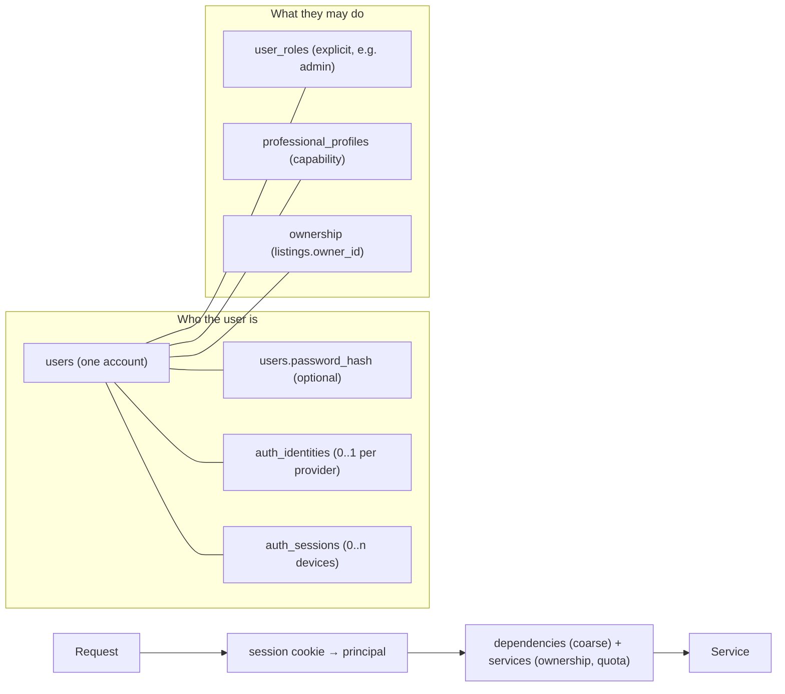

# B-17 Portal — Authentication, Authorization & Roles

**Status:** **frozen by Phase 11A; email/password authentication, sessions, CSRF and the RBAC foundation are IMPLEMENTED in Phase 11B** (§20 lists exactly what was built and the few as-built refinements). **Google OAuth, account linking/claiming (Connect/Disconnect) and the OAuth schema (§10, migration `0004`) are IMPLEMENTED in Phase 11C** (§21 lists exactly what was built and the few as-built refinements; the real-Google smoke test is a documented manual step). Phase 12A adds §22 (the authorization matrix for the write APIs and the frontend integration contract; Phase 11 behaviour is unchanged). Where a number is marked *tunable*, 11B/11C may adjust it inside the stated bounds; every other statement is binding.
**Owns:** the identity model, session/cookie/CSRF design, password and token handling, email verification and reset, Google OAuth and account linking, roles and authorization architecture, the auth API contract, the auth schema plan, the threat review and the security test matrix.
**Does not own:** general table design → [`DATA_MODEL.md`](DATA_MODEL.md) · HTTP conventions/envelopes → [`API_CONTRACT.md`](API_CONTRACT.md) · layering/logging/CORS baseline → [`BACKEND_ARCHITECTURE.md`](BACKEND_ARCHITECTURE.md) · hosting/secrets/ops → [`DEPLOYMENT.md`](DEPLOYMENT.md).

> **Authentication = who the user is. Authorization = what the user may do.** Separate mechanisms, separate failures (`401` vs `403`). Authorization is decided by the **backend's own data** (roles, ownership, plan), never by an identity provider, a client claim, or frontend state. **Public browsing stays public:** no role restricts a public module — a Professional or Admin browses Food, Property, Services and News exactly like a Resident.

## 1. Decision summary (what 11B/11C implement — both now built)

| # | Decision | Section |
|---|---|---|
| D1 | **Opaque server-side sessions in PostgreSQL**, carried by one `HttpOnly` cookie. No JWTs, no refresh tokens, no tokens in `localStorage`/response bodies. | §4 |
| D2 | Session secret = 256-bit random token; **only its SHA-256 hash is stored**. New session id on login/register/privilege change (no fixation). | §4 |
| D3 | Cookie `__Host-b17_session` (staging/prod) / `b17_session` (dev): `HttpOnly; Secure; SameSite=Lax; Path=/`; host-only (no `Domain`). | §5 |
| D4 | CSRF = **layered**: `SameSite=Lax` + a mandatory exact `Origin` check (plus `Sec-Fetch-Site` as defence in depth) + a **session-bound `X-CSRF-Token`** on authenticated unsafe requests. JSON bodies for normal endpoints; multipart only on explicit upload endpoints, with **no weaker** protection. | §6 |
| D5 | Sessions: idle 14 days (sliding), absolute 30 days, multiple devices (cap 10), admin actions need a recent session (idle 2 h, max 12 h). No remember-me. | §4.4 |
| D6 | **Argon2id** (`argon2-cffi`), central parameters, rehash on login; password policy is **length-based** (10–128, denylist screening, no composition rules). | §7.3 |
| D7 | Email is stored **trimmed + lower-cased** (DB `CHECK` + existing `lower(email)` unique index); Gmail-style dot/plus folding is **not** applied. | §7.2 |
| D8 | Registration creates a **Resident** account and signs in immediately; unverified users may log in/browse/save, but **listing writes and service requests require a verified email**. | §7.1, §9 |
| D9 | Verification/reset tokens live in **one purpose-tagged table**: 256-bit random, hashed, single-use (atomic consume), expiring (24 h / 1 h). Delivered in the URL **fragment**, redeemed by `POST`. | §8 |
| D10 | Password reset/change revokes sessions; `forgot-password`, `resend-verification` and `login` never reveal whether an email exists. Registration returns an **explicit `409 email_already_registered` — an intentional UX/security trade-off**, rate-limited. | §8, §7.4, §13.1 |
| D11 | **Google OAuth** = backend-driven authorization-code flow + PKCE + `state` + `nonce`, flow state in PostgreSQL bound to the browser by a short-lived cookie; identity key = `(provider, sub)`, never the email. | §10 |
| D12 | **No automatic linking by email.** A verified existing account requires sign-in then *Connect Google*. The **only** email-match exception is the narrow, fully-specified *unverified-account claim* (account recovery / pre-hijacking defence). | §10.4 |
| D13 | Roles: **Resident** = every account, **Professional** = a `professional_profiles` row (a capability, not a role), **Admin** = an explicit `user_roles` row granted only out-of-band. | §11.1 |
| D14 | Authorization is centralized in dependencies (`get_optional_user`, `get_current_user`, `require_verified_user`, `require_professional`, `require_admin`) plus service-level ownership policies. Frontend guards are UX only. | §11 |
| D15 | `401` unauthenticated / `403` authenticated-but-not-allowed / `404` for resources the caller may not know exist. | §11.5 |
| D16 | PostgreSQL only: sessions, tokens, OAuth flows, audit events and identity-keyed rate-limit counters. **No Redis.** | §4.2, §13 |
| D17 | Phasing (**approved**): **11A** design freeze · **11B** email/password + PostgreSQL sessions + CSRF + authorization/RBAC foundation (migration `0003`) · **11C** Google OAuth + linking + authentication hardening (migration `0004`) · then **12** write APIs + frontend integration · **13** media + production deployment. | §19 |

## 2. Current state (audited in Phase 11A)

**Frontend (prototype, unchanged by 11A):**
- `AuthProvider` holds `DemoUser { name }` in React state — no password, session, id or persistence; `logout` also clears `residentStore` and `planStore` (the demo's privacy boundary). `AdminAuthProvider` is a **separate** in-memory context with a fixed `Demo Admin` and a "Continue as Admin (Demo)" button.
- `useRequireAuth` / `useRequireAdminAuth` redirect to `/login` / `/admin/login` immediately when the context is empty and preserve `location.state.from`. They have **no "loading" state** (state is synchronous today).
- Resident ≠ Professional login: any signed-in user can open `/provider`; ownership is `submittedBy === user.name`.
- `residentStore` (saved items, requests) and `planStore` persist to **`localStorage`** — acceptable for demo data, never for credentials.
- E2E `guards.spec.ts` pins the redirect/return UX, "a resident is still sent to Admin Login", and "an admin session does not open the Professional workspace". The last two are properties of the *demo's two contexts*; with real accounts the rule becomes "authorization decides" (§15).
- The service worker (`pwa/sw.template.js`) handles only same-origin GETs: navigations are network-first with an offline shell fallback; `/assets/*` cache-first; **everything else is untouched**. No API response is cached.

**Backend (Phases 10B–10D):**
- Schema exists, behavior does not: `users` (`email` + unique `lower(email)`, `email_verified_at`, `display_name`, nullable `password_hash`, `status active|suspended|deleted`, `last_login_at`), `user_roles(user_id, role)` with `RoleName = {admin}`, `auth_identities` (`provider google|facebook|apple`, `provider_subject`, `provider_email`; `UNIQUE(provider, provider_subject)`), `professional_profiles(user_id, plan_code)`.
- CORS: explicit origins, `allow_credentials=False`, headers `Authorization, Content-Type, X-Request-ID, If-Match, Idempotency-Key`.
- Errors: `unauthenticated` (401) and `forbidden` (403) already exist; validation errors never echo input values (`validation_details` keeps only field/type/message).
- Request log: method, path template, status, duration — **no body, no query string**. Uvicorn's own access log (not configured by the app) *does* print query strings (§13.4).
- No auth dependency, hashing, session, cookie, token or email code exists.

**Schema sufficiency:** `users`, `user_roles`, `professional_profiles` and `auth_identities` are **sufficient in shape**; Phase 11B/11C add *new* tables and three constraints (§16). Published migrations `0001`/`0002` are never edited.

## 3. Identity model



- **One credentials system.** `password_hash` lives **on `users`** (nullable): a social-only account has none. A separate credential table was rejected — there is exactly one password per account, the table would add a join to every login for no gain, and `auth_identities` already models "other ways in". Professionals and Admins use the same account and login; there is **no second credentials table and no second login system** (the `/admin/login` *screen* is just a different entry point to the same endpoint, §15).
- **Login identifier = email.** No usernames. `display_name` (2–60) is a label, never an identifier.
- **A user's sign-in methods** = password (if `password_hash`) + 0..1 identity per provider. A user must always keep at least one (§10.6).

## 4. Session architecture

### 4.1 Strategy: server-side session cookie (D1)

| | **A. HttpOnly cookie + server-side session** | **B. JWT access + refresh, both in HttpOnly cookies** |
|---|---|---|
| Revocation / logout | Immediate (delete/mark the row) | Access tokens live until expiry; revocation needs a denylist or refresh-token rotation with reuse detection |
| Multi-device | One row per device; revoke one/all trivially | Same, but only through the refresh-token store (i.e. a session table anyway) |
| Moving parts | One cookie, one table | Two cookies, signing keys + rotation, refresh endpoint, reuse detection, clock skew |
| Per-request cost | One indexed PostgreSQL lookup (the request already hits PostgreSQL) | Signature check, but role/status changes (suspend, role revoke) are not seen until expiry unless looked up anyway |
| CSRF | Needed (cookie) | Needed (cookie) |
| OAuth | Callback sets the same cookie | Same |
| Native app later | Needs a bearer form — the same table can back an opaque bearer token (§15.3) | Natural |
| XSS token theft | `HttpOnly` blocks reads | Same |

**Chosen: A.** B's only real advantage — stateless verification — buys nothing for a single modular monolith that queries PostgreSQL on every request anyway, and it makes suspension, role change and logout slower and more complex. A future native client is served by an opaque bearer token backed by the same session table, not by distorting the browser model today.

### 4.2 Storage (D2, D16)

PostgreSQL table `auth_sessions` (no Redis — one indexed lookup per request is far below any threshold that would justify a second datastore):

| Column | Notes |
|---|---|
| `id uuid PK` | internal id (UUIDv4), safe to show/log; **not** the secret |
| `user_id → users` `ON DELETE CASCADE` | |
| `token_hash bytea(32)` **UNIQUE** | SHA-256 of the cookie token. The token is 256 bits of `secrets.token_urlsafe(32)` randomness, so a plain SHA-256 is sufficient (no pepper, no password-style KDF, **no signing secret to manage or rotate**). The raw token exists only in the cookie. |
| `created_at`, `last_seen_at` | `last_seen_at` is updated at most once per **5 minutes** per session (one write, not one per request) |
| `expires_at` | *idle* expiry, slid forward from `last_seen_at`, never beyond `absolute_expires_at` |
| `absolute_expires_at` | `created_at` + absolute lifetime |
| `revoked_at`, `revoke_reason` | `logout · logout_all · password_reset · password_change · admin_action · suspended · role_change · session_cap · account_claimed` |
| `user_agent varchar(200)` | truncated, informational — recognises a device in a future "your sessions" list. **No IP address is stored** (PII, and meaningless behind proxies). |

A session is valid iff the row exists, `revoked_at IS NULL`, `now() < expires_at`, `now() < absolute_expires_at` **and** the joined user is `status = 'active'`. The principal (user + roles + professional summary) is loaded by **one** query/join — no lazy loading in the dependency.

### 4.3 Creation, rotation, fixation (D2)

- A **new** token and row are created at register, login (password or OAuth) and after any privilege elevation (admin role granted → all that user's sessions are revoked; the user signs in again). The server never accepts a client-chosen session identifier, and pre-auth requests carry no session, so there is nothing to fix.
- On login the server also deletes that user's long-expired sessions (opportunistic cleanup, §13.5) and enforces the **cap of exactly 10 active sessions per user** (see below).
- Password change rotates the current session (new token) and revokes the user's other sessions.
- **Active-session cap = 10 per user (frozen).** A valid login is **never rejected** because the cap was reached. Creating a session runs in one transaction that first locks the user's row (`SELECT … FOR UPDATE`, which serializes concurrent logins for that user), counts the user's active sessions (not revoked, not expired), and — if the count is ≥ 10 — revokes the **oldest** active sessions (by `created_at`) with `revoke_reason = 'session_cap'` until at most 9 remain, then inserts the new session. The automatic revocation is atomic with the insert and each revoked session is recorded as an `auth_events` `session_revoked` event (`details.reason = session_cap`). No session-management UI is part of 11B.

### 4.4 Lifetimes (D5)

| | Value | Why |
|---|---|---|
| Idle timeout (sliding) | **14 days** | Residents open the PWA irregularly; a few-hours expiry would be hostile, an unlimited one risky |
| Absolute lifetime | **30 days** | Bounds a stolen cookie; forces a periodic fresh login |
| Admin recency (`require_admin`) | session `last_seen` within **2 h** and `created_at` within **12 h**, else `401 session_expired` | Stricter handling for the highest-privilege role without a second session type (a resident action by the same admin keeps the normal lifetime) |
| Remember-me | **Deferred** — one policy for everyone | Avoid a second lifetime class without a requirement |

Renewal: when `last_seen_at` is refreshed the server also slides `expires_at` and re-sends `Set-Cookie` with the new `Max-Age` (only then, not on every response). A missing/unknown token → `401 unauthenticated`; a known but expired/revoked token → `401 session_expired` **and** the cookie is cleared. All tunables are settings (§14).

### 4.5 Multi-device and revocation (D5)

Multiple concurrent sessions per user are supported (one row per device). Revocation triggers:

| Trigger | Sessions revoked |
|---|---|
| `POST /auth/logout` | the current one (row marked + cookie cleared — deleting the cookie alone is never sufficient) |
| `POST /auth/logout-all` | all of the user's |
| password **reset** | all |
| password **change** | all others (current is rotated) |
| account suspended / deleted | all; and a suspended user's sessions are unusable even before they are marked (status is part of validity) |
| admin role granted/revoked | all of that user's |
| email change (future) | all others |

Future (no UI now): `DELETE /auth/sessions/{id}` and a list endpoint — the table already supports them (`id`, `user_agent`, `last_seen_at`).

## 5. Cookie contract (D3)

| Attribute | Value |
|---|---|
| Name | `__Host-b17_session` in `staging`/`production`; `b17_session` in `development`/`test` |
| Value | the raw random token — nothing else (no user id, no role, no JSON) |
| `HttpOnly` | **always** — never readable from JavaScript |
| `Secure` | always in `staging`/`production` (a setting that may not be disabled there; the `__Host-` prefix makes browsers enforce it); off only for plain-HTTP local development |
| `SameSite` | **`Lax`** |
| `Path` | `/` (required by `__Host-`) |
| `Domain` | **never set** (host-only, which `__Host-` requires): the cookie belongs to the API host and is sent only to it |
| `Max-Age` | seconds until idle expiry (persistent cookie; re-issued when the session slides) |
| Clearing | `Set-Cookie` with an empty value, `Max-Age=0`, identical name/path/flags |

**Why `Lax`, not `Strict`:** `Strict` withholds the cookie on top-level navigations arriving from other sites (an email link to the frontend, the OAuth callback), which breaks nothing important here but buys little beyond what the CSRF layers already give, and `Lax` is the browser default users' tools expect. **Why never `None`:** `SameSite=None` is only needed when the frontend and API are **cross-site** (different registrable domains) or embedded in third-party frames — exactly the topology §5.1 forbids; browsers increasingly block such third-party cookies, and `None` removes the very protection layer D4 relies on.

Summary by environment:

| | Development / test | Staging / production |
|---|---|---|
| Name | `b17_session` | `__Host-b17_session` |
| `HttpOnly` | yes | yes |
| `Secure` | **no** (plain `http://`) | **yes** (cannot be disabled) |
| `SameSite` | `Lax` | `Lax` |
| `Path` | `/` | `/` |
| `Domain` | none | none (host-only) |

A second short-lived cookie is used only by the OAuth flow (§10.2): `__Host-b17_oauth` / `b17_oauth`, `HttpOnly; Secure; SameSite=Lax; Path=/; Max-Age=600`.

### 5.1 Topology (cookie-relevant; no host chosen)

**Same-site** = same registrable domain (scheme + eTLD+1); **same-origin** = same scheme + host + port. `SameSite` is evaluated on *site*, CORS on *origin*.

| Topology | Verdict |
|---|---|
| **Preferred:** `https://b17portal.pk` (frontend) + `https://api.b17portal.pk` (API) — *same-site, cross-origin* | ✔ Lax cookie is sent on the SPA's credentialed `fetch`; needs CORS with credentials + the CSRF layers (§6) |
| **Equally valid:** one origin, a reverse proxy mapping `/api` to the API — *same-origin* | ✔ no CORS needed; the SW must exclude `/api` (§15.2); CSRF layers still apply |
| ✘ Frontend and API on different registrable domains (e.g. `b17portal.pk` ↔ `b17-api.example.net`) | Would force `SameSite=None` third-party cookies — not supported |
| ⚠ Default provider domains (`*.vercel.app`, `*.onrender.com`, `*.herokuapp.com`, …) are on the Public Suffix List, so two such subdomains are **cross-site** | A **custom domain** that makes both sides same-site is a prerequisite for enabling auth in staging/production |

**Development (deterministic topology, frozen):** frontend `http://127.0.0.1:5173` ↔ API `http://127.0.0.1:8000` — same host, different ports ⇒ **same-site, cross-origin**, so it exercises exactly the production mechanics (credentialed CORS, `Lax` cookie, CSRF layers) with non-`Secure` cookies over plain HTTP. **Never mix `localhost` and `127.0.0.1` in auth development or tests** (`localhost` ↔ `127.0.0.1` is cross-site and the cookie would silently not be sent); `http://127.0.0.1:5173` is already in the default development `FRONTEND_ORIGINS`, and the E2E preview (`http://127.0.0.1:4173`) uses the same host. Cookies are scoped by host, not port, so all `127.0.0.1` ports share one cookie jar (harmless for development). Phase 12 starts the Vite dev server with `--host 127.0.0.1` for auth work. A Vite `/api` proxy (making dev same-origin) remains an allowed Phase 12 convenience.

## 6. CSRF and CORS (D4)

Cookie authentication makes state-changing requests CSRF-able. Defence in depth, all enforced centrally (a middleware/dependency, never per route):

1. **`SameSite=Lax` cookie** — cross-site `POST/PUT/PATCH/DELETE` subrequests and forms do not carry the cookie.
2. **`Origin` validation on every unsafe method** (`POST/PUT/PATCH/DELETE`) that is cookie-authenticated or targets a pre-session auth endpoint: the `Origin` header **must be present** (browsers always send it on cross-origin requests and on same-origin unsafe requests) and **must exactly match** an entry of `FRONTEND_ORIGINS`; a missing, `null` or unlisted `Origin` → `403 csrf_failed` (no `Referer` fallback). **`Sec-Fetch-Site` is defence in depth only:** if the header is present its value must be `same-origin` or `same-site`, otherwise reject; if it is absent (older browsers, proxies) nothing changes — correctness never depends on its presence, it rests on `Origin` + the token. Requests authenticated only by a future bearer token are not cookie-CSRF-able and are exempt from this layer.
3. **Session-bound CSRF token** on every *authenticated* unsafe request: header `X-CSRF-Token` must equal `base64url(HMAC-SHA256(key = session token, msg = "b17-csrf-v1"))`, compared in constant time. Stateless (no storage, no extra secret), unforgeable without the session token, and immune to cookie-injection from sibling subdomains. The token is returned in the JSON body of `register`, `login` and `GET /auth/me`; the SPA keeps it **in memory** (never `localStorage`) and re-fetches it from `/auth/me` on load. A cross-origin attacker cannot read those responses (CORS). Failure → `403 csrf_failed`.
4. **Content types.** Normal authentication and application mutation endpoints accept **`application/json` request bodies only** (anything else → `415`, mapped to `bad_request`), so a cross-origin request needs a CORS preflight that the allow-list refuses. **Explicit media/file-upload endpoints (Phase 13) may additionally accept `multipart/form-data`**, declared per route and nowhere else. Multipart is a CORS "simple" content type that skips the preflight, so such endpoints get **no weaker protection**: they require exact `Origin` validation, session authentication, the `X-CSRF-Token` **header** (never a form field) when cookie-authenticated, the normal authorization rules, and the file validation in `MEDIA_STORAGE.md`. The CSRF layers 1–3 are mandatory and tested for them.

Pre-session unsafe endpoints (`register`, `login`, `forgot-password`, `reset-password`, `verify-email`, `oauth/*/start`) have no session to bind a token to; they rely on layers 1, 2 and 4 (this is also the login-CSRF defence). `resend-verification` is authenticated and therefore also takes the token. `GET`/`HEAD`/`OPTIONS` are safe/idempotent and never change state (the OAuth callback is the single, state-bound exception, §10).

**CORS change in 11B:** `allow_credentials=True` is switched on **in the same change that ships the first cookie-authenticated endpoint**, only with a non-empty exact `FRONTEND_ORIGINS` list (startup fails otherwise; wildcards are already rejected by config validation, and `*` with credentials is forbidden). Add `X-CSRF-Token` to `allow_headers`. `Authorization` stays allowed only as the reserved seam for a future bearer form (§15.3). Responses already carry `Vary: Origin`.

## 7. Email/password

### 7.1 Registration — `POST /api/v1/auth/register`

Input `{ email, password, displayName }`. **No** `role`, `plan`, `status`, `emailVerified` or any other field is accepted (unknown fields are rejected `422`). Output: `201` with the `/auth/me` shape, a session cookie, and a verification email queued (§8). If the normalized email already exists the answer is the **explicit `409 email_already_registered`** — an *intentional UX/security trade-off*: registration signs the user in, so a neutral reply is impossible and the user needs to be told to log in or reset; the exposure is bounded by registration rate limiting (§13.1) while `login`, `forgot-password` and `resend-verification` stay strictly neutral. The new account is a **Resident** (no `user_roles` row, no professional profile). The professional workflow is separate (§11.4).

### 7.2 Email normalization (D7)

`email` = NFKC-normalized, trimmed, **lower-cased**; validated with `email-validator` (syntax + length ≤ 254, no DNS lookup); stored in `users.email`. Uniqueness is guaranteed by the existing `uq_users_email_lower` unique index, and migration `0003` adds `CHECK (email = lower(btrim(email)))` so even a buggy writer cannot store a non-normalized address. No separate "display email" is kept. Gmail-style dot/`+tag` folding is **not** applied (it would merge distinct mailboxes on other providers and surprise users); `a+tag@x.org` is a distinct account.

### 7.3 Passwords and hashing (D6)

- **Policy (length-based, per NIST SP 800-63B):** 10 ≤ length ≤ **128** Unicode code points (NFKC-normalized before hashing; spaces allowed; no trimming; no composition rules). Rejected: entries on a **bundled common-password denylist** — the SecLists `10k-most-common.txt` corpus (10,001 entries, MIT, stored byte-identical under `app/core/security/data/` with its pinned commit, checksum and license in `data/README.md`), read from disk on first use, **NFKC-normalized and case-folded on both sides before lookup**, with no network call — and passwords equal to the email or its local part or the display name. A breached-password online check (k-anonymity API) is a deferred option — it adds an external call. The 128 cap (and a request-size limit) bounds hashing cost.
- **Hash: Argon2id** via `argon2-cffi` (new runtime dependency in 11B). Parameters are defined **in one module** (`app/core/security/passwords.py`), starting from RFC 9106's low-memory profile (`t=3, m=64 MiB, p=4`); 11B benchmarks them on the production container size and may lower `p`/`m`, **never below** the OWASP floor (`m=19 MiB, t=2, p=1`). PHC-format hashes carry their own parameters, so verification keeps working when parameters change.
- **Rehash on login:** after a successful verification, if `check_needs_rehash` is true the hash is recomputed and stored in the same transaction.
- **Capacity:** hashing is CPU- and memory-heavy and the API is synchronous (threadpool). A process-wide semaphore bounds concurrent hashes (default 4) so a login burst cannot exhaust memory.
- **Constant-ish timing:** a login for an unknown email still verifies against a precomputed dummy hash.
- Never logged, never returned, never in an exception message; auth request schemas use `SecretStr`.
- bcrypt/scrypt were considered: both are acceptable, but Argon2id is the current OWASP first choice and `argon2-cffi` is a single well-maintained dependency; no reason to prefer an older default.

### 7.4 Login — `POST /api/v1/auth/login`

Input `{ email, password }`. Success: `200`, new session cookie, the `/auth/me` shape; `users.last_login_at` updated; hash upgraded if needed. Failure for **any** of unknown email, wrong password, or a social-only account: `401 invalid_credentials` with one fixed message, equal work (dummy hash) and no distinguishing detail. A suspended account that supplied the **correct** password gets `403 account_disabled` (the wrong-password case stays `invalid_credentials`, so this reveals nothing to someone who does not know the password). An unverified email is **allowed to log in** (§9). Per-account failure throttling: §13.1.

### 7.5 Logout, change password

- `POST /auth/logout` — requires CSRF; marks the current session revoked, clears the cookie; `204`. `POST /auth/logout-all` — all sessions, `204` (reserved in the contract, ships with 11B because it is trivial and is the "compromised account" lever).
- `POST /auth/change-password` `{ currentPassword, newPassword }` — authenticated + CSRF; verifies the current password, applies the policy, stores the new hash, **revokes all other sessions and rotates the current one**, sends a "password changed" notice email. A social-only user who wants a password uses **forgot-password** (proof of mailbox control).

## 8. Email verification and password reset (D9, D10)

**Table `auth_tokens` (one table, purpose-tagged — chosen over per-purpose tables because the lifecycle, hashing, expiry, single-use rule and cleanup are identical):** `id`, `user_id → users` (cascade), `purpose` (`email_verification | password_reset`), `token_hash bytea(32)` UNIQUE, `email` (snapshot of the address the token is for — a verification token for an old address cannot verify a changed one), `expires_at`, `consumed_at`, `created_at`.

- **Token:** `secrets.token_urlsafe(32)`; only the SHA-256 is stored; never logged (not even in development logs outside the console email backend); **JWT tokens are not used** (they cannot be single-use or revoked without the very table we have).
- **TTL:** verification **24 h**, reset **60 min**. Issuing a new token of a purpose invalidates that user's older unconsumed tokens of the same purpose.
- **Single-use, race-safe:** redeem with one atomic statement `UPDATE auth_tokens SET consumed_at = now() WHERE token_hash = :h AND purpose = :p AND consumed_at IS NULL AND expires_at > now() RETURNING …`; zero rows → `token_invalid` (unknown/used/wrong purpose, indistinguishable) or `token_expired` (known but past `expires_at`).
- **Delivery (fragment-token policy, frozen):** the email link points at the **frontend** and carries the token in the **URL fragment** (`https://b17portal.pk/reset-password#token=…`): fragments are never sent to servers, proxies or `Referer`, so they cannot reach access logs; the token is redeemed by `POST` (a `GET` that consumes a token is triggered by email scanners and link prefetchers).
- **Future frontend requirement (Phase 12):** the verification/reset route must (1) read the token from `location.hash`; (2) **immediately remove the fragment with `history.replaceState`** — before analytics, error-reporting or any unrelated third-party script can run (so the app must not load such scripts ahead of this route's first effect, and the token is held only in a local variable/React state); (3) `POST` the token to the backend; (4) **never persist the token** in `localStorage`, `sessionStorage`, cookies or a URL; (5) send `Referrer-Policy: no-referrer` for the page and keep the token out of any logged error context.

**Verify:** `POST /auth/verify-email { token }` — no session needed; sets `email_verified_at = now()`; `204`. **Resend:** `POST /auth/resend-verification` — authenticated (+CSRF); no-op `204` if already verified; throttled (§13.1). **Forgot:** `POST /auth/forgot-password { email }` — **always** `202` with the same body and a similar code path whether or not the account exists; email dispatch happens after the response (background task), so response time does not reveal it. Only `active` accounts get an email. **Reset:** `POST /auth/reset-password { token, newPassword }` — applies the password policy, stores the hash, consumes the token and all other outstanding reset tokens, **revokes all sessions**, sets `email_verified_at` if null and the token's email equals the current email (the mailbox was just proven), writes audit events, sends a "password changed" notice. It does **not** log the user in.

## 9. Verification policy (frozen)

| Capability | Anonymous | Unverified user | Verified user |
|---|---|---|---|
| Browse/search public content | ✔ | ✔ | ✔ |
| Register, log in, `GET /auth/me`, log out, resend verification | — | ✔ | ✔ |
| Save / unsave listings (`/saved`) | — | ✔ | ✔ |
| Change own password; connect/disconnect a provider | — | ✔ | ✔ |
| Create the Professional profile; create/edit/resubmit/archive a listing | — | ✘ `403 email_not_verified` | ✔ |
| Submit a service request (it reaches a real provider) | — | ✘ `403 email_not_verified` | ✔ |
| Any Admin capability | — | ✘ (an admin must be verified) | ✔ + role |

Enforced centrally by `require_verified_user`; a service never re-implements it. A Google account whose provider asserts `email_verified: true` is created verified; if the provider does **not** assert it, the account is created unverified and a verification email is sent (never assume a provider email is verified).

## 10. Google OAuth and account linking (11C; frozen here)

### 10.1 Controls (D11)

OpenID Connect **authorization-code flow with PKCE (S256)**, run **entirely by the backend** (a confidential client; the client secret never leaves the server); `state` (≥ 128-bit random, one-time) and `nonce` (in the ID token); scopes `openid email profile`; the redirect URI is a single pre-registered exact value `{API_PUBLIC_BASE_URL}/api/v1/auth/oauth/google/callback`. The callback verifies, in order: the flow cookie matches a live, unconsumed `oauth_flows` row for the `state`; the code exchange (server-to-server, with the PKCE verifier and client secret) succeeds; the **ID token** signature (Google JWKS, cached), `iss`, `aud` = our client id, `exp`, `nonce`; and the `email_verified` claim. The B-17 session is then created; **Google's access/ID/refresh tokens are discarded** — never stored, never sent to the SPA (B-17 uses Google only to learn *who*; no Google API is called). Provider errors are mapped to fixed codes and never relayed.

### 10.2 Flow

1. SPA → `POST /auth/oauth/google/start { purpose: "login" | "link", returnTo? }` (Origin + CSRF as applicable). The server creates an `oauth_flows` row (`state_hash`, `nonce`, PKCE `code_verifier`, `purpose`, `user_id` for `link`, validated `return_to`, `expires_at` = 10 min, `consumed_at`), sets the short-lived **flow cookie** (random value whose hash is stored in the row — this binds the flow to *this browser*, defeating login-CSRF where an attacker feeds the victim the attacker's callback), and returns `{ authorizationUrl }`. The SPA does `window.location.assign(authorizationUrl)`.
2. Google authenticates the user and redirects the browser to `GET /auth/oauth/google/callback?code&state`. The flow cookie (`SameSite=Lax`, top-level GET) arrives; the row is consumed atomically (single use).
3. Account resolution (§10.4) → session created → `302` to `{FRONTEND_BASE_URL}{returnTo}` with the session cookie set. On any failure: `302` to `{FRONTEND_BASE_URL}/login?error=<code>` with `code ∈ {oauth_denied, oauth_failed, identity_conflict, email_not_verified, account_disabled}` — a fixed list, never provider text.

### 10.3 Redirect safety (open-redirect protection)

The post-login destination is never taken from the callback request. `returnTo` is supplied at **start**, stored server-side, and must be a **relative path** matching `^/[A-Za-z0-9._~!$&'()*+,;=:@%/-]*$`, not starting with `//` or `/\`, with no scheme/host, ≤ 200 chars, and not under `/api` or `/admin/login`. **A missing or blank `returnTo` means `/`; an explicitly supplied unsafe value is rejected with `422 validation_error` (`details[].field = returnTo`, the value is never echoed) — it is never silently converted to `/`, no flow row is created and no authorization URL is returned** (decided in the 11C final review; the 11A draft said "replaced by `/`"). The redirect target is always `FRONTEND_BASE_URL` (a configured exact origin that must be in `FRONTEND_ORIGINS`) + that path.

### 10.4 Account resolution and linking rules (D12)

Identity key is **`(provider, provider_subject = sub)`** — never the email. `auth_identities.provider_email` is informational only.

| Case | Situation | Result |
|---|---|---|
| **A** | `(google, sub)` unknown, **no** account with that email | Create a user (`email` from Google, `email_verified_at` set **only if** `email_verified=true`, `display_name` from the profile, no password) + identity, new session |
| **B** | `(google, sub)` already linked | Log that user in (status must be `active`) |
| **C1** | `(google, sub)` unknown; an account with the same normalized email exists and its email is **verified** (`email_verified_at` set) | **Do not link, do not claim.** Redirect with `identity_conflict`. The user signs in with their existing method, then chooses *Connect Google* (case D). Disclosing that the account exists is acceptable: the caller just proved control of that mailbox via Google |
| **C2** | **Unverified-account claim** — see the conditions below | Link, verify, clear the password, revoke sessions, new Google session (below) |
| **C3** | Google did **not** assert `email_verified: true` and an account with that email exists | Reject (`email_not_verified`); never link, claim or create on an unverified provider email that collides |
| **C4** | Same-email account exists but is **`suspended`** (a `deleted` tombstone has its email scrubbed and never matches), or already holds a **different** Google identity | Reject: `account_disabled` / `identity_conflict`; never claimed |
| **D** | Authenticated user runs *Connect Google* (`purpose: link`) | The flow row carries `user_id`; on callback the same user must still hold a valid session; link `(google, sub)` to **that** user. If `(google, sub)` belongs to another user → `identity_conflict` (never moved silently). One identity per provider per user |

#### The unverified-account claim (C2) — the ONLY email-match exception

It is an **account-recovery / pre-hijacking defence**, not normal email linking: someone may have registered *your* email address (and set a password) without ever proving they own the mailbox; when you then prove ownership through Google, the squatted account must not lock you out or remain controlled by them. It is allowed **only when ALL of these hold**:

1. an account with the same **normalized email** exists;
2. that account's `email_verified_at IS NULL`;
3. the account's `status` is `active`;
4. Google **explicitly asserts the same email as verified** (`email_verified: true` in the validated ID token);
5. there is **no conflicting provider identity** (the account has no different Google identity, and `(google, sub)` belongs to no other user).

On success — one transaction that locks the user row (`FOR UPDATE`) and **re-checks conditions 2–3 under the lock** (so a concurrent legitimate verification wins and the flow falls back to C1):

- link the Google identity `(google, sub)` to that account;
- set `email_verified_at = now()`;
- **clear the existing `password_hash`** (set by an unverified party);
- **revoke all existing sessions** of the account (`revoke_reason = account_claimed`) and consume its outstanding `auth_tokens`;
- create a **new** session for the Google login and set the cookie;
- write the audit event `account_claimed` (plus `session_revoked` rows for the revoked sessions).

It is **never** applied to: suspended or deleted accounts; accounts whose email is already verified (those always require authenticated *Connect Google*, case C1/D); accounts with a conflicting provider identity; or any case where Google did not assert verification (C3). Because an unverified account cannot own listings or requests (§9), nothing of value changes hands. **No other path links an identity to an account by email.**

Unlinking: `DELETE /auth/oauth/google` (authenticated + CSRF) is refused unless the user keeps another sign-in method (a password, or another identity). Linking/unlinking are single transactions and audited.

### 10.5 Other providers (compatibility, not promises)

`auth_identities.provider` already allows `facebook` and `apple`. Adding one later means a provider adapter (endpoints, scopes, claim mapping) behind the same flow/linking rules — no schema change. Notes: Apple returns the email only on first authorization (and may be a private relay address), requires a JWT client secret, and is **required by App Store policy** if a native iOS app offers any third-party login; Facebook is not fully OIDC-compliant (check the Limited Login/ID-token path). **Instagram is not an identity provider and is not promised.**

### 10.6 Provider library

**Decided in 11C: `PyJWT[crypto]` + `httpx`** (no Google SDK, no OIDC framework). Authlib was evaluated and rejected: its `httpx` integration relied on a deprecated shim that fails under the project's `filterwarnings = error`, and it pulls in a second JOSE implementation (`joserfc`). PyJWT performs the RS256 verification (signature, `exp`, `iss`, `aud`, required claims, with an explicit algorithm allow-list) against Google's JWKS, which the adapter caches; `httpx` makes the two server-to-server calls. We write **no** JWT/OIDC cryptography ourselves. See DECISIONS.md. The provider boundary is an interface (`OAuthProvider`: build the authorization URL, exchange the code, return validated claims) so tests inject a **mock provider** and normal CI never calls Google.

## 11. Authorization architecture

### 11.1 Roles (D13)

| Role | How a user has it |
|---|---|
| **Resident** | Every authenticated account. Not stored. |
| **Professional** | A `professional_profiles` row exists — a **capability**, not a `user_roles` value, so there is no role/profile duplication. Created self-service by a *verified* user on first use of the workspace (preserving today's "any signed-in user can list"); a professional-verification state is a future seam on the profile. |
| **Admin** | An explicit `user_roles` row `admin`. **Never** inferred from an email domain, OAuth provider, frontend state, query parameter, `localStorage`, or any client-supplied field. |

`RoleName = {admin}` and the `user_roles` table are **sufficient as built** (no change). A user can be Resident + Professional + Admin; roles only add capabilities. The capability matrix of the 10A design (who may save, list, moderate, feature, publish news, manage categories) is unchanged and is the specification for the Phase 12 authorization tests.

### 11.2 Dependencies (D14) — `app/dependencies/auth.py`

| Dependency | Returns / raises |
|---|---|
| `get_optional_user()` | the `Principal` or `None`; never raises for a missing session; used by endpoints whose answer may differ for signed-in users |
| `get_current_user()` | the `Principal`, else `401 unauthenticated` / `401 session_expired` |
| `require_verified_user()` | as above + `403 email_not_verified` |
| `require_professional()` | verified user with a `professional_profiles` row, else **`403 professional_profile_required`** (changed from `forbidden` in Phase 12D; the profile is created explicitly with `PUT /users/me/professional-profile`, which needs only `require_verified_user`) |
| `require_admin()` | verified + `admin` role + the admin recency rule (§4.4), else `403 forbidden` / `401 session_expired` |
| `csrf_protected` | applied once, centrally, to all unsafe methods (§6) |

`Principal` is a frozen dataclass: `user_id`, `display_name`, `email`, `email_verified`, `roles: frozenset[RoleName]`, `professional: ProfessionalSummary | None` (`plan_code`), `session_id`, `session_created_at`, `session_last_seen_at`. Routers **declare** a dependency; no router contains `if user.role == …`. A small code-defined role→permission map (`app/core/permissions.py`) backs the dependencies and the tests; a database-driven permission model stays deferred.

### 11.3 Ownership (N)

Ownership is a **service-level policy** (`app/services/authorization.py`), never read from the client: services receive the `Principal`, load the resource, and call e.g. `ensure_can_edit_listing(principal, listing)`. `ownerId`/`submittedBy` in a request body are rejected. Visibility decides the failure: a resource the caller may not even know exists (someone else's `pending`/`rejected`/`archived` listing, a non-existent id) → **`404`**; a resource the caller can see but may not change (another owner's *approved* listing) → **`403 forbidden`**. Admin moderation uses separate `/admin/...` endpoints, never an owner-endpoint bypass.

### 11.4 Professional onboarding

Register/log in (Resident) → later `POST` to create the Professional profile (Phase 12; requires a verified email, creates `professional_profiles` with `plan_code = free`) → Professional capabilities. One account, one login, one credentials store.

### 11.5 Status codes (D15)

| Code | When |
|---|---|
| **401** `unauthenticated` | no / unknown / unparseable session cookie |
| **401** `session_expired` | the session existed but is expired, revoked, or the admin recency rule failed (cookie cleared) |
| **401** `invalid_credentials` | login failed (only on `/auth/login`) |
| **403** `forbidden` | authenticated, not allowed (wrong role, not the owner of a *visible* resource) |
| **403** `email_not_verified` · `account_disabled` · `csrf_failed` | the specific, safe-to-reveal reasons |
| **404** `not_found` | resource not visible to the caller (existing 10D/10A rule) |
| **409** `email_already_registered` · `identity_conflict` | conflicts |
| **429** `rate_limited` | with `Retry-After` |

The frontend treats **any** `401` as "anonymous / sign in again" and **any** `403` as "show a not-allowed state" — it never infers security from them.

### 11.6 Admin security

Backend-only grants (`python -m app.cli.admin grant <email>` / `revoke`, requiring an existing, active, **verified** account; every grant/revoke is audited and revokes that user's sessions); **no public admin signup, no endpoint that lets a user change roles** (an admin role-management tool is a later admin-only feature); shorter effective session (§4.4); every admin write is audited (listing moderation already writes `listing_status_history`; role/status changes write `auth_events`); `require_admin` is the single seam where **step-up auth / MFA** will be added later (the session row can gain `mfa_verified_at`) without touching routers.

### 11.7 Account status

`users.status` (`active | suspended | deleted`) is **sufficient** — no schema change. `suspended`: cannot log in (`account_disabled`), existing sessions invalid. `deleted`: tombstone per `DATA_MODEL.md` §11. Status changes are admin/ops actions that revoke all sessions and write an audit event. No richer suspension lifecycle now.

## 12. API contract (Phase 11B/11C)

All under `/api/v1/auth`; request/response bodies use the standard `{data}` / `{error}` envelopes, camelCase, null-omitted. Every response from these routes — and any response that sets or clears a cookie — carries **`Cache-Control: no-store`** (public read APIs are *not* touched: they stay cacheable).

| Endpoint | Auth | CSRF token | Result |
|---|---|---|---|
| `POST /register` | — | — (Origin) | `201` me-shape + cookie; `409 email_already_registered`; `422` |
| `POST /login` | — | — (Origin) | `200` me-shape + cookie; `401 invalid_credentials`; `403 account_disabled`; `429` |
| `POST /logout` | session | ✔ | `204`, cookie cleared |
| `POST /logout-all` | session | ✔ | `204` |
| `GET /me` | session | — | `200` me-shape; `401` |
| `POST /verify-email` `{token}` | — | — | `204`; `400 token_invalid\|token_expired` |
| `POST /resend-verification` | session | ✔ | `204`; `429` |
| `POST /forgot-password` `{email}` | — | — | always `202 {data:{status:"accepted"}}`; `429` |
| `POST /reset-password` `{token,newPassword}` | — | — | `204`; `400 token_*`; `422` |
| `POST /change-password` | session | ✔ | **`200` me-shape with the rotated cookie and the new `csrfToken`** (as built; the 11A draft said `204`); `401 invalid_credentials` (wrong current password); `429`; `422` |
| `POST /oauth/google/start` `{purpose, returnTo?}` | none / session for `link` | ✔ for `link` | `200 {data:{authorizationUrl}}` + flow cookie; `401` (`link` without a session); `503 service_unavailable` (Google not configured); `422` |
| `GET /oauth/google/callback` | flow cookie | — (state-bound) | always `302` to the frontend: `{returnTo}` (+ session cookie on sign-in) or `/login?error=<code>` |
| `DELETE /oauth/google` | session | ✔ | `204`; `404` (no Google identity); `409 conflict` if it is the last sign-in method |

Not frozen (YAGNI): session list/revoke-one endpoints, email change, display-name update (`/users/me`, Phase 12), account deletion.

**Me-shape (`/auth/me`, and the body of register/login):**

```json
{ "data": {
    "id": "…uuid…", "displayName": "Ayesha Khan", "email": "ayesha@example.org", "emailVerified": true,
    "roles": ["admin"],
    "professional": { "planCode": "free" },
    "authMethods": { "password": true, "providers": ["google"] },
    "session": { "expiresAt": "2026-11-14T10:00:00Z" },
    "csrfToken": "…"
} }
```
`roles` lists explicit grants only (a Resident has `[]`); `professional` is omitted unless a profile exists. **Never present:** password hash, provider subjects, audit fields, session token/id. The session token is **only** ever in the `Set-Cookie`.

**Error codes** (stable; the first two reuse the existing 10A/10B names — `authentication_required`→`unauthenticated`, `permission_denied`→`forbidden`): `unauthenticated`, `forbidden`, `invalid_credentials`, `session_expired`, `email_not_verified`, `account_disabled`, `csrf_failed`, `email_already_registered`, `identity_conflict` (11C; delivered as `/login?error=` by the callback), `token_invalid`, `token_expired`, `rate_limited`, plus the existing `validation_error`, `bad_request`, `not_found`, `internal_error`, `service_unavailable` (OAuth not configured). Provider and internal errors never leak.

## 13. Abuse resistance, audit, logging, retention

### 13.1 Enumeration policy and the rate-limit seam

| Surface | Policy |
|---|---|
| `login` | one generic failure for unknown email / wrong password / social-only; equal work |
| `forgot-password`, `resend-verification` | identical response regardless of account existence |
| `register` | **explicit** `409 email_already_registered` (intentional, frozen). Accepted trade-off: the user needs feedback and registration signs in immediately, so an always-neutral response is impossible; the leak is bounded by rate limiting (below) and by the fact that login/forgot stay neutral. |
| OAuth callback | reveals an existing account only to someone who just proved control of that mailbox |

**Seam:** `app/core/rate_limit.py` defines `RateLimiter.hit(key, policy) -> Decision` and an `Depends(rate_limit(policy))` helper. 11B ships a **PostgreSQL-backed fixed-window limiter** (`auth_rate_limits`, atomic `INSERT … ON CONFLICT DO UPDATE`) used for **identity-keyed** limits — correct across any number of workers/processes. **IP-based limits are an edge responsibility** (reverse proxy/CDN/WAF, `DEPLOYMENT.md`): the app does not trust `X-Forwarded-For` unless a trusted-proxy setting says so, and an in-process in-memory limiter is **not** used (it is wrong with more than one worker). Redis arrives only if measured load makes PostgreSQL counters insufficient.

Initial limits (*tunable*, key = hash of the normalized email): login **10 failures / 15 min** per email (then `429` until the window passes — an accepted lock-out trade-off at this scale, backed by edge IP limits); register 5 / hour per email; forgot-password 3 / hour per email; resend-verification 1 / min and 5 / day per account; `oauth/start` limited at the edge. Every `429` carries `Retry-After`.

### 13.2 Audit events (table `auth_events`, 11B)

`register · login_success · login_failure (user known) · logout · logout_all · session_revoked · password_changed · password_reset_requested · password_reset_completed · email_verification_sent · email_verified · identity_linked · identity_unlinked · account_claimed · role_granted · role_revoked · account_suspended · account_reactivated`. Columns: `occurred_at`, `user_id` (SET NULL), `actor_user_id` (for admin actions), `event_type`, `request_id`, and a tiny `details` JSONB limited to an allow-listed set of keys (`provider`, `reason`, `session_id`). **Never stored:** passwords, hashes, tokens, OAuth codes, emails of unknown accounts, IP addresses, user-agents. Retention 400 days (purged by the maintenance command).

### 13.3 Logging and redaction

Auth routes never log request/response bodies. The app request log already omits bodies and query strings. 11B additionally: (1) auth schemas use `SecretStr`/custom validation messages so **no validation error echoes a password, token or email** (tested); (2) no log call receives a token, code or cookie; (3) the `Cookie`/`Set-Cookie`/`Authorization` headers are never logged; (4) the console email backend (dev/test only) prints links with tokens and is **forbidden** outside development/test by a settings validator.

### 13.4 Access-log caveat

`uvicorn`'s access log prints the request line **including the query string** — the OAuth callback carries `code` and `state` there. Production runs uvicorn with `--no-access-log` (the app's own request log replaces it) or a log filter that strips the query on `/auth/`; reverse-proxy logs must also drop the query for `/api/v1/auth/oauth/`. Email links use fragments (§8), so verification/reset tokens never appear in any URL log.

### 13.5 Retention and cleanup

No scheduler or background-job system is introduced. **One interpretation (frozen):**

* **Expired sessions have no retention guarantee.** An `auth_sessions` row is only a live credential; once its idle or absolute expiry has passed it is garbage and may be deleted at any time. The durable security record is `auth_events`, never an expired session row.
* **Opportunistic deletion:** creating a session (register, login, and later OAuth login) deletes *that user's* already-expired sessions in the same transaction. Expired (and revoked) sessions never count toward the 10-session cap.
* **The sweep:** `python -m app.cli.auth_maintenance purge` (run from the host's cron/scheduled task, `DEPLOYMENT.md`) is a **safety net for rows nobody's login ever cleaned up**. Its 7-day threshold is a sweep threshold, not a retention promise: it deletes sessions whose idle/absolute expiry — or whose revocation — is more than 7 days old, one-time tokens expired or consumed more than 7 days ago, expired `oauth_flows` (11C), rate-limit windows older than 2 days, and audit events older than 400 days. A revoked-but-unexpired session is simply kept until it expires or the sweep reaches it.
* **Correctness never depends on cleanup:** validity is always checked against `expires_at`/`absolute_expires_at`/`revoked_at`/`consumed_at`, so an expired row that is still present authenticates nothing.

## 14. Email seam and configuration

**Transactional email seam:** `app/services/email.py` defines `EmailSender.send(message)` and typed messages (`VerificationEmail`, `PasswordResetEmail`, `PasswordChangedNotice`). Backends: `console` (dev/test only, §13.3), `memory` (tests assert on the outbox), and a production provider chosen later (SMTP or an HTTP API) behind the same interface — **no vendor is chosen in 11A**. Sending happens **after the commit** and outside the request's transaction (background task); a send failure is logged (no token) and never fails the request — the user can resend.

**Settings introduced by 11B/11C** (typed `Settings`; placeholders only in `.env.example`; real values from the host's secret store; startup validation fails fast in staging/production):

| Variable | Phase | Notes |
|---|---|---|
| `AUTH_COOKIE_SECURE` | 11B | defaults true; **cannot be false** when `ENVIRONMENT` is `staging`/`production` |
| `SESSION_IDLE_DAYS` (14), `SESSION_ABSOLUTE_DAYS` (30), `ADMIN_SESSION_IDLE_MINUTES` (120), `ADMIN_SESSION_MAX_HOURS` (12), `MAX_SESSIONS_PER_USER` (10) | 11B | tunable |
| `FRONTEND_BASE_URL` | 11B | exact origin used in email links and OAuth redirects; must be one of `FRONTEND_ORIGINS` |
| `EMAIL_BACKEND` (`console`/`memory`/provider), `EMAIL_FROM`, provider credentials | 11B | `console` rejected outside development/test |
| `PASSWORD_HASH_TIME_COST` / `PASSWORD_HASH_MEMORY_COST_KIB` / `PASSWORD_HASH_PARALLELISM` / `MAX_CONCURRENT_PASSWORD_HASHES` | 11B | optional overrides; staging/production refuse values below the OWASP floor (memory ≥ 19456 KiB, time ≥ 2) |
| `API_PUBLIC_BASE_URL` | 11C | builds the exact OAuth redirect URI |
| `GOOGLE_OAUTH_CLIENT_ID`, `GOOGLE_OAUTH_CLIENT_SECRET` (`SecretStr`) | 11C | OAuth endpoints answer `503 service_unavailable` if unset |

**Deliberately absent:** a session secret, token pepper or JWT signing key — session/CSRF/token security derives from per-token randomness and hashes, so there is **no signing secret to leak, rotate or mismanage**. Nothing is added to `.env.example` in 11A.

## 15. Frontend integration, PWA, native clients

### 15.1 React (Phase 12; recorded now)

- **Auth state comes from the server.** On app load: `GET /auth/me` (`credentials: "include"`) → `status: loading | anonymous | authenticated` (+ user, `csrfToken` held in memory). Never reconstruct auth from stored tokens; the frontend may cache non-sensitive display data, never credentials.
- **Guards wait for `loading`** before redirecting (today's guards redirect synchronously — they must gain a loading state or a reload would flash `/login`). They remain **UX only**; the backend is the authority and every guarded call still handles `401/403`.
- Replace the demo name-login with email/password + (11C) *Continue with Google*; `/admin/login` stays as a separate screen that posts to the **same** `/auth/login`, then checks `roles.includes("admin")`.
- On logout and on any change of authenticated user id, clear `residentStore`/`planStore` and any user-scoped caches (they currently persist to `localStorage`); once Saved/requests are server-side these stores become caches keyed by user id.
- E2E `guards.spec.ts` is rewritten against seeded accounts and the real cookie flow.

### 15.2 PWA

Login, registration, reset and every mutation require the network; **no offline login** is attempted. An installed PWA uses the same cookie. The offline shell may keep showing already-loaded, read-only data. Service-worker rules (Phase 12): API responses are never cached; if the API is **same-origin** (`/api` proxy) the worker must exclude `/api/` from its navigation handler (network-only, **no shell fallback**) so OAuth callbacks and API navigations are never replaced by the app shell; with the preferred cross-origin `api.` host the worker already ignores it (`url.origin !== self.location.origin`).

### 15.3 Future native clients

Cookies are a web mechanism. A native app (store packaging is a later phase) would use a dedicated flow: system-browser OAuth (PKCE) against the same backend, ending in an **opaque bearer token backed by the same `auth_sessions` table** (a `client` discriminator and `Authorization: Bearer` support in `get_optional_user`). Nothing needed for it is built or exposed now, and the web model is not weakened for it (Apple sign-in rules apply to iOS, §10.5).

## 16. Schema plan (no migration in 11A)

**Migration `0003` (Phase 11B)** — `0001`/`0002` are never edited:
1. `users`: `CHECK (email = lower(btrim(email)))` and `CHECK (char_length(email) <= 254)`. (`password_hash`, `email_verified_at`, `status`, `last_login_at` already exist; **no new `users` columns**.)
2. `auth_sessions` (§4.2) — indexes: unique `token_hash`; `(user_id) WHERE revoked_at IS NULL`; `expires_at` for cleanup.
3. `auth_tokens` (§8) — unique `token_hash`; `(user_id, purpose)`.
4. `auth_events` (§13.2) — `(user_id, occurred_at)`, `(event_type, occurred_at)`.
5. `auth_rate_limits` — `(key_hash, policy, window_start)` PK, `count`.
All new tables use the `pk_/fk_/uq_/ck_/ix_` naming, VARCHAR+CHECK for closed sets, `timestamptz`, and are covered by the model-drift test.

**Migration `0004` (Phase 11C, implemented):** `oauth_flows` (§10.2) and `UNIQUE(user_id, provider)` on `auth_identities` (`uq_auth_identities_user_id_provider`). The upgrade fails loudly if existing data already has two identities of one provider for one user (none can exist yet: nothing created identities before 11C). `0001`–`0003` are untouched.

Pre-check for `0003`: every existing `users.email` must already be lower-case and trimmed (true for all fixtures; there are no production users yet).

## 17. Test plan (written before implementation)

**Unit (no database):** password policy and denylist; hash/verify/needs-rehash wrapper; dummy-hash path; token generation/hashing; CSRF token derivation and constant-time comparison; Origin/Sec-Fetch-Site decision function; email normalization; redirect-path validator; role→permission map and `Principal` decisions; cookie attribute builder per environment.

**PostgreSQL integration:** email case-insensitive uniqueness and the normalization CHECK; session create/validate/expire/revoke/absolute cap/10-session cap; token atomic single-use under concurrent redemption; expiry; replaced-token invalidation; cascade on user delete; (11C) identity uniqueness and per-provider uniqueness; rate-limit window atomicity; audit rows; purge command.

**API:** register / login / logout / logout-all / me / verify / resend / forgot / reset / change-password happy paths and errors; suspended and unverified rules; every dependency × {anonymous, unverified, verified resident, professional, other professional, admin}; CSRF failures (no token, wrong token, wrong Origin, cross-site `Sec-Fetch-Site`); `401` vs `403` vs `404` semantics.

**OAuth (11C):** a mock provider only — never Google in CI: state mismatch, missing/foreign flow cookie, replayed state, nonce mismatch, wrong `aud`/`iss`, expired/unsigned ID token, unverified provider email, cases A / B / C1 / C2 / C3 / D, identity belonging to another user, last-method unlink refusal, open-redirect attempts.

**Security matrix (each is a named test):**

| # | Assertion |
|---|---|
| S1 | session cookie is `HttpOnly`; `Secure` in staging/production settings; `SameSite=Lax`; `Path=/`; no `Domain`; `__Host-` prefix |
| S2 | no token/secret in any response body; `Cache-Control: no-store` on auth routes; public reads stay cacheable |
| S3 | only the SHA-256 hash is stored (the raw token is not in the database) |
| S4 | CSRF: unsafe authenticated request without/with a wrong token → `403 csrf_failed`; bad Origin → `403`; token from another session rejected |
| S5 | expired and revoked sessions → `401 session_expired` and the cookie is cleared; logout really revokes (replaying the old cookie fails) |
| S6 | new session id after login/register; old pre-login cookie never becomes authenticated |
| S7 | login: unknown email, wrong password and social-only are byte-identical failures; comparable work |
| S8 | forgot-password / resend: identical response and status for existing and unknown emails |
| S9 | reset/verify token: second use rejected, expired rejected, wrong purpose rejected; reset revokes all sessions; change revokes others |
| S10 | validation errors never echo password/token/email values; no secret in logs (log capture test) |
| S11 | a Resident gets `403` on admin endpoints; a user without a professional profile gets `403` on professional endpoints; an unverified user gets `403 email_not_verified` on writes |
| S12 | the registration payload cannot set role/plan/status/verified; no endpoint lets a user become admin; admin recency (stale session → `401`) |
| S13 | CORS: credentials enabled only with exact origins; an unlisted origin gets no `Access-Control-Allow-Origin`; `*` is impossible |
| S14 | (11C) every OAuth item in the OAuth list above |
| S15 | (Phase 12) owner A cannot edit/see-private owner B's listing (`404`/`403` per §11.3) |

Full-stack Playwright against real auth is Phase 12.

## 18. Threat review

| Threat | Mitigation | Enforced in |
|---|---|---|
| XSS → token theft | `HttpOnly` cookie, no tokens in `localStorage`/bodies, CSP/escaping in the SPA; XSS can still act as the user (so CSRF token and short admin recency limit the blast radius) | 11B |
| CSRF | `SameSite=Lax` + mandatory exact `Origin` (+ `Sec-Fetch-Site` defence in depth) + session-bound token + JSON bodies (multipart only on equally protected upload endpoints) | 11B |
| Session fixation | server-issued random tokens only; new token on login/register/privilege change | 11B |
| Stolen session cookie | `HttpOnly`/`Secure`/`__Host-`, idle + absolute expiry, hash-only storage, logout-all, admin recency, revocation on password change | 11B |
| Brute force | per-account PostgreSQL counters + edge IP limits; Argon2id cost | 11B + deployment |
| Credential stuffing | denylist + breached-password check (deferred option), edge limits, generic failures, audit of failures | 11B |
| Account enumeration | generic login/forgot/resend; registration trade-off documented and rate-limited | 11B |
| Password-reset abuse | 60-min single-use hashed tokens, neutral response, per-email throttle, notice email, all-session revoke | 11B |
| OAuth state/CSRF/replay | `state` + `nonce` + PKCE + browser-bound flow cookie + one-time flow row | 11C |
| OAuth account-linking takeover | link by `(provider, sub)`; no email auto-link (C1); authenticated *Connect* only; C2 claim only for never-verified accounts | 11C |
| Pre-hijacking | C2 claim + unverified accounts cannot write listings/requests | 11C |
| Open redirects | server-stored relative `returnTo`, strict validator, fixed frontend origin | 11C |
| Privilege escalation | admin only via out-of-band grant; no client role fields (extra fields rejected); roles read live per request; sessions revoked on role change | 11B |
| IDOR / ownership | service-level ownership policies, 404 concealment, never trust `ownerId` | Phase 12 |
| Admin-role spoofing | role only from `user_roles`; not from email/provider/client | 11B |
| Sensitive logging | no bodies/query logged; `SecretStr`; no token in logs; uvicorn access log disabled | 11B / deployment |
| CORS mistakes | exact origins, credentials only with them, startup validation, `Vary: Origin` | 11B |
| Email-scanner token burn | tokens redeemed by `POST`, delivered in the fragment | 11B |
| Hash DoS | 128-char cap, hashing semaphore | 11B |

## 19. Phasing, deferrals, open questions

**11B — Authentication + sessions (email/password):** migration `0003`; `argon2-cffi` and `email-validator` (and `httpx` becoming a runtime dependency only in 11C); password/token/CSRF/cookie modules; `auth_sessions` service; register, login, logout, logout-all, me, verify-email, resend-verification, forgot/reset/change-password; the `get_*`/`require_*` dependencies and permission map; central CSRF + Origin enforcement and the CORS credentials switch; email seam with console/memory backends; PostgreSQL rate limiter; `auth_events`; `app.cli.admin grant|revoke`; `app.cli.auth_maintenance purge`; auth config and `.env.example` placeholders; the full 11B tests above; backend CI stays green. **No frontend change.**
**11C — OAuth + RBAC hardening (implemented):** migration `0004`; Google provider behind `OAuthProvider`; start/callback/link/unlink; the flow/linking cases A–D and the narrow unverified-account claim (C2); mock-provider tests; admin-recency and authorization-matrix tests across all dependencies. **No frontend change.**
**Phase 12** then adds write APIs (with ownership policies), the frontend integration (§15), service-worker changes and full-stack E2E.

**Deferred on purpose:** MFA/step-up · remember-me · session-management UI · email change · account deletion/export flows · professional verification workflow · breached-password API · Facebook/Apple adapters · native bearer tokens · Redis · a database-driven permission model · admin role-management UI.

**Confirmed in the Phase 11A review:** the narrow unverified-account claim (§10.4), the explicit `email_already_registered` registration conflict (§7.1, §13.1), fragment-delivered tokens (§8), the 11A/11B/11C split, and the 127.0.0.1 development topology (§5.1). **Still required before auth is enabled outside development:** a production email provider and a custom domain that makes frontend and API same-site (§5.1).

## 20. Implementation notes — Phase 11B as built

Source: `backend/app/{core/security,models/auth.py,repositories/auth.py,services/auth*.py,services/email.py,services/rate_limit.py,dependencies/auth.py,middleware/auth_security.py,api/v1/auth.py,cli}/` and migration `0003_auth_sessions_tokens_events_rate_limits`. Everything in §1–§19 that is marked 11B is implemented; this section records the *as-built* detail and the few refinements. Nothing frozen was changed.

**Refinements and clarifications**

1. **`change-password` returns `200` with the me-shape** (rotated session cookie + new `csrfToken`), not `204`, because the rotated session needs a new CSRF token. Wrong current password → `401 invalid_credentials`, and counts against the same per-email failure budget as login (a stolen session cannot guess it); a password-less (social-only) account → the same `401`.
2. **`resend-verification` is authenticated + CSRF** (11A §12) — not a pre-session endpoint (the 11B brief listed it among them; the frozen contract wins). Throttled 1/min and 5/day per account; a no-op `204` for a verified account.
3. **Active-session cap:** `SessionService.create` locks the user row (`SELECT … FOR UPDATE`), deletes that user's already-expired sessions, and if the user already has 10 active sessions revokes the oldest (`created_at`, then `id` for ties) with reason `session_cap` and one `session_revoked` audit event each — in the same transaction as the insert.
4. **`last_seen_at`** is written at most every 5 minutes inside `SessionService.authenticate`, which owns that one tiny, explicit transaction; the cookie is re-issued only when the session slid.
5. **Admin freshness** (`require_admin`) evaluates the session's *pre-touch* `last_seen_at`, and a request refused as stale **restores** the previous `last_seen_at` — a refused attempt must not count as activity, otherwise a retry would pass. The session stays valid for ordinary use.
6. **Token redemption** locks the token row (`FOR UPDATE`) and then performs the guarded `UPDATE … WHERE consumed_at IS NULL AND expires_at > now RETURNING`: exactly one concurrent redeemer wins (covered by a multi-thread PostgreSQL test). A weak new password on reset raises *before* consuming (the error rolls back), so it never burns the token.
7. **CSRF is one ASGI middleware** (`AuthSecurityMiddleware`) over every route under the API prefix: mandatory exact `Origin` on unsafe methods (no `Referer` fallback), `Sec-Fetch-Site` as defence in depth, `X-CSRF-Token` for cookie-carrying requests except the five pre-session endpoints (`register`, `login`, `forgot-password`, `reset-password`, `verify-email`), `415` for non-JSON bodies on `/auth/` only, and `Cache-Control: no-store` on every `/auth/` response. It sits inside CORS and the request log, so a browser can read the 403 and it is logged.
8. **Sessions** are looked up by `SHA-256(cookie)`; an unknown/malformed cookie is `401 unauthenticated` (cookie left alone), a known-but-dead one (expired, revoked, or the account no longer `active`) is `401 session_expired` and the cookie is cleared.
9. **Rate limiter:** `PostgresRateLimiter` writes each count in its own small transaction (so a failed login still counts). Login failures are keyed by the normalized email and are checked *before* verifying the password (`429` even for a correct one while the window is exhausted).
10. **Email:** `EmailSender` with `memory` (tests), `console` (development) and `disabled` (staging/production; a message is dropped with a logged *event*, never its content). Settings refuse `console`/`memory` when hosted. Messages are sent after the commit via a background task; a failure is logged without the link.
11. **Audit:** `AuthAuditService` writes inside the caller's transaction and keeps only `provider`, `reason`, `session_id` (≤ 64 chars) in `details`; `occurred_at` and every session/token timestamp come from the application clock (`app.state.clock`).
12. **Common-password list:** exactly the frozen requirement — the upstream SecLists top-10k file, unmodified (an earlier 11B draft shipped a ~210-entry hand-curated list instead; that deviation was corrected before commit). Honest note: with a 10-character minimum only **51** of its 10,001 entries have 10+ characters and can ever be the deciding reason (the rest are already refused by the length rule), so a larger corpus — e.g. SecLists' `100k-most-used-passwords-NCSC.txt` — would be a separate, data-only decision. A breached-password API remains deferred.
13. **Account status comparisons** use `==` against `UserStatus` (robust to plain-string values).
14. **No Google/OAuth, no `oauth_flows`, no account claiming, no `auth_identities` changes** are present; `authMethods.providers` simply lists any existing identity rows.

**Operator commands** (standard library only): `python -m app.cli.admin grant|revoke EMAIL` (requires an existing, active, verified account for `grant`; audited; revokes all of the user's sessions; idempotent) and `python -m app.cli.auth_maintenance purge` (a safety-net sweep, §13.5: sessions/tokens expired, revoked or consumed more than 7 days ago, rate-limit windows > 2 days, audit events > 400 days; never required for correctness, and expired sessions have no retention guarantee).

**Security matrix (§17) status:** S1–S13 are implemented and tested in 11B (cookie flags, no secrets in bodies, hash-only storage, CSRF/Origin, expiry/revocation, fixation, enumeration, one-time tokens, redaction, role/verification guards, escalation, CORS credentials). **S14 (OAuth) was Phase 11C — see §21; S15 (owner A vs owner B) is Phase 12.**

## 21. Implementation notes — Phase 11C as built

Source: `backend/app/services/oauth/{provider,google,fake,flow,__init__}.py`, `app/core/security/redirects.py`, `app/services/auth_tokens.py`, the OAuth routes in `app/api/v1/auth.py`, `OAuthFlow` in `app/models/auth.py`, `IdentityRepository`/`OAuthFlowRepository` in `app/repositories/auth.py`, and migration `0004_oauth_flows`. §10 is implemented as frozen; nothing frozen was weakened. This section records the as-built detail.

**Architecture.** `OAuthProvider` is a two-method interface (`authorization_url(...)`, `exchange(...) -> OAuthIdentity`). `GoogleOAuthProvider` is the real adapter; `FakeOAuthProvider` is an in-process stand-in (development/test only; the settings validator refuses it in staging/production). `OAuthService` is the only orchestrator: it never sees a provider token, only the validated `OAuthIdentity(provider, subject, email, email_verified, name, nonce)`. Every successful sign-in ends in the existing `SessionService.create` → PostgreSQL session → `HttpOnly` cookie → session-derived CSRF token. No JWT session, no refresh token, nothing from Google in `localStorage`, the response body or the database; Google's tokens are discarded inside the adapter.

**The flow, as built.**

1. `POST /auth/oauth/google/start` (JSON-only, exact `Origin`; `link` additionally needs the session and `X-CSRF-Token`). Creates the `oauth_flows` row — `state_hash`, `flow_cookie_hash` (SHA-256 of two independent 256-bit secrets), `nonce`, PKCE `code_verifier`, `purpose`, `user_id` (link only), validated `return_to`, `expires_at` = now + 10 min — and sets the flow cookie (`b17_oauth`; `__Host-b17_oauth` when hosted): `HttpOnly`, `SameSite=Lax`, host-only, `Path=/`, `Max-Age=600`, `Secure` per settings. `nonce`/`code_verifier` are stored in clear (needed to verify/redeem; ≤ 10 min, single use); the raw `state` and flow-cookie secret are never stored.
2. Google redirects to `GET /auth/oauth/google/callback?code&state`. The flow is consumed by **one guarded `UPDATE … WHERE state_hash AND flow_cookie_hash AND provider AND consumed_at IS NULL AND expires_at > now RETURNING`, committed on its own before any provider I/O**: of any number of replayed or concurrent callbacks at most one proceeds; an expired, foreign or replayed one fails with `oauth_failed`. A request that matches no flow does **not** touch the genuine flow or clear its cookie (`CallbackOutcome.flow_spent`), so a stray or forged hit cannot cancel the user's real attempt.
3. Code exchange (server-to-server, `client_secret_post`, `code_verifier`), then ID-token validation: RS256 only (an algorithm allow-list, so `none`/`HS256` downgrades are refused), `kid` looked up in the cached JWKS (a known `kid` uses the cache; an **unknown `kid` refreshes the key set once and retries the lookup**, so a rotated key verifies immediately and a still-unknown `kid` fails; the cache also expires after 1 h; only `RSA`/`RS256`/`sig` entries are accepted and one malformed entry never poisons the rest of the set), `iss` ∈ {`https://accounts.google.com`, `accounts.google.com`}, `aud` **a single string equal to our client id** (a multi-audience list is refused), `exp`, `iat`, `iss`, `aud` and `sub` required (30 s clock-skew leeway on `exp`/`iat`), `sub` a non-empty string ≤ 255 (the stable identity key — never the email), `nonce` equal to the flow's (constant-time, and re-checked by `OAuthService`), `email` a required non-empty string (the `email` scope is always requested), and `email_verified` a real JSON boolean (absent → unverified; any non-boolean such as `"true"`, `1` or `"yes"` → `oauth_failed`). Every adapter failure (network, timeout, non-2xx, bad JSON, missing `id_token`, bad signature, …) collapses to the fixed `oauth_failed`; provider text, the client secret, the code, the verifier and every token are never logged or relayed.
4. Resolution (cases A, B, C1–C4, D) runs in **one transaction** with the user row locked (`FOR UPDATE`) and **one retry on `IntegrityError`** (a lost race on `(provider, subject)` or the email re-resolves against the winner; no raw 500).
5. The callback always answers `302` to `FRONTEND_BASE_URL` + the stored, validated `returnTo` (session cookie set on a sign-in), or to `/login?error=<code>`, `code ∈ {oauth_denied, oauth_failed, identity_conflict, email_not_verified, account_disabled}`. The redirect origin is configuration, never the request.

**`returnTo`** is validated at start by `app/core/security/redirects.py` (the §10.3 character class, ≤ 200, no `//` or backslash start, no control characters, no dot segments, no `/api…` or `/admin/login…` — checked again after percent-decoding, twice, so `%2F%2F`, `%5C` and `%2e%2e` variants fail). Absent or blank → `/`; explicitly unsafe → `422 validation_error` (schema validator, with the service re-checking as defence in depth). The `oauth_flows.return_to` CHECK (`left(return_to,1)='/'`) is a database backstop.

**Cases as built.** A: new Resident, no password, no roles, no professional profile; `email_verified_at` only when Google said verified; an *unverified* Google email creates the account unverified **plus** the normal verification email (frozen §9). B: sign in by `(google, sub)` — authoritative even if the Google email changed (it only refreshes `provider_email`); a non-`active` account → `account_disabled`. C1 (verified local account with that email): **no link, no claim** → `identity_conflict`. C2 (the claim): only when the locked row is `active`, `email_verified_at IS NULL`, Google asserts the same email verified, and no conflicting identity — then identity linked, email verified, **password cleared**, **all sessions revoked** (`account_claimed`, one `session_revoked` per session), outstanding verification/reset tokens retired, one fresh session. C3: unverified Google email + colliding account → `email_not_verified`. C4: suspended account or one holding a different Google identity → `account_disabled` / `identity_conflict`. D (Connect): the flow carries `user_id`; the callback requires the *same* B-17 session still to be valid (a different or missing session → `oauth_failed`); an identity owned by someone else is **never moved** (`identity_conflict`); linking an identity the account already holds is an idempotent success; one identity per provider per user. A successful connect keeps the current session. The account's email and password are never changed by Connect.

**Disconnect** (`DELETE /auth/oauth/google`, authenticated + CSRF, no client-supplied identifiers) locks the user, counts sign-in methods (`password_hash` present ? 1 : 0, plus identities) and refuses to remove the last one (`409`); it deletes only the caller's own identity and audits `identity_unlinked`. Sessions are not revoked by a disconnect.

**Sessions, cap, audit.** Google sign-ins go through `SessionService.create` — the same 10-session cap (oldest revoked, `session_cap`), lifetimes and cookie contract as a password login; `last_login_at` is updated. Audit events reuse the existing types with `details` restricted to `provider`/`reason`/`session_id`: `register`, `identity_linked`, `login_success`, `account_claimed`, `session_revoked`, `identity_unlinked`, `email_verification_sent` — never an email, subject, code or token.

**Rate limiting.** The OAuth endpoints inherit the Origin/CSRF middleware but add **no** application-level OAuth throttle: every callback needs an unguessable, single-use, browser-bound `state` (a flood of guesses costs one indexed lookup and never reaches a write), the only unauthenticated write (`start`) inserts one small row that expires in 10 minutes and is swept by `auth_maintenance purge` (flows expired > 1 day), and per-IP limiting belongs to the edge (DEPLOYMENT.md) until a trusted-proxy policy exists. This is a recorded trade-off (DECISIONS.md), not an omission.

**Settings** (`app/core/config.py`): `GOOGLE_OAUTH_PROVIDER` = `disabled` (default; start answers `503`, the callback redirects `oauth_failed`) | `google` | `fake`; `GOOGLE_OAUTH_CLIENT_ID`; `GOOGLE_OAUTH_CLIENT_SECRET` (`SecretStr`, never in repr/dumps/logs); `API_PUBLIC_BASE_URL` (defaults to `http://127.0.0.1:8000` in development). Enabling Google requires the public API URL; `google` requires id + secret and an `https` callback when hosted; `fake` is refused when hosted. Empty strings count as unset. The redirect URI is derived, never read from a request: `{API_PUBLIC_BASE_URL}/api/v1/auth/oauth/google/callback`.

**`/auth/me`** is unchanged in shape: `authMethods.providers` now lists `google` for a connected account and `authMethods.password` is false for a Google-only Resident.

**Maintenance.** `python -m app.cli.auth_maintenance purge` additionally deletes OAuth flows (consumed or not) that expired more than a day ago and prints the count. Correctness never depends on it: expiry and consumption are checked against the row itself.

**Security matrix S14 — implemented and tested** (`tests/test_oauth_unit.py`, `tests/db/test_oauth_flow_api.py`, `tests/db/test_oauth_services.py`): state required/unknown/expired/replayed/cross-browser; missing or wrong flow cookie; PKCE verifier/challenge pairing; nonce mismatch/missing; ID-token signature, `iss`, `aud`, `exp`, `alg` downgrade, unknown `kid`; `email_verified` handling; every provider/network failure → a fixed code; the redirect-hygiene matrix; no secret/code/token in logs, redirects, responses or the database; the whole A/B/C1–C4/D/Disconnect matrix including the claim's side effects; concurrency on committed rows (two callbacks for one flow → one winner; the same new subject twice → one user and one identity, no raw `IntegrityError`; one identity linked by two users → one owner; a claim racing an email verification never leaves a half-claimed account). The normal test run, CI and Docker never contact Google (a mock `httpx` transport and genuinely RS256-signed test tokens exercise the real adapter).

**Not done in 11C (deliberate).** No frontend integration (Phase 12: the SPA calls `start`, navigates to `authorizationUrl`, and reads `/login?error=`); no Facebook/Apple/Instagram; no MFA, Redis, background jobs or real email provider; no write APIs. A **real-Google smoke test** needs a Google Cloud OAuth client and cannot run in CI — the checklist is in DEPLOYMENT.md ("Google sign-in").
## 22. Phase 12 authorization matrix and frontend integration (frozen in Phase 12A — frontend authentication built in 12C, see §23)

Phase 11 behaviour (opaque PostgreSQL sessions, `HttpOnly` cookie, session-derived CSRF token, Origin check, Argon2id, Google OAuth, rate limiter, audit) is **unchanged**. This section only (a) assigns the existing dependencies to the Phase 12 mutations and (b) fixes how the React app replaces its demo auth. Endpoint detail: [`API_CONTRACT.md`](API_CONTRACT.md) §10.

### 22.1 Guard per mutation

| Mutation | Dependency | Also |
|---|---|---|
| Create professional profile | `VerifiedUser` | idempotent `PUT` |
| Create / edit / archive own listing | `ProfessionalUser` (= verified + profile; the missing-profile case answers `403 professional_profile_required`) | ownership check in the service → `404`; quota lock; `revision` guard; rate limit (listing create 10/hour/user, tunable) |
| Approve / reject / category writes | `AdminUser` (verified + `admin` role + fresh session: idle ≤ 2 h, age ≤ 12 h) | a stale admin session answers `401 session_expired` and does **not** count as activity (11B behaviour) |
| Save / unsave | `CurrentUser` | email verification is not required (low-risk, per the product rule that browsing and low-risk actions stay available) |
| Create a service request | `VerifiedUser` | not to own listing; rate limits (`API_CONTRACT.md` §10.8) |
| Advance / cancel a request | `CurrentUser` + ownership (provider owner, or requester for `cancel`) | guarded status `UPDATE`; `404` for non-parties |
| Read own listings / requests / leads | `CurrentUser` (`ProfessionalUser` for leads) | `Cache-Control: no-store` |

An account whose status stops being `active` loses its session immediately (11B), so a suspended owner can neither write nor read. Roles and the professional capability are re-read from the database on every request; nothing is trusted from a client.

### 22.2 Replacing demo auth in React (slice 12C)

- **One identity system.** `/admin/login` is only a different screen that posts to the same `/auth/login`; the separate `AdminAuthProvider` and the name-only `AuthProvider` are removed. Admin access is `roles.includes("admin")` from `/auth/me` and is **UX only** — the API is the authority.
- **`AuthProvider` has three states: `loading` → `anonymous` | `authenticated`.** On mount it calls `GET /auth/me` (`credentials: "include"`). While `loading`, guards render a neutral skeleton and **never redirect** (a refresh must not bounce a signed-in user to `/login`). `useRequireAuth` / `useRequireAdminAuth` become status-aware.
- **CSRF:** the `csrfToken` from `/auth/me` and from login / register / change-password lives **only in memory** (module state / React context). A single `apiClient` wrapper adds `credentials: "include"` to every call and `X-CSRF-Token` to every unsafe call. The browser sets `Origin`. On `403 csrf_failed` the client refetches `/auth/me` once and retries once; a second failure surfaces as an error.
- **Never** read the session cookie (it is `HttpOnly`), and **never** store session data, the CSRF token, a one-time token or any provider value in `localStorage`, `sessionStorage`, IndexedDB or the service worker cache. The service worker does not cache API responses (unchanged).
- **Per-user client state:** Saved, requests and plan become server-authoritative. The `localStorage`-persisted `residentStore` / `planStore` are removed (or reduced to a non-authoritative cache that is keyed by user id and cleared on logout and on `401`), closing the shared-browser privacy gap noted in `CURRENT_STATE.md`.
- `401 session_expired` anywhere → clear in-memory auth, go to `/login` preserving the intended path (`from`), show "Your session ended".

### 22.3 Google sign-in in the SPA (frozen)

1. The "Continue with Google" button calls `POST /auth/oauth/google/start` with `{purpose: "login", returnTo: <intended relative path>}` (the `returnTo` is validated by the server too; an unsafe value is `422` — the client sends only paths it built itself).
2. On `200`, `window.location.assign(authorizationUrl)`. Google redirects to the **backend** callback; the backend sets the session cookie and redirects the browser to the frontend `returnTo` (or `/login?error=<code>`).
3. The frontend lands on `returnTo`, `AuthProvider` runs `GET /auth/me`, and the user is signed in. React never sees a Google token, code or state.
4. On `/login?error=<code>` the page reads **only** the fixed set `oauth_denied · oauth_failed · identity_conflict · email_not_verified · account_disabled`, shows fixed copy for it (unknown values show the generic failure), and immediately removes the query string with `history.replaceState`.
5. *Connect Google* (profile page) calls `start` with `purpose: "link"` plus the CSRF token; *Disconnect* is `DELETE /auth/oauth/google` with the CSRF token and surfaces `409` as "add a password or another sign-in method first".

### 22.4 Verification / reset pages and error handling

- **Routes:** `/verify-email` and `/reset-password` (the backend e-mail links are `{FRONTEND_BASE_URL}/verify-email#token=…` and `…/reset-password#token=…`). The component reads `location.hash`, **immediately** calls `history.replaceState` to drop the fragment (before any analytics or third-party script — none is loaded ahead of this route's first effect), keeps the token in a local variable only, `POST`s it, and never persists or logs it. `Referrer-Policy: no-referrer` applies to these two routes (`LOCATION_MAP.md` §10.2 explains why it is per route, not site-wide).
- **Status handling** (one shared `ApiError` with `status`, `code`, `details`):

| Response | Frontend behaviour |
|---|---|
| `401 unauthenticated` | not signed in → `/login` with `from` |
| `401 session_expired` | clear auth, notify, `/login` with `from`; for admin pages "sign in again to continue" |
| `403 email_not_verified` | show the verify-email banner with "resend" (`POST /auth/resend-verification`) |
| `403 professional_profile_required` | route to the professional onboarding step |
| `403 plan_limit_reached` | show the plan-limit state (no silent retry) |
| `403 csrf_failed` | refetch `/auth/me`, retry once |
| `404 not_found` | the standard not-found view (also what a non-owner sees) |
| `409 listing_conflict` | **never overwrite.** Dialog: "This listing changed since you opened it." Actions: *Reload latest* (refetch the owner detail and replace the form, discarding local edits) or *Cancel* (keep the form open, unsaved, so the user can copy their text). There is no "overwrite anyway" in V1. |
| `409 invalid_state_transition` | refetch and show the current status |
| `422 validation_error` | map `details[].field` (camelCase paths) onto form fields; focus the first invalid field |
| `429 rate_limited` | show a retry-later message honouring `Retry-After` |

### 22.5 No client-owned security state

The frontend never decides the authoritative `owner`, `status`, `role`, `emailVerified`, professional capability, moderation outcome, `revision` increment, or the privacy serialization of a location. Capability checks (`useCapability`, route guards) only shape the UI; every one is re-enforced by the API.

### 22.6 Write-security test matrix (extends §17; PostgreSQL + real app)

For every Phase 12 write endpoint: {anonymous, unverified, verified resident, professional-owner, professional-other, admin (fresh), admin (stale session), suspended} × expected status; plus — **IDOR** (owner B reading / patching / archiving owner A's listing, request, saved item → `404`, nothing changed); **injection** (`ownerId`, `status`, `revision`-as-field, `featured`, `roles`, `emailVerified`, `kind` change on `PATCH`, `userId` on Saved → `422 not_allowed`, nothing persisted); **lifecycle** (every cell of the §10.3 table, valid and invalid, including archived → anything, double approve, approve of `rejected`); **concurrency** (two edits with the same `revision` → one `200`, one `409 listing_conflict`; approve racing an edit → `409`; two concurrent creates at quota 2/3 → exactly one succeeds; concurrent saves → one row; concurrent request `accept` → one winner); **category misuse** (module change, slug change, cross-module parent, cycle, inactive category in a new listing, Food listing with a `directory` category, 4 Food categories); **Food constraints** (Food block on a General business, > 8 menu items, `category` on a Food business); **location** (the `LOCATION_MAP.md` §16 matrix, including that a non-owner never receives exact coordinates, and `range`-only coordinate validation); **moderation-bypass via narrowing** — on an `approved` listing, a request that narrows visibility *and* changes anything else (a moved pin, `area`, `block`, `address`, `landmark` or clearing one of them, title, description, tags, image, categories, a price or subtype field, Food data, a future contact field) MUST end `pending` with exactly one `resubmitted` history row (`approved → pending`), while a *pure* narrowing (`exact → approximate`, `exact → area_only`, `approximate → area_only`, nothing else different, only the point cleared for `area_only`) MUST stay `approved` with `revision`+1 and no history row; every widening (`area_only → approximate`, `area_only → exact`, `approximate → exact`) MUST end `pending`; the same requests on `pending` / `rejected` listings never change their status; a stale `revision` is `409 listing_conflict` and a non-owner gets `404`, both writing nothing; **legacy rows** (a pre-`0005` Property edited or resubmitted without a valid location → `422`; archive and admin approve / reject of a legacy row still work); **CSRF / Origin** (missing or wrong token, missing or foreign `Origin` → `403`, nothing persisted); **sessions** (revoked or suspended session mid-flow; admin freshness boundary at exactly 2 h / 12 h); **rate limits** (the documented budgets return `429` with `Retry-After`).

## 23. Implementation notes — Phase 12C as built (frontend)

The frontend half of §22.2–§22.4 is implemented; the backend is unchanged. Only deviations and additions to the freeze are listed.

- **Code map:** `src/lib/api/{client,session,errors,auth}.ts` (HTTP boundary, in-memory CSRF, typed auth calls) · `src/features/auth/AuthProvider.tsx` (state machine) · `src/hooks/useAuth.ts` (the only public hook) · `src/components/access/AuthGate.tsx` (route guard) · `src/lib/{safePath,fragmentToken,navigation}.ts` · `src/features/auth/*` (login/register/forgot/reset/verify pages, forms, Google button, verification notice).
- **A fourth state, `unavailable`.** A network error or `5xx` during bootstrap shows a retry notice instead of pretending the user is logged out. Everything else follows §22.2.
- **Stale-answer protection.** `/auth/me` requests carry an epoch and a sequence number; late answers are dropped. `refreshMe({ fresh: true })` is used after verification, password reset and CSRF recovery.
- **CSRF.** Token from `/auth/me`, login or register, in module memory only; sent on authenticated unsafe requests; pre-session endpoints (register, login, forgot/reset password, verify-email, OAuth start) send none. One retry after `403 csrf_failed`. Bodiless requests send no `Content-Type` (the middleware only requires JSON for bodies).
- **Session loss.** `401 unauthenticated | session_expired` or `account_disabled` clears auth (and the demo resident/plan stores — also when the 401 is the bootstrap answer; a network / 5xx failure is `unavailable` and clears nothing) and shows a notice ("Your session ended" / "account disabled") on `/login`. Logout tolerates a `401` and keeps the session on a network error so the user can retry.
- **Fragment tokens.** Captured by `src/lib/fragmentBootstrap.ts`, the first import of `main.tsx`, i.e. before the router is created and before any other application module is evaluated (idempotent under StrictMode; only the two token routes; the `#token=` of any other route is untouched), read once by the page, never persisted or logged. Invalid, used or expired tokens show fixed copy.
- **Open-redirect safety.** `safeLocalPath` for `from`/`returnTo` (rooted local paths only; rejects `//`, backslashes, control characters, dot segments, double-encoded variants and `/api…`); `backendReturnTo` sends a path matching the backend's own validator.
- **Admin:** one identity system; `AdminLoginPage` reuses the login form; an authenticated non-admin sees "Admin access only" with "Log out to switch account". **Professional:** gated on `professional` from `/auth/me`; absent → "Professional profile needed".
- **Service worker:** `/api` requests are returned untouched (never cached, never answered offline). No offline authentication exists.
- **Not built (no existing account-security UI):** change password, log out everywhere, Connect / Disconnect Google. The API supports them; they are scheduled with an account-security screen. The `409` copy for Disconnect in §22.3 is therefore not implemented yet.
- **Tests:** see `docs/development/TESTING.md` (mock auth backend for Playwright; real-API smoke performed manually with the fake Google provider; real Google remains a manual DEPLOYMENT.md §10 checklist item).

## 24. Implementation notes — Phase 12D (backend write guards)

Phase 11 behaviour (sessions, cookie, CSRF, Origin, rate-limit seam) is unchanged; the Phase 12D endpoints use the existing dependencies and middleware.

- **Guards as built** (§22.1): `PUT /users/me/professional-profile` → `VerifiedUser`; create / edit / archive → `ProfessionalUser` (so a verified user without a profile gets `403 professional_profile_required`, an unverified one `403 email_not_verified`); `GET /users/me/listings[/{id}]` → `CurrentUser`. Ownership is a query predicate (`owner_id = :principal`); a non-owner and a missing listing are the same `404`. Professional is a profile row: the `PUT` writes no role and grants no Admin power (an admin keeps exactly their roles); the plan is server-owned (`free`) and the body accepts no field.
- **CSRF / Origin:** nothing route-specific was added; the central middleware covers every unsafe method (tested for `PUT`, `POST`, `PATCH` with a missing / foreign / `null` Origin and a missing / wrong / another session's CSRF token). The `Cache-Control: no-store` rule now covers `/auth/*` **and** `/users/me/*`, errors included.
- **Rate limit:** `listing_create` 10 per user per hour (§22.1), identity-keyed in PostgreSQL like the auth policies; checked before the work and counted after the commit. Edits and archives are not throttled (no frozen number).
- **Matrix (§22.6) as tested:** anonymous · unverified · unverified professional · verified resident · professional-owner · professional-other · admin without / with a profile · suspended × every endpoint; plus IDOR (read / patch / narrow / archive of another owner's listing → `404`, nothing changed, byte-identical error bodies), mass assignment (`ownerId`, `status`, `revision`, `featured`, `roles`, `planCode`, `publicLatitude`, nested keys), and the write → read regression (only `approved` is public).

## 25. Implementation notes — Phase 12E (admin authorization as built)

Phase 11 mechanics (cookie, CSRF, Origin, session store) are unchanged; the eight `/admin/*` operations (`API_CONTRACT.md` §12) hang off one router-level `require_admin` dependency, so a future admin route cannot forget it.

- **Authority comes only from `user_roles`.** `require_admin` loads the principal's roles from the database on every request: it is not derived from the professional profile, the plan, the e-mail address, the route, a header, a query parameter, `localStorage` or anything the SPA holds. A professional (even Premium) is never an admin; an admin role is granted only by the operator CLI (`python -m app.cli.admin grant EMAIL`, §20), never over HTTP.
- **Check order:** authenticated, active account (`401`) → verified e-mail (`403 email_not_verified`) → `admin` role (`403 forbidden`) → session recency (`401 session_expired`). A non-admin therefore learns nothing about listings or categories: every admin route, including a read of a real listing id, answers the same `403`.
- **Fresh session (as built):** the admin's session must have been created ≤ 12 h and last seen ≤ 2 h ago (the `ADMIN_SESSION_IDLE_MINUTES` / `ADMIN_SESSION_MAX_HOURS` settings, injected clock in tests). A stale session gets `401 session_expired` **before** any write or read happens, and the refused request does not count as activity (it cannot keep a stale session alive). Signing in again restores access. The absolute 30-day session lifetime is unchanged.
- **CSRF / Origin** are the central middleware's: every admin `POST` / `PATCH` needs an allowed `Origin` and the session's CSRF token (`403 csrf_failed` otherwise, nothing written). `GET` is exempt as everywhere.
- **Caching:** `/admin/*` joins `/auth/*` and `/users/me/*` in the middleware's `Cache-Control: no-store` prefix list, errors included.
- **Admin may moderate their own listing.** No rule forbids it (no multi-admin roles exist yet); the audit trail records the actor. Granular roles (Master Admin, Property Moderator, …) remain deferred.
- **Matrix as tested** (`tests/db/test_admin_security_api.py`): {anonymous, unverified, unverified admin, verified resident, professional, Premium professional, suspended, admin with stale session, fresh admin} × all eight operations; Origin / CSRF tampering on every mutation; the stale-session boundary on each side of both limits.


## 26. Implementation notes — Phase 12F (guards for Saved items and service requests)

Phase 11 mechanics are unchanged; the new routes use the existing dependencies and the central middleware (`/saved` and `/requests` join `/auth/`, `/users/me/` and `/admin/` in the `Cache-Control: no-store` list, errors included).

- **Guards as built** (§22.1): Saved list / `PUT` / `DELETE` → `CurrentUser` (verification not required); `POST /requests` → `VerifiedUser` (unverified = `403 email_not_verified`, no forced logout; no professional profile needed); `GET /requests`, `GET /requests/{id}` and the four actions → `CurrentUser` plus **party membership checked in the service**; `GET /users/me/leads` → `ProfessionalUser` (verified + profile: `403 email_not_verified` / `403 professional_profile_required`).
- **Party, not capability.** The actions are authorised by being the requester or the **owner of the target listing**; the professional profile is not consulted (a provider who lost the profile can still work requests they own, but cannot open the inbox). Admin is not a party: there is no admin request surface, so an admin gets the same `404` as any outsider.
- **Refusal order for an action:** CSRF / Origin (central, before any lookup, so a tampered write cannot be used to probe) → authentication `401` → non-party `404` (byte-identical to a missing or malformed id) → no authority over the action `403` → wrong status `409`.
- **Rate limits** (identity-keyed in PostgreSQL like the others): request create 5 / hour / user and 1 / provider listing / day / user. Counted in the create transaction (`record`), serialised per requester by an advisory lock; actions, saves and reads are not throttled.
- **Suspended accounts** lose Saved, requests and the inbox at once (the session is dead, `401`); roles and the professional capability are re-read from the database on every request.
- **Matrix as tested** (`test_service_request_lifecycle_api.py`, `test_service_request_security_api.py`): {requester, provider, stranger, other professional, admin, anonymous} × {accept, start, complete, cancel} × {the five statuses}; Origin / CSRF tampering (six forms) on every new write; no request or contact data on any public surface.
