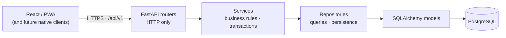

# B-17 Portal — Backend Architecture

**Status:** frozen by Phase 10A (architecture + contract documentation only — no backend code exists yet).
**Owns:** the stack, the layered architecture and its rules, the planned folder layout, transaction and concurrency rules, and cross-cutting concerns (config, CORS, logging, security baseline, testing, migrations policy).
**Does not own:** table design → [`DATA_MODEL.md`](DATA_MODEL.md) · HTTP contract → [`API_CONTRACT.md`](API_CONTRACT.md) · identity / roles → [`AUTH_RBAC.md`](AUTH_RBAC.md) · media → [`MEDIA_STORAGE.md`](MEDIA_STORAGE.md) · environments / hosting → [`DEPLOYMENT.md`](DEPLOYMENT.md).

The frontend is a finished, tested prototype (React 19 + Vite PWA; Zustand in-memory/localStorage state; demo auth; client-side search). The backend's job in V1 is to be the **authoritative home of the data and the rules the prototype currently simulates**, behind the same shapes the frontend already uses.

## 1. Stack (agreed direction)

| Concern | Choice | Notes |
|---|---|---|
| Language / framework | Python 3.x (current stable supported by the dependencies; pinned in Phase 10B) + **FastAPI** | Typed request/response models, OpenAPI for free, small-team friendly. |
| Validation / schemas | **Pydantic v2** | API boundary only (see layering). |
| ORM / data access | **SQLAlchemy 2.x** (2.0-style typed `Mapped[...]` models) + **psycopg 3** | **Synchronous** sessions in V1 (see Decision A below). |
| Migrations | **Alembic** | Version-controlled, reviewed, applied deliberately (see §9). |
| Database | **PostgreSQL** (a current, supported major; managed in production) | Rationale in §2. |
| Tests | **pytest** (+ `httpx` test client) | Day-one requirement (§8). |
| Packaging | **Docker** image for the API; Compose for local Postgres | Not required for every dev action (§10). |
| API style | **REST, JSON, `/api/v1`** | Contract in `API_CONTRACT.md`. |
| Object storage | S3-compatible, **later** | `MEDIA_STORAGE.md`. |
| Redis / queues / search engine | **None** | No current requirement. Seams in §11. |

**Decision A — synchronous SQLAlchemy in V1.** Every request's work is "authenticate, run a handful of indexed SQL statements, serialize". There is no fan-out to slow external services. Plain `def` route handlers run in FastAPI's threadpool, and sync SQLAlchemy has simpler session lifetimes, no lazy-load/`await` pitfalls, and simpler tests. Async buys nothing measurable at this scale and costs complexity. *Revisit when:* profiling shows threadpool saturation, or a real async dependency (streaming, many outbound calls) appears. Layer boundaries below mean the switch would touch repositories and dependencies, not routers' contracts.

### Why FastAPI

It gives typed contracts that map one-to-one onto the frontend's TypeScript types, automatic OpenAPI (usable later to generate or verify a TS client), first-class dependency injection (which is exactly how request-scoped sessions, the current user and permission checks are expressed), and a large, boring ecosystem. Django would also work; FastAPI was already the agreed direction and fits an API-only backend for a separate SPA/PWA and future native clients.

## 2. Why PostgreSQL (and not MongoDB) as the primary database

B-17 Portal's core data is **relational and consistency-sensitive**:

- **Ownership and roles** — users own listings; roles gate actions; admins act on other users' records.
- **Moderation lifecycle** — a state change plus its audit row must commit together or not at all (real multi-row transactions).
- **Normalized relations** — listings ↔ categories (with order/primary), Saved (user ↔ listing, unique), requests (resident → provider listing), listing → subtype profile → menu items.
- **Constraints as guarantees** — uniqueness, foreign keys, check constraints and partial indexes enforce rules the frontend only validates (one Saved row per user/listing; at most 3 Food categories; one primary).
- **Filtering and search** — multi-column filters (`area`, `category`, `vertical`, `listingType`, …) and substring text search map onto B-tree/GIN/`pg_trgm` indexes without a second system.
- **Flexibility where needed** — `text[]` (tags, service options) and `jsonb` (if a genuinely schemaless blob ever appears) live in the same engine. **PostGIS** is available later for location/proximity without changing databases.

MongoDB is an excellent document store and would handle a single self-contained listing document well. It is not preferred here because the dominant operations are cross-entity (moderation + history, quota counting per owner, Saved joins, category-driven filters) where relational integrity and transactions are the point, and the document model would push uniqueness, referential integrity and cross-document consistency into application code. Postgres can still hold document-shaped fields where they are natural. This is a trade-off, not a verdict on MongoDB generally.

## 3. Architecture: modular monolith

One deployable FastAPI application, internally divided into domain modules with enforced boundaries. **Not** microservices.



Text form: `Frontend → REST /api/v1 → routers → services → repositories → SQLAlchemy → PostgreSQL`.

**Is a modular monolith right for this team and product?** Yes. The product is one cohesive hyperlocal portal; the domain modules (listings, taxonomy, accounts, saved, news, requests, search) share users, categories and transactions constantly; the team is small; and there is no independent scaling or deployment requirement. Microservices would add network failure modes, distributed transactions and operational cost with no benefit. The monolith's internal boundaries keep a later extraction possible.

### Layer responsibilities (the rules)

| Layer | Owns | Must **not** |
|---|---|---|
| **Routers** (`api/v1`) | URL/method/status mapping, parsing and serializing via schemas, declaring dependencies (auth, permission, DB session), translating domain errors to the error envelope. | Contain SQL, ORM queries, state-transition rules, or multi-step business logic. |
| **Schemas** (`schemas`) | Pydantic request/response models: the **public contract** (camelCase JSON; see API_CONTRACT). | Be reused as ORM models or leak DB columns that are not part of the contract. |
| **Services** (`services`) | Business rules: lifecycle transitions, quota/entitlement checks, category-count rules, "edit moves a listing back to pending", authorization decisions that depend on data (e.g. *owner of this listing*). **They own the transaction** (commit/rollback). | Build HTTP responses, know about FastAPI/`Request`, or write SQL. |
| **Repositories** (`repositories`) | Persistence: all queries and writes for one aggregate/area, filters/sorting/pagination, row locking helpers. Return model objects or plain data. | Commit, enforce business policy, or call other modules' repositories. |
| **Models** (`models`) | SQLAlchemy tables, relationships, DB-level constraints and indexes. | Hold business logic. |
| **Dependencies** (`dependencies`) | `Depends(...)` providers: DB session, current user, role/permission guards, pagination params. | Contain business rules. |
| **Core** (`core`) | Settings, logging setup, error types / codes and the error-envelope builder, security primitives (later), constants. | Import from domain layers. |
| **Middleware** (`middleware`) | Pure-ASGI cross-cutting behavior: request ID, request logging + the unexpected-exception boundary. | Contain business logic or touch the database. |
| **DB** (`db`) | Engine/session factory, base metadata, naming convention for constraints, migration wiring. | Define domain tables (those are in `models`). |

**Module boundary rule:** a service may call another module's **service**, never its repository or models' internals. Example: `listings` service asks `taxonomy` service to validate categories; it does not query the categories table itself. This keeps the monolith extractable and testable.

## 4. Planned folder layout (design only — nothing is created in 10A)

```
backend/
  app/
    main.py                  # app factory: routers, middleware, exception handlers
    api/
      v1/
        router.py            # includes all v1 routers under /api/v1
        health.py  auth.py  users.py  categories.py  listings.py
        search.py  news.py  saved.py  requests.py  admin.py
    core/                    # config (Pydantic settings), logging, errors, security, request_id
    db/                      # engine/session factory, Base + naming convention, ids, reference data + seed command
    models/                  # SQLAlchemy models (one module per aggregate)
    schemas/                 # Pydantic request/response models, mirroring models/
    services/                # business logic (listings, moderation, taxonomy, accounts, saved, news, requests, search)
    repositories/            # persistence (same split as services)
    dependencies/            # FastAPI Depends providers
  tests/
    unit/                    # services/rules with fakes or an in-memory repo
    integration/             # repositories against the TEST Postgres
    api/                     # endpoints through the HTTP client
    conftest.py
  alembic/                   # env.py + versions/
  alembic.ini
  Dockerfile
  pyproject.toml             # dependencies + tool config (pytest, ruff, mypy-strict adopted in 10B)
  .env.example               # documented variables, no secrets
```

Conventions: file names are domain nouns (`listings.py`, not `listing_helpers.py`); one repository + one service per aggregate; if a domain outgrows the layer-first layout, it can become a package (`app/modules/listings/…`) without changing the layering rules. Seed/fixture loaders live under `backend/scripts/` (dev/staging only) when needed — never in `app/`.

## 5. Transaction rules

Services own the unit of work: open it, call repositories, commit once on success, roll back on any exception. Repositories **flush** but never **commit**. Routers never touch the session beyond receiving it through a dependency.

| Operation | Must be one transaction |
|---|---|
| Create listing (+ subtype profile + categories) | base `listings` row, subtype (`business_profiles`/`property_profiles`/`tutor_profiles`), `listing_categories`, and the **history row** (`→ pending`). |
| Food listing | all of the above **plus** `food_profiles` and `food_menu_items` (replace-all on edit). |
| Edit & resubmit | content updates, category/menu replacement, `revision` increment, status → `pending`, history row. |
| Moderation (approve / reject) | status change + history row (+ reason) — with the guarded update in §6. |
| Archive | status change + history row. |
| Quota-checked create | the active-listing count and the insert, serialized per owner (§6). |
| Register / link identity | `users` + `auth_identities` (+ initial role grant) together; account linking atomically. |
| Saved toggle | single statement (`INSERT … ON CONFLICT DO NOTHING` / `DELETE`), naturally atomic. |
| Service request status change | status change + its history row. |

Read endpoints use no explicit transaction beyond the session's default.

**Implemented (10C):** `app.db.session.transaction(session)` is the one place a business transaction ends (commit on success, rollback and re-raise on any error); repositories (`app/repositories/`) only `add` / query / `flush`, and `ListingStatusHistory` has no update or delete at all. A `Session` is created per request by the `get_db_session` dependency and always closed (closing rolls back anything uncommitted); the `Engine` is a process-level lazy pool created by the app factory, so the API starts and `/health` stays up even when PostgreSQL is down. `ListingCreationService` (Food + General business) proves the pattern against real PostgreSQL: listing, subtype, Food profile, menu items, categories and the initial history row commit together or not at all.

## 6. Concurrency and consistency (no distributed locking)

Prefer, in order: **database constraints**, **guarded single-statement updates**, **row locks inside a transaction**, **optimistic concurrency tokens**.

- **Two admins moderating the same listing:** the transition is a guarded update — `UPDATE listings SET status=… WHERE id=:id AND status='pending' AND revision=:revision` — and the service checks the affected-row count. The loser gets `409 conflict` (`invalid_state_transition`), not a silent double-apply. A history row is written only for the winner.
- **Admin approves while the owner edits:** `listings.revision` is an integer concurrency/version counter (a **current requirement**). Every content edit increments it. A moderation request carries the `revision` the admin reviewed (a request-body field — see API_CONTRACT); a mismatch is `409`, so an admin can never approve content they did not see and conflicting updates are rejected. This counter is **not** content-version history (that is deferred; see the seams table).
- **Quota races:** creating a listing locks the owner's `professional_profiles` row (`SELECT … FOR UPDATE`), counts active (`pending`+`approved`) listings, then inserts — so two simultaneous requests cannot both pass the check. The backend, not the frontend capability check, is authoritative.
- **Duplicate Saved:** primary key `(user_id, listing_id)`; the endpoint is idempotent.
- **Duplicate category slug:** unique `(module, slug)`; violation maps to `409`.
- **Repeated submission (double-click/retry):** creating a listing is not naturally idempotent (a user may legitimately own several). Reserve an optional `Idempotency-Key` header for create endpoints (designed, implemented only if duplicates are observed).

## 7. Cross-cutting concerns

### Configuration
Pydantic settings, loaded from the environment. Variables (implemented in 10B): `ENVIRONMENT` (`development|test|staging|production`), `DEBUG`, `APP_NAME`, `APP_VERSION`, `API_V1_PREFIX`, `FRONTEND_ORIGINS`, `LOG_LEVEL`. `DATABASE_URL` (a secret, never logged; optional so the API starts without a database) and `DB_CONNECT_TIMEOUT_SECONDS` (10C). `TEST_DATABASE_URL` is read **only by the test harness**, never by the application. Planned: later auth settings (`SECRET_KEY`, token lifetimes, OAuth client ids/secrets) and object-storage settings. `.env.example` is committed with placeholders; the real `.env` is git-ignored; **no secret is ever committed**; production secrets come from the host's secret store (`DEPLOYMENT.md`). Settings fail fast on startup if required values are missing.

### CORS
Explicit allow-list, never `*`, and never a wildcard together with credentials.
- **Local:** the known dev origins, listed explicitly — `http://localhost:5173` and `http://127.0.0.1:5173` (Vite dev) and `http://127.0.0.1:4173` (the Playwright production-preview origin used by E2E).
- **Staging / production:** the exact deployed frontend origin(s) only, from `FRONTEND_ORIGINS` (comma-separated or JSON list; wildcards and paths are rejected at startup; nothing is implicit outside `development`).
- Allowed methods/headers are the minimal set the contract uses (`Authorization`, `Content-Type`, `X-Request-ID`, `If-Match`, `Idempotency-Key`). If cookie auth is chosen in Phase 11, `allow_credentials` is enabled only with exact origins (see `AUTH_RBAC.md` §6). Implemented in 10B.

### Logging and observability (lightweight)
- Structured (JSON) application logs via the standard `logging` module, one line per request: method, path template, status, duration, request ID, user id (if any).
- A `request_id` middleware accepts or generates `X-Request-ID`, adds it to log context and the response, and includes it in error envelopes.
- Exceptions are logged with stack traces **server-side only**; clients get the generic error envelope (no stack, SQL or exception class names).
- Never log passwords, tokens, authorization headers, OAuth codes or full request bodies on auth routes.
- **Not now:** Sentry, OpenTelemetry, Prometheus. The request-ID middleware and structured logger are the seams where they attach later.

### Security baseline (checklist; implemented by the owning phase)
Password hashing with a modern memory-hard algorithm (Argon2id preferred) · secure token/session handling · RBAC enforced in services/dependencies · input validation on every body/query (Pydantic + DB constraints) · rate limiting on auth, request-creation and search-suggestion endpoints · file-upload validation (type, size, content sniffing; `MEDIA_STORAGE.md`) · least-privilege DB credentials (app role cannot alter schema; migrations run with a separate role) · secrets via environment/secret manager only · exact-origin CORS · CSRF protection **if** cookie auth is used · audit logging of moderation and admin actions · dependency and image scanning in CI. **Nothing in this list is implemented in 10A**; frontend capability checks (Free/Premium, route guards) remain UX only and the backend is authoritative.

## 8. Testing strategy (from day one)

| Layer | What | How |
|---|---|---|
| Unit | State machine, quota rules, category-count/primary rules, Food validation, visibility rules | pytest, no database (fake repositories or pure functions). |
| Integration | Repositories, constraints, indexes, transactions, migrations | pytest against a **dedicated test PostgreSQL** (never SQLite — the constraints under test are PostgreSQL behavior). Once per session the harness validates the database, drops/recreates its `public` schema, runs `alembic upgrade head` and seeds the reference taxonomy; each test runs in a connection-level transaction with SAVEPOINTs (a service's `commit()` releases a savepoint; the whole test rolls back), so there is no test-order dependence and nothing to clean up. Migration tests use a throw-away `<name>_migrations_test` database. |
| API | Endpoints, status codes, envelopes, pagination/filter semantics | `httpx`/FastAPI test client over the real app and the test DB. |
| Authorization | Every endpoint × {anonymous, resident, professional-owner, professional-other, admin} | Parametrized matrix; a new endpoint without a matrix row fails review. |
| Migration | `alembic upgrade head` on an empty DB; downgrade/upgrade round trip where meaningful; autogenerate shows no drift | CI job. |

**Isolation rule (implemented in `tests/db_safety.py`):** a database is reset only if **all** hold — it comes from an explicit `TEST_DATABASE_URL` (never a fallback to `DATABASE_URL`); its name **ends in `_test`**; its host is `localhost`, `127.0.0.1`, `::1` or the Compose service `db`; its name differs from the application `DATABASE_URL`'s; and `SELECT current_database()` confirms it after connecting. Otherwise the DB suite **fails loudly** (it is never silently run elsewhere). With no `TEST_DATABASE_URL`, DB tests skip locally but **fail when `CI` is set**, so a CI misconfiguration cannot turn the suite off. The production database is unreachable from tests by construction.

**Frontend E2E later:** the Playwright suite (see `docs/development/TESTING.md`) is re-pointed at the real backend with a seeded **test/staging** database. That will require deterministic fixture ids (UUIDs fixed in fixtures) because today's specs use prototype ids such as `business-01`.

## 9. Migrations policy (Alembic)

- Every schema change is an Alembic migration, committed with the code that needs it; no hand-edited schemas, ever, in any shared environment.
- Migrations are reviewed like code (reviewers check: constraint names, defaults on large tables, lock impact, reversibility, data backfills).
- Constraints and indexes get explicit, conventional names (set once via a SQLAlchemy `naming_convention`) so autogenerate is stable.
- Destructive changes (drop column/table) use expand → migrate → contract across releases.
- Deployments apply migrations deliberately as a release step (not implicitly on app start in production), using a migration-capable DB role distinct from the runtime role.
- Seed/demo data is **not** a migration. Reference data that the app requires (e.g. the initial category taxonomy) is loaded by an idempotent script.

## 10. Local development direction

Docker Compose provides PostgreSQL (`backend/compose.yaml`, `postgres:17-alpine`, named volume, healthcheck, loopback-only port **54329** by default so it never collides with a PostgreSQL installed on the machine) and, behind the optional `api` profile, the API image; the Vite frontend and the API itself normally stay host-run. Docker is not required for frontend work or for the 125 database-free backend tests. Commands: see `backend/README.md`.

## 11. Extension seams — documented, not built

| Future need | Seam | Not now because |
|---|---|---|
| Object storage / uploads | `media_assets` + storage adapter interface | No upload requirement until the media phase. |
| Background work (emails, image processing) | A service-level "outbox"/task interface; FastAPI `BackgroundTasks` first | No Celery/queue until a job proves too slow/unreliable for in-process. |
| Caching | HTTP caching headers (`ETag`/`Cache-Control`) on public reads first | Redis only if measured need appears. |
| Search engine | Search behind `services/search.py` + a repository | Postgres (`pg_trgm`, then FTS) suffices (see DATA_MODEL §9). |
| Notifications (Phase 9I UI shell) | An `events` seam from status transitions | UI is mock-only. |
| Content-version history — full snapshots of past listing content, restore/diff, keep the old approved version live while a new one is reviewed (**not** the `revision` counter, which is current) | e.g. a `listing_revisions` table | Frontend semantics today: an edit takes the listing offline until re-approved; the counter alone suffices for concurrency. |
| Personalization | Separate activity tables (DATA_MODEL §10) | Out of V1 scope. |
| Payments / ordering | New module | Explicitly out of scope. |

## 12. Backend phase map (approved in the Phase 10A review; ROADMAP matches)

| Phase | Scope |
|---|---|
| **10A** | This architecture/contract freeze (docs only). |
| **10B** | FastAPI project foundation (**complete**): app factory, settings, health, error envelope, logging/request-ID, CORS, pytest harness, ruff + mypy, backend CI. No database, no domain tables. |
| **10C** | PostgreSQL data layer (**complete**): 15-table schema, Alembic baseline + drift check, constraints/indexes, reference seed, dev fixtures, repositories + constraint/transaction tests, Dockerfile + Compose PostgreSQL, `/health/ready`, PostgreSQL service in backend CI. |
| **10D** | Public read APIs (**complete**): categories, search/suggestions, listing detail, news; migration `0002` search foundation (`pg_trgm`, maintained `search_document`); read services + repositories + explicit read schemas; extended fixtures; parity notes in `READ_API_PARITY.md`. |
| **11** | Authentication, OAuth, roles/permissions enforcement (`AUTH_RBAC.md`). |
| **12** | Write APIs (owner listing lifecycle, moderation, saved, requests, news admin) and frontend/API integration. |
| **13** | Media storage and production deployment/hardening. |

The 10A freeze deliberately fixes *contracts and structure*; endpoint-by-endpoint detail for later phases is owned by those phases (see API_CONTRACT §9).
