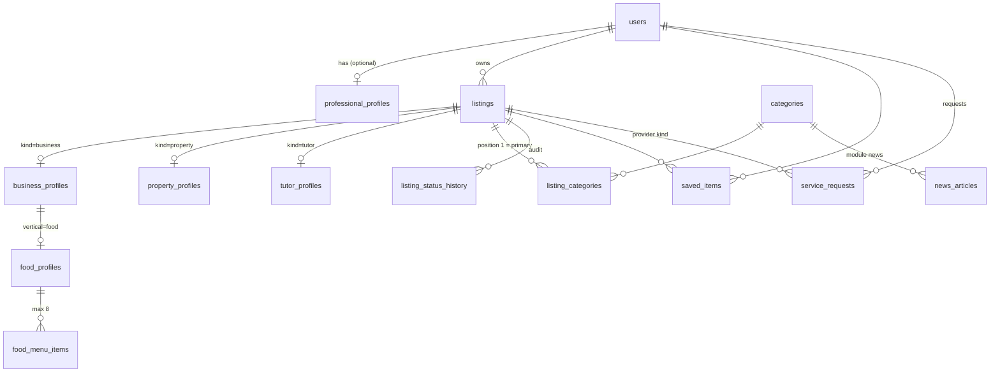
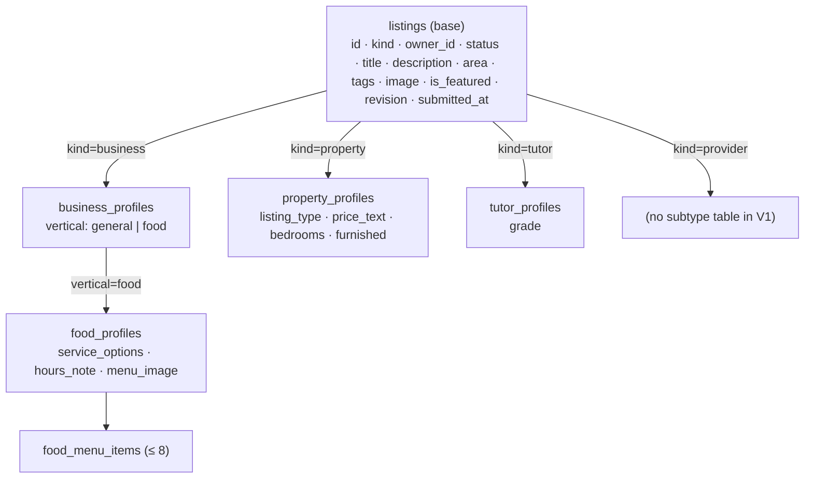

# B-17 Portal — Data Model

**Status:** frozen by Phase 10A (design only — no migrations exist yet; column types are indicative, final DDL is written in Phase 10C).
**Owns:** the audit of the frontend's actual contracts, entities and relationships, the listing subtype model, categories/taxonomy, lifecycle and history, constraints, indexes, delete/archive policy.
**Does not own:** layering/transactions → [`BACKEND_ARCHITECTURE.md`](BACKEND_ARCHITECTURE.md) · JSON shapes → [`API_CONTRACT.md`](API_CONTRACT.md) · identity/role tables in depth → [`AUTH_RBAC.md`](AUTH_RBAC.md) · media → [`MEDIA_STORAGE.md`](MEDIA_STORAGE.md).

Source of truth for this document is the **current frontend source** (`src/types/*`, `src/config/food.ts`, `src/state/*`, `src/features/provider/listing*`, `src/services/search.ts`), not older prose docs. Where they differ, the source wins and the difference is called out.

## 1. Frontend contract audit → backend treatment

Legend — **R** required by the current forms/seed · **O** optional · **Demo** frontend-only/demo · **BE** backend-owned (clients may not set it) · **¬P** must not be persisted as-is.

### Common listing fields (Provider, Business, Property, Tutor)

| Frontend field | R/O | Class | Backend treatment |
|---|---|---|---|
| `id` (string; seed uses `business-01`, user listings use `crypto.randomUUID()`) | R | BE | Server-generated UUID PK. Frontend ids are opaque strings, so UUIDs are compatible; seed ids do not survive (fixtures get fixed UUIDs). |
| `name` (Provider/Business/Tutor) / `title` (Property) — 2–80 / 2–100 chars | R | persist | One column `listings.title`; the API keeps the per-kind field name (`name` or `title`). |
| `description` (Provider/Business 20–400; Property optional in the type, required by the form; Tutor calls it `bio`) | R (forms) | persist | `listings.description` (nullable at DB level because curated/seed Property rows have none; required ≥20 by create schemas). |
| `area` (free text, ≥2; filter is exact match) | R | persist | `listings.area` text. **Open:** exact-match filter on free text fragments by typos — see §13 (O-1). |
| `tags: string[]` (lowercased, trimmed, comma-split) | R for Provider/Business, O for Property | persist | `listings.tags text[]` (normalized server-side the same way), GIN-indexed. |
| `image?: string` (seed: `/images/…`; onboarding: browser `blob:` URL) | O | **¬P** | A `blob:` URL is meaningless server-side and is never stored. Interim `image_url` (public https/site-relative only); later a media asset reference — `MEDIA_STORAGE.md`. |
| `featured?: boolean` (Provider, Business only; seed-curated) | O | BE | `listings.is_featured`, admin-only; never accepted from owners. |
| `status` (`pending\|approved\|rejected\|archived`) | R | BE | `listings.status`; changed only by services through the state machine (§7). |
| `submittedAt` (ISO; reset on resubmit) | R | BE | `listings.submitted_at timestamptz`. |
| `submittedBy` (a **name string**) | R | **¬P** | Replaced by `owner_id` FK → `users`. A display name is not an identity. |
| `rejectionReason?` (cleared on resubmit) | O | BE | Stored on the history row; the current reason is derived (§7). |
| `kind` (`provider\|business\|property`; Tutor is seed-only) | R | persist | `listings.kind` enum with the **frontend vocabulary** (`provider`, `business`, `tutor`, `property`). |
| "Demo Listing" badge, `(Demo)`/`(Demo Area)` suffixes in seed names | — | Demo | Presentation/seed content only. No `is_demo` column; demo fixtures are loaded in dev/staging only (O-4). |

### Business, Food

| Field | R/O | Class | Treatment |
|---|---|---|---|
| `vertical: "general"\|"food"` | R | persist | `business_profiles.vertical`. **Food stays a Business vertical, not a listing kind.** |
| `category` (General: free text typed in the form; Food: *derived* label of the primary Food category) | R | **¬P (Food) / O-2 (General)** | Never stored as a string. Read-model `category` = name of the listing's primary category (`listing_categories`, position 1) — one source of truth, exactly the frontend rule. General free text → taxonomy: see O-2. |
| `food.categories` (1–3 canonical slugs, first = primary) | R (Food) | persist | `listing_categories` rows with `position` 1–3 (module `food`). |
| `food.serviceOptions` (`dine-in\|takeaway\|delivery`, ≥1, canonical order) | R (Food) | persist | `food_profiles.service_options text[]` + CHECK. "delivery" = *by the business* (no platform delivery). |
| `food.hoursNote?` (≤80, display text; no structured hours, no "open now") | O | persist | `food_profiles.hours_note varchar(80)`. |
| `food.menuHighlights?` (≤8; `name` ≤60 required, `section` ≤40, `description` ≤120, `price` ≤24 display string) | O | persist | `food_menu_items` (`price` stored as `price_text`, **never parsed**). The frontend regenerates item ids (`<listingId>-mh-N`) on every edit, so ids are not stable → items are replaced as a set; position is the stable key. |
| `food.menuImage?` | O | **¬P** (blob) | Same media rule as `image`. |

### Property

| Field | R/O | Treatment |
|---|---|---|
| `listingType` `sale\|rent` | R | `property_profiles.listing_type` enum. |
| `propertyType` (`House\|Flat\|Plot` from a hard-coded `<select>`) | R | The primary **category** (module `property`) so property types can become admin-managed without code changes. |
| `price` display string (`"PKR 4.5 Cr"`, "not a real offer") | R | `property_profiles.price_text` (never parsed). A numeric `price_amount` is reserved, **not invented** now. |
| `bedrooms?` (int ≥0), `furnished?` (`Furnished\|Unfurnished\|Semi-Furnished`) | O | `smallint` + CHECK; enum. |

### Tutor (seed-only today: no onboarding, moderation or edit flow in the frontend)

`subject` → primary category (module `education`); `grade` (free text) → `tutor_profiles.grade`; `bio` → `listings.description`. The tutor write path is **not designed beyond the table** — there is no frontend flow to preserve (see §12).

### News / Updates

`kind` `news|update`; `status` `draft|published` (**no moderation step** — admin authors and publishes directly); `title` 3–120; `category` (free text 2–40, exact-match filter); `summary` 20–400; `image?`; `publishedAt` is a **date-only** string (`"2026-09-05"`); `tags`. → `news_articles` (own table; news is not a listing). `category` becomes a category in module `news`; `publishedAt` → `date`; backend adds `created_by`.

### Resident / requests / plan

| Frontend | Treatment |
|---|---|
| `SavedItem {kind, id, savedAt}` (kinds provider/business/tutor/property; persisted to localStorage; cleared on logout) | `saved_items(user_id, listing_id, created_at)`; `kind` is derived from the listing. |
| `ServiceRequestRecord` (service, details 10–500, area, preferredDate, preferredTime?, notes? ≤500, `requestedBy` name, `providerName` snapshot, status `submitted→accepted→in-progress→completed`, `cancelled`) | `service_requests` (§6); `requestedBy` → `requester_id` FK; `providerName` snapshot kept. Transition table is the existing `REQUEST_TRANSITIONS`. |
| `Plan` `free\|premium`, `maxListings` 3 / unlimited, quota counts **pending+approved** only | Backend-authoritative: `professional_profiles.plan_code` + code-level entitlement map mirroring `config/plans.ts`. Billing is out of scope. |
| `DemoUser {name}`; separate in-memory admin login | Replaced by real `users` (see `AUTH_RBAC.md`). Professional ≠ a separate login: any signed-in user can use `/provider`. |
| `SponsoredCard`, Home "discovery categories", `site` copy | **Not persisted in V1** — static content/config (sponsored/ad CRUD is Phase 9F scope, undecided). |

### Gaps the frontend does not model (not invented here)

- **No contact data anywhere** (no phone/WhatsApp/email on any listing; "Call/WhatsApp/Contact" are simulated toasts). Real leads need a contact channel — a product decision (O-3).
- **No listing slug** (URLs use the id).
- **No per-listing timestamps** except `submittedAt`/`publishedAt` (backend adds `created_at`/`updated_at`).

## 2. Conventions

- **IDs: UUID** primary keys for every externally visible resource, generated by the application with the standard library's `uuid.uuid4()` and stored as native Postgres `uuid`. *Why:* non-guessable, safe to expose in URLs (`/businesses/:id`), mergeable across environments (fixtures, staging→prod), no enumeration of competitors' listing counts, compatible with the frontend's opaque-string ids. *Trade-off:* 16 bytes vs 8, and random v4 values have poorer B-tree locality than time-ordered ones — acceptable at B-17's scale; bigint PKs were rejected because they leak counts/order and would force a second public identifier. Time-ordered UUIDv7 was an optional preference ("where available"), not a requirement, and is **not** used: no custom generator and no extra dependency. Switching later is an application-only change (the column type does not change). One strategy everywhere; no mixing. Reference/lookup tables that are code-defined stay as enum/text, not rows.
- **Time:** `timestamptz`, UTC, `created_at`/`updated_at` on mutable tables (set by the app/DB, not clients). News `published_at` is a `date`.
- **Naming:** snake_case tables/columns, plural table names, FKs `<thing>_id`. Constraints and indexes get explicit conventional names (naming convention in `db/`).
- **Strings:** length limits come from the current frontend schemas and are mirrored as `varchar(n)`/CHECKs where they are domain rules.
- **Enums:** `VARCHAR(32)` + a named `CHECK` (decided in 10C; not native PostgreSQL enums — changing a CHECK is a reversible migration, `ALTER TYPE … ADD VALUE` is not); Python gets `StrEnum` types.
- **Ownership of rules:** the DB guarantees what it cheaply can; services own the rest (marked *service rule*).

## 3. Entities (initial production model)

Text form: a `listings` base row; `business`/`property`/`tutor` listings have one subtype row (provider listings have none — see §4); a Food business additionally has `food_profiles` → `food_menu_items`; categories attach through `listing_categories`.

| Table | Purpose | Created in V1? |
|---|---|---|
| `users`, `user_roles`, `auth_identities` | Identity and roles (columns in `AUTH_RBAC.md`) | Yes (Phase 11 fills behavior) |
| `professional_profiles` | The professional workspace anchor: plan/entitlements, future verification | Yes |
| `listings` | Base row for every listing kind | Yes |
| `business_profiles` | Business-specific data (`vertical`) | Yes |
| `food_profiles`, `food_menu_items` | Food vertical | Yes |
| `property_profiles` | Property-specific data | Yes |
| `tutor_profiles` | Tutor-specific data (`grade`) | Yes (read path; no write flow yet) |
| `categories`, `listing_categories` | Taxonomy and listing↔category | Yes |
| `listing_status_history` | Audit of every lifecycle transition | Yes |
| `saved_items` | Resident favorites | Yes |
| `news_articles` | News & Daily Updates | Yes |
| `service_requests` (+ status history) | Request Service / Leads | Yes, but designed **conceptually** here; detailed in its own phase |
| `media_assets` | Uploaded media metadata | **Reserved** — introduced with the media phase |

**Deliberately not created:** `provider_profiles` (a Provider has no data beyond the base row + category — an empty subtype table would be noise; add it when a real field such as coverage areas or licence appears) · `listing_tags` (tags are a free-form search keyword list, never joined — an array fits) · `modules` (a module is a code-defined concept; see §8) · generic `audit_events`, `notifications`, `reviews`, `payments`, `orders` (no current requirement) · `deleted_at` columns (§11) · `provider_categories`/per-kind category tables (one `categories` table with a module).

## 4. Listing architecture — base table + subtype tables

**Strategy: class-table inheritance with shared primary key.** `listings` holds everything every kind shares *and* everything the lifecycle needs (owner, status, history, quota, moderation, Saved, search). A subtype table's PK **is** its `listing_id` (FK, `ON DELETE CASCADE`).

| | Pros | Cons |
|---|---|---|
| **Chosen: base + subtype tables** | One lifecycle, one owner/quota rule, one Saved/moderation/search path for all kinds; subtype columns are real, typed, constrained; adding a kind = one table, not a new lifecycle. | Reads of a full listing join base + subtype (cheap, PK joins); creation touches two tables (one transaction). |
| One giant `listings` table | No joins. | Hundreds of nullable columns, no meaningful NOT NULL/CHECKs, every new kind widens the hot table. **Rejected.** |
| JSONB blob for kind data | Flexible. | No constraints/typing/indexing of the fields the filters use (`bedrooms`, `listing_type`, `vertical`); validation only in app code. **Rejected** for domain fields (JSONB stays available for genuinely schemaless extras). |
| Fully separate tables per kind | Simple per kind. | Duplicated lifecycle/status/history/Saved/quota — the duplication the frontend deliberately avoided. **Rejected.** |

`kind` is immutable after creation (changing a listing's kind is a new listing). A `listings.kind` ↔ subtype-row match is **enforced by the database** (composite FK `(listing_id, kind) → listings(id, kind)` + `CHECK kind = '<kind>'` on each subtype — §14); `owner`, `status` and `revision` are enforced in services and guarded updates (`BACKEND_ARCHITECTURE.md` §6).

### 4.1 `listings`

`id uuid PK` · `kind` (enum, NOT NULL) · `owner_id uuid NULL → users` (NULL = admin-curated/unclaimed seed content) · `status` (`pending|approved|rejected|archived`, NOT NULL) · `title varchar(100)` NOT NULL · `description text` · `area text` NOT NULL · `tags text[]` NOT NULL DEFAULT `{}` · `image_url text` (interim, §1) · `is_featured bool` DEFAULT false · `revision int` NOT NULL DEFAULT 1 (the **integer concurrency/version counter** — a current requirement; incremented on every content edit; see *Revision counter vs revision history* in §7) · `submitted_at timestamptz` NOT NULL · `search_document text` NOT NULL DEFAULT `''` (denormalized lower-cased public text — **added in Phase 10D by migration `0002`** together with its maintenance, §9 and §14.1) · `created_at`, `updated_at`.

CHECKs: `tags` normalized by the service (lowercase/trim) and `array_length` sane; `title` non-blank; `is_featured` only for kinds that have it (`CHECK featured_kinds`: provider/business). Per-kind **length limits** differ (name ≤80 vs property title ≤100) — enforced by per-kind create schemas; the column takes the max.

### 4.2 `business_profiles`, `food_profiles`, `food_menu_items`

- `business_profiles(listing_id PK/FK, vertical NOT NULL DEFAULT 'general', UNIQUE(listing_id, vertical))`.
- `food_profiles(listing_id PK, vertical NOT NULL DEFAULT 'food' CHECK (vertical='food'), service_options text[] NOT NULL CHECK (cardinality ≥ 1 AND <@ {dine-in,takeaway,delivery}), hours_note varchar(80), menu_image_url, FOREIGN KEY (listing_id, vertical) → business_profiles(listing_id, vertical))`. The composite FK makes it **impossible** for a Food profile to exist on a non-food business. The converse (a `vertical='food'` business *must* have a `food_profiles` row and ≥1 Food category) is a *service rule*, written in the same transaction.
- `food_menu_items(id uuid PK, listing_id FK→food_profiles, position smallint CHECK 1..8, name varchar(60) NOT NULL, section varchar(40), description varchar(120), price_text varchar(24), UNIQUE(listing_id, position))` — the DB itself caps highlights at 8.

### 4.3 `property_profiles`, `tutor_profiles`

- `property_profiles(listing_id PK/FK, listing_type enum(sale|rent) NOT NULL, price_text varchar NOT NULL, bedrooms smallint CHECK ≥0, furnished enum(Furnished|Unfurnished|Semi-Furnished))`. `property_type` lives in `listing_categories` (module `property`).
- `tutor_profiles(listing_id PK/FK, grade text NOT NULL)`; subject = primary category (module `education`).

## 5. Food mapping (preserves current Food behavior)

| Frontend behavior | Persistence |
|---|---|
| Listing kind `business`, vertical `food` | `listings.kind='business'` + `business_profiles.vertical='food'` + `food_profiles` row |
| 1–3 categories, first is primary *(a **Food** rule)* | `listing_categories` rows with `position` 1..n, **primary = position 1**; the maximum of 3 is enforced by the Food service, not by the generic table |
| `Business.category` derived from primary | Read-model: name of the position-1 category. Never stored separately. |
| Canonical slugs (`bakeries`, `desi-food`, …) | `categories` rows (module `food`), seeded from `config/food.ts`; slugs are the stable ids |
| ≥1 service option, canonical order | `food_profiles.service_options` (the API returns canonical order) |
| ≤80 hours text; ≤8 menu highlights with display-string prices; optional menu image | `hours_note`; `food_menu_items` (cap by CHECK); `menu_image_url` |
| Search: `type=business&vertical=food&foodCategory=<slug>&service=<opt>` | `business_profiles.vertical`, a `listing_categories`→`categories` join, `service_options @> ARRAY[…]` |
| Edit → prefill → resubmit never drops Food data | Edit = replace categories + menu items inside the edit transaction; `food_profiles` row kept |
| Switching a Food business to General | A *service rule*: deletes the `food_profiles`, menu items and Food categories, assigns a General category, flips `vertical` — in one transaction (the frontend warns that Food data is removed on save) |

**Categories: why `position` instead of an `is_primary` flag.** Primary-by-position is the frontend's own rule ("the first is primary") and removes a second field that could disagree with the order. `UNIQUE(listing_id, position)` + `CHECK (position >= 1)` give the generic relation uniqueness and a sane lower bound; **the "at most 3" cap is Food-specific** (docs/product/FOOD_DINING.md) and every other kind has exactly one category, so the shared table deliberately carries no maximum — the Food service enforces 1..3, contiguous positions from 1 (so a primary exists) and the module match, and verifies them again by reading the stored rows back inside the transaction (a violation rolls everything back). No trigger. The alternative — `is_primary` + a partial unique index — was rejected for the redundancy; revisit only if categories ever need an order independent of primacy.

## 6. Other tables

**`professional_profiles`** — `user_id PK/FK`, `plan_code` (`free|premium`, DEFAULT `free`), `created_at/updated_at`; future `verification_status`. Exists because plan/entitlements and (later) verification belong to the *professional* concept, not every account. Created when a user first uses the professional workspace (the frontend lets any signed-in user list — no admin approval to become a professional). It is also the **row locked during quota-checked creates**.

**`saved_items`** — `PRIMARY KEY (user_id, listing_id)`, `created_at`. **One table for all kinds** (kind derived via the listing). Behavior: only approved (publicly visible) listings can be saved; if the listing later becomes non-public (pending after an edit, rejected, archived) the row is **kept** but hidden from the Saved list — mirroring the frontend, which filters unresolvable references — and reappears if re-approved. Hard-deleting a listing cascades. News is not saveable (as today).

**`news_articles`** — `id`, `kind` (`news|update`), `status` (`draft|published`), `title` ≤120, `summary` ≤400, `category_id → categories` (module `news`), `image_url`, `published_at date`, `tags text[]`, `created_by → users`, `created_at/updated_at`. Public reads require `status='published'`. No moderation lifecycle (admin-authored), so it does not use `listing_status_history`.

**`service_requests`** *(conceptual in 10A)* — `id`, `requester_id → users`, `provider_listing_id → listings` (kind provider), `provider_name_snapshot`, `service`, `details` (10–500), `area`, `preferred_date date`, `preferred_time`, `notes`, `status` (`submitted|accepted|in-progress|completed|cancelled`), timestamps; transitions = `REQUEST_TRANSITIONS` (terminal: completed, cancelled), with a small status-history table when that phase is built. Visible to the requester and to the listing's owner. A contact channel is **not** modelled (O-3).

## 7. Listing lifecycle (state machine) and history

Statuses: `pending`, `approved`, `rejected`, `archived`. There is **no `draft`** today (the form is submit-only); `draft` is reserved as an additive future value together with a `POST …/submit` action.

| # | Actor | From → To | Action | Source | Rules |
|---|---|---|---|---|---|
| 1 | Owner | ∅ → `pending` | `submitted` | `ListingFormPage.submitListing` | Quota check (active = pending+approved < plan max); creates subtype/categories; history row. |
| 2 | Owner | `pending`/`approved`/`rejected` → `pending` | `resubmitted` | `EditListingPage.resubmitListing` | Content replaced; `revision`++; `submitted_at` reset; current rejection reason ceases to apply. **An edit takes an approved listing offline until re-approved** (frontend: "it won't stay public while changes are pending"). `archived` is not editable. |
| 3 | Admin | `pending` → `approved` | `approved` | `ReviewPanel.handleApprove` | Must carry the reviewed `revision`; becomes publicly visible. |
| 4 | Admin | `pending` → `rejected` | `rejected` | `ReviewPanel.handleConfirmReject` | **Reason required, ≥10 chars** (CHECK on history). |
| 5 | Admin | `approved` → `rejected` | `rejected` | UI allows rejecting any status | Takedown with required reason — kept because the frontend does it; confirm in Phase 12 (O-5). |
| 6 | Owner | `pending`/`approved`/`rejected` → `archived` | `archived` | `ProfessionalListingsPage.archiveListing` | Terminal in V1. |

**Everything else is rejected** with `409 invalid_state_transition`: e.g. admin approving a `rejected` (owner must edit and resubmit) or `archived` listing — the **frontend UI currently lets an admin click Approve/Reject on any status, including archived (a latent looseness); the backend is deliberately stricter** — and archived → anything (no unarchive in V1; reserved).

**Quota:** active = `pending`+`approved`. Rejected/archived free a slot (frontend rule, `isListingCountedTowardPlanLimit`).

**Visibility:** public reads return `status='approved'` only (news: `published`). Owners additionally see their own listings in every status; admins see all. This predicate lives in **one** repository helper (the frontend's `approvedListings()` equivalent).

### Revision counter vs revision history (do not conflate)

- **Current requirement — `listings.revision`:** a simple integer counter on the listing row. It increments on every content edit and is compared in guarded updates so a **stale moderation decision or a conflicting update is rejected** (`409`). It stores no content.
- **Deferred — content-version history:** full snapshots of a listing's past content (who changed which fields, restoring or diffing versions, keeping an old approved version live while a new one is reviewed), e.g. a future `listing_revisions` table. Not part of V1.
- **Unchanged — status history:** `listing_status_history` below remains append-only and records lifecycle transitions only (it also stores the `revision` the transition applied to).

### `listing_status_history` (append-only audit)

`id`, `listing_id → listings` (cascade), `from_status` (NULL for creation), `to_status`, `action` (`submitted|resubmitted|approved|rejected|archived`), `revision int`, `actor_user_id → users`, `actor_role`, `reason text` (CHECK: required when `to_status='rejected'`), `created_at`.

- **Creation is recorded** (`from NULL → pending`, action `submitted`) so the history is complete and the "pending" starting point and time are auditable.
- **Resubmissions are recorded even when `pending → pending`** — hence the `action` column in addition to from/to (the brief's minimal `previous/new status` cannot distinguish a resubmission from nothing).
- Written in the **same transaction** as the status change; never updated or deleted by the application.
- **Single source of truth for the rejection reason:** the *current* reason is derived from the latest `rejected` history row while the listing is `rejected` (no separate `rejection_reason` column to drift).

## 8. Dynamic categories (taxonomy)

**Requirement:** production categories must not require frontend code changes. Today they are hard-coded (service categories in `data/serviceCategories.ts`, Food in `config/food.ts`, Property types in a `<select>`, General-business category as free text, News category as free text, Education subject as seed text).

**`categories`** — `id uuid`, `module` (`services|directory|food|education|property|news`; a **code-defined** enum stored as text+CHECK), `name`, `slug`, `parent_id → categories NULL` (hierarchy is **supported but not required**; Food and Services are flat today), `is_active bool` DEFAULT true, `display_order int` DEFAULT 0, `created_at/updated_at`.
Constraints: `UNIQUE(module, slug)`; `parent_id` must belong to the same module (composite FK `(parent_id, module)`, database-enforced); `slug` format CHECK; slugs of seeded categories equal the current frontend slugs (`bakeries`, `construction`, …) so URLs and filters stay stable.

**Rule: a *category* is the primary classification a user browses/filters by inside an existing module** — Services category, Directory category, Food category, Property type, Education subject, News category. Everything else (`vertical`, `listing_type`, `furnished`, `bedrooms`, `grade`, service options) is an *attribute*, not a category.

**A category is not a module.** An admin can add *"Used Mobiles"* under an **existing** taxonomy later, but a new top-level capability (Marketplace, Pharmacy…) needs product architecture: new routes, a subtype table, lifecycle rules, search integration. `module` is therefore a code-defined enum; adding one is a code + migration change, never an admin action.

**How categories feed the product later:** (1) *listing forms* load active categories for the listing's module (`GET /categories?module=…`) instead of constants; (2) *Search filters* build their options from the same endpoint (replacing `getCategoryOptions` derived from data); (3) *discovery pages* (Food landing tiles, Services grid) render from it; (4) *Admin* CRUD for create/edit/activate/reorder (Phase 12+). Icons stay a frontend presentation concern keyed by slug (an optional `icon_key` may be added later).

**Deactivation (`is_active=false`)** hides a category from pickers and filter option lists but never breaks existing listings: they keep the link and display it. A category in use cannot be deleted (`ON DELETE RESTRICT`).

**`listing_categories`** — `(listing_id, category_id, position)`; `UNIQUE(listing_id, category_id)`, `UNIQUE(listing_id, position)`, `CHECK(position >= 1)`; PK `(listing_id, position)`. It is a **generic** relation shared by every listing kind, so it carries **no maximum**. Per-module cardinality (Food 1–3; every other listing exactly 1; `vertical=food` ⇒ module `food`, `general` ⇒ `directory`) and contiguous positions are *service rules* (a cross-row/type-specific check is not expressible as a row CHECK without triggers). *(The Phase 10A draft wrote `CHECK(position BETWEEN 1 AND 3)` here; that encoded Food's limit on the shared table and was corrected in 10C before the migration was published.)*

## 9. Search and indexing direction (database part; HTTP part is in API_CONTRACT)

The frontend's search is a **case-insensitive substring match** over `title + subtitle + description + area + tags (+ Food category labels + menu item names)` plus exact-match filters; there is **no ranking** for results (insertion order; only *suggestions* are ranked). PostgreSQL reproduces that faithfully:

1. **V1 — maintained `listings.search_document`** *(created in Phase 10D with the service that keeps it correct; see §14.1)*: (lowercased concatenation of those fields incl. category names and Food menu item names), rebuilt by the service in the write transaction, with a **`pg_trgm` GIN index** so `search_document ILIKE '%q%'` is index-assisted. Exact filters use B-tree/GIN indexes.
2. **Later, only if evidence demands:** Postgres full-text search (`tsvector`, ranking, stemming) and/or trigram similarity for typo tolerance; **PostGIS** for distance; and only at real scale a dedicated engine. No Elasticsearch/OpenSearch now.

Indicative indexes (final in 10C, driven by `EXPLAIN` on real queries): `listings(status, kind, created_at)`, `listings(owner_id, status)`, `listings` GIN(`tags`), GIN(`search_document gin_trgm_ops`), `listing_categories(category_id, listing_id)`, `categories(module, is_active, display_order)`, `food_profiles` GIN(`service_options`), `property_profiles(listing_type)`, `saved_items(user_id, created_at DESC)`, `listing_status_history(listing_id, created_at)`, `news_articles(status, published_at DESC)`, `service_requests(provider_listing_id, status)` and `(requester_id, created_at DESC)`, unique index on `lower(users.email)`.

## 10. Audit history vs personalization history — kept separate

| | **Audit history** (V1) | **Personalization history** (future) |
|---|---|---|
| Purpose | Business/system record: who changed what status, when, why | Behavior signals: recently viewed, recent searches, module preferences |
| Tables | `listing_status_history` (+ request status history) | e.g. `user_recent_views`, `user_recent_searches` (not designed further) |
| Properties | Append-only, retained, referenced by moderation/disputes | User-controllable, purgeable, TTL/retention-limited, privacy-reviewed |
| Never | …stores browsing behavior | …is used as an audit trail |

They must never share a table or a repository. Personalization is out of V1 scope; only the separation is frozen.

## 11. Constraints, delete/archive and deletion policy

**Database guarantees (in addition to application validation):** PKs/FKs everywhere with explicit `ON DELETE` (subtype/menu/categories/history/saved cascade from their listing; `listings.owner_id` and `categories` are not cascaded) · `UNIQUE(categories.module, slug)` · `UNIQUE(saved_items.user_id, listing_id)` · `UNIQUE(lower(email))` · `UNIQUE(provider, provider_subject)` on identities · NOT NULL where the domain requires it (`status`, `kind`, `title`, `area`, `submitted_at`, `service_options`) · CHECKs (≤8 menu items by `position`, ≤3 categories by `position`, `bedrooms ≥ 0`, enum domains, `reason` required on rejection, lengths) · composite FK tying `food_profiles` to a food-vertical business · timestamps on every mutable table · partial indexes where they remove scans (e.g. active listings per owner).

**Policy (no universal `deleted_at`):**
- **Business archive** (`status='archived'`) is a lifecycle state of a listing: reversible in the domain's future, hidden from public reads, still owned, still in history. It is *not* deletion.
- **Hard delete of a listing** is an exceptional admin/ops action (e.g. legal removal) — cascades its subtype/menu/categories/Saved/history. Not exposed to owners.
- **Account deletion** is not a row delete: the `users` row becomes a tombstone (`status='deleted'`, PII scrubbed, identities and roles removed, sessions revoked); the user's listings are archived; Saved rows are removed; history keeps the `actor_user_id` (a non-PII tombstone). Detailed in Phase 11.
- **Category deactivation** — see §8. **News**: `draft`/`published` is its own state; deletion by admin is a hard delete (no audit requirement yet).

## 12. Seeds and migration of prototype data

Current seed data (`src/data/*`) is fictional and in-memory. For dev/staging, an idempotent script loads it with **fixed UUIDs** and `status='approved'`, `owner_id NULL`, after the reference taxonomy is loaded (service categories, Food categories, property types, general business categories, news categories). The reference taxonomy (not demo listings) is the only data every environment needs. Whether any demo listings exist in production is open (O-4). Tutors exist as seed rows only; their onboarding/moderation flow is a future product phase.

## 13. Open questions recorded (decisions deferred on purpose)

- **O-1 Area normalization.** `area` is free text and the filter is exact-match, so spelling variants split the filter list. Options: keep text (V1), or an `areas` lookup / sector enum for B-17 blocks. Decide with the product owner before Phase 12.
- **O-2 General-business category.** Today a typed free-text string; with a managed taxonomy it must be chosen from `directory` categories (as Services/Food already are) — a small form change in Phase 12 plus seeding existing values. Alternative: keep free text and denormalize. Recommended: taxonomy.
- **O-3 Contact channel** for listings and for request requesters (phone/WhatsApp/email) — missing from the frontend model; needed before leads are usable.
- **O-4 Demo content in production** and any `is_demo` marker.
- **O-5 Admin `approved → rejected`** takedown — confirm vs. an explicit "unpublish".

## 14. Implementation notes (Phase 10C — the schema as built)

Source: `backend/app/models/` and `backend/alembic/versions/0001_initial_schema.py` (15 tables, verified on PostgreSQL 17). Where implementation refined the design above, the refinement is listed here and is binding. Nothing was redesigned: every item is an *additional* database guarantee, a naming detail, or a deferral.

**Conventions as built.** Primary keys are application-generated UUIDs (`uuid.uuid4()` from the standard library; native `uuid` columns); development/test fixtures use name-based UUIDv5 and must never be used for real data. Every timestamp is `timestamptz`: `created_at` is database-generated (`now()`, the transaction's start time), `updated_at` is database-generated on insert and refreshed by the ORM on update (no trigger). Constrained values are `VARCHAR(32)` + a named `CHECK` — not native PostgreSQL enums (§2); Python code still gets `StrEnum` types. Constraints and indexes follow `pk_ / fk_ / uq_ / ck_ / ix_` naming, enforced by a test.

**Refinements to §1–§11**

1. **Subtype ↔ kind is database-enforced** (§4 said "service rule"): each subtype table has a `kind` column with `CHECK (kind = '<its kind>')` and a composite foreign key `(listing_id, kind) → listings(id, kind)`. A `business_profiles` row cannot exist for a property listing, and so on — the same mechanism the approved Food design uses.
2. **A category's parent must be in the same module** (§8 "service rule / composite FK"): implemented as the composite FK `(parent_id, module) → categories(id, module)`, plus `CHECK parent_id <> id`.
3. **A news article can only use a `news`-module category**: `category_module` (`CHECK = 'news'`) with the composite FK `(category_id, category_module) → categories(id, module)`.
4. **`is_featured` is row-checked** (§4.1 "service rule"): `CHECK (NOT is_featured OR kind IN ('provider','business'))`.
5. **`listing_status_history`** — `actor_user_id` is `NOT NULL` (`ON DELETE RESTRICT`; users are tombstoned, so the audit trail always has a valid actor); `actor_role` is `owner | admin`; row-local CHECKs: `from_status IS NULL` ⇔ `action = 'submitted'`; `to_status` is determined by `action` (`CASE`); a rejection needs a reason of at least 10 characters. The *allowed source status of each transition* stays a service rule — no trigger.
6. **`auth_identities.provider_subject`** is the column name (OIDC `sub`), not `provider_user_id`; unique together with `provider`. Nothing links identities by e-mail.
7. **`news_articles.created_by`** is nullable with `ON DELETE SET NULL` (authorship survives an account being removed).
8. **`listing_categories`** primary key is `(listing_id, position)`, plus `UNIQUE(listing_id, category_id)` and `CHECK position >= 1` (primary = position 1). **No maximum on the generic table**: Food's 1..3 is a service rule (see §8), so a Provider, Property or future kind is never limited by it.
9. **Deferred (not in `0001`):** `listings.search_document` and the `pg_trgm` extension — they shipped in Phase 10D (migration `0002`, §14.1) together with the service that *maintains* the document (a denormalized column nothing keeps correct is worse than none); `GIN(tags)` is still not created; `service_requests` (conceptual in §6) and `media_assets` (reserved); `listing_revisions` (content-version history); a `provider_profiles` table.

**What PostgreSQL guarantees vs what a service must**

| Database (tested against real PostgreSQL) | Service (transactional, cross-row) |
|---|---|
| Valid kind / status / vertical / module / action values (CHECK) | The status state machine: which transitions are allowed, from which status |
| A subtype row only for a listing of its kind | Creating the matching subtype row with the listing; `kind` immutability |
| A Food profile only for a business whose vertical is `food` (composite FK); a Food→General flip is blocked while a Food profile exists | A `vertical='food'` business **has** a Food profile; the Food→General switch deletes Food data in one transaction |
| Service options non-empty ⊆ {dine-in, takeaway, delivery}; hours ≤ 80 chars | Option de-duplication and canonical order |
| ≤ 8 menu items (position 1..8) with unique positions per Food profile | Assigning positions 1..n contiguously |
| Category slug unique per module; parent in the same module; no category twice and no position twice on a listing; `position >= 1` | **At least one** category; positions contiguous from 1 (a primary exists); the category's module matches the listing (Food→`food`, General→`directory`, …); **1..3 distinct categories for Food (a Food-only maximum)**, exactly 1 otherwise; category is active — enforced before writing *and* re-verified by reading the stored rows back inside the transaction |
| Saved: one row per `(user, listing)` | Hiding non-public listings from the Saved list |
| History row consistency (above); append-only is the repository's contract (no update/delete offered) | Writing the history row in the same transaction as every status change; `revision` increments; quota; ownership/authorization |
| `revision >= 1`, unique `(id, kind)`, title/area non-blank | Comparing `revision` in guarded moderation updates (Phase 12) |

**Foreign-key delete behavior (deliberate, not blanket CASCADE)**

| Reference | On delete | Why |
|---|---|---|
| subtype / food / menu / `listing_categories` / `saved_items` / history → `listings` | CASCADE | no meaning without the listing (hard delete is an exceptional ops action) |
| `listings.owner_id`, `listing_status_history.actor_user_id` → `users` | RESTRICT | ownership and audit history must survive; accounts are tombstoned |
| `listing_categories.category_id`, `categories.parent_id`, `news_articles.category_id` → `categories` | RESTRICT | a category in use is deactivated, never deleted |
| `user_roles`, `auth_identities`, `professional_profiles`, `saved_items` → `users` | CASCADE | only meaningful with the user |
| `user_roles.granted_by`, `news_articles.created_by` → `users` | SET NULL | the record outlives the granter/author |

**Reference data vs fixtures.** Reference taxonomy (39 categories across the six modules, taken from the frontend sources named in `app/db/reference_data.py`) is loaded by `python -m app.db.seed` in **every** environment — insert-only and idempotent, so an admin's later edits are never overwritten. Fake users and demo listings (`python -m scripts.dev_fixtures`, name-based UUIDv5 ids) exist only for development/test/staging and the loader refuses `ENVIRONMENT=production`.

### 14.1 Search foundation (Phase 10D — migration `0002_search_foundation`)

Real decisions only; the migration (`backend/alembic/versions/0002_search_foundation.py`) never touches `0001`.

1. **`pg_trgm`** is created (`CREATE EXTENSION IF NOT EXISTS`; trusted since PostgreSQL 13, present in the official image). The downgrade drops it. No other extension (PostGIS, unaccent, …) is installed.
2. **`listings.search_document text NOT NULL DEFAULT ''`** — the lower-cased, whitespace-collapsed public text a listing is found by: title, category names (position order), description, area, tags; Food menu-item names; property price text, "N bed", furnishing, "for sale"/"for rent"; tutor grade. Never owner/account data, moderation reasons, history, ids or status. Built by one pure function (`app/services/search_document.py`).
3. **Maintenance is application-level, not a trigger or generated column** (a document spans several tables, and 10C chose services + constraints over trigger meshes). The single entry point is `SearchIndexer` (`app/services/search_index.py`): `ListingCreationService` calls it **in the creation transaction**; any future code that changes a listing's content, menu, categories or a category's name must do the same. `find_stale()` recomputes every document and reports differences (used by tests and `python -m app.db.search_index check`); `rebuild_all()` repairs everything (`… rebuild`) and is the **required release step after `0002`** on any populated database (`alembic upgrade head` → `python -m app.db.search_index rebuild` → `… check`; `DEPLOYMENT.md` §4.1), which leaves existing rows with `''`. Never run automatically on startup. Proven by `tests/db/test_search_upgrade_path.py`.
4. **Indexes:** `ix_listings_search_document_trgm` — GIN `gin_trgm_ops` on `search_document` (serves `LIKE '%q%'`); `ix_listings_approved_area` — partial B-tree on `area WHERE status = 'approved'` (the public area filter). Existing indexes (`status/kind/created_at`, `news_articles(status, published_at DESC)`, category and profile indexes) serve the rest; `GIN(tags)` was **not** added — tags are searched through `search_document`, and the evidence (`EXPLAIN`, tests) shows no query that needs it yet.
5. **News has no stored document** (small, admin-authored): title, category name, summary and tags are matched in the query.
6. **Public visibility is query logic, not a view or RLS**: `status = 'approved'` (listings) / `'published'` (news) in every public query.

## 15. Authentication schema (Phase 11A design — **`0003` implemented in Phase 11B**; `0004` is Phase 11C)

Migration `0003_auth_sessions_tokens_events_rate_limits` exists and is applied (the `users` CHECKs and the four tables below); `0004` (`oauth_flows`, `UNIQUE(user_id, provider)`) does not exist yet. `0001`/`0002` are never edited. Full rationale: [`AUTH_RBAC.md`](AUTH_RBAC.md) §3, §4.2, §8, §10, §13, §16.

**Audit of the existing identity tables — sufficient in shape:** `users` already has `email` (unique on `lower(email)`), `email_verified_at`, `display_name`, nullable `password_hash` (a social-only account has none), `status` (`active|suspended|deleted`) and `last_login_at`; `user_roles` (`admin` only; Resident is every account, Professional is a `professional_profiles` row); `auth_identities` (`provider_subject` is the stable key, `UNIQUE(provider, provider_subject)`); `professional_profiles`. **Decisions:** the password hash stays on `users` (one password per account; no credentials table); no username column; no new `users` columns; account status needs no schema change.

| Migration | Change |
|---|---|
| `0003` (11B) | `users`: `CHECK (email = lower(btrim(email)))`, `CHECK (char_length(email) <= 254)` · **`auth_sessions`** (`id`, `user_id`, `token_hash bytea` UNIQUE, `created_at`, `last_seen_at`, `expires_at`, `absolute_expires_at`, `revoked_at`, `revoke_reason`, `user_agent`) · **`auth_tokens`** (`id`, `user_id`, `purpose` `email_verification|password_reset`, `token_hash bytea` UNIQUE, `email`, `expires_at`, `consumed_at`, `created_at`) · **`auth_events`** (audit: `occurred_at`, `user_id` SET NULL, `actor_user_id`, `event_type`, `request_id`, allow-listed `details` JSONB) · **`auth_rate_limits`** (`key_hash`, `policy`, `window_start`, `count`) |
| `0004` (11C) | **`oauth_flows`** (`state_hash`, `flow_cookie_hash`, `nonce`, `code_verifier`, `purpose`, `user_id` NULL, `return_to`, `expires_at`, `consumed_at`) · `auth_identities`: `UNIQUE(user_id, provider)` |

As built: `auth_sessions.token_hash`/`auth_tokens.token_hash` are `bytea` with `CHECK octet_length = 32` and a unique index; `auth_sessions` also has `CHECK (revoked_at IS NULL) = (revoke_reason IS NULL)`, `CHECK expires_at <= absolute_expires_at`, a partial index on `(user_id) WHERE revoked_at IS NULL` and an index on `expires_at`; `auth_events.request_id` is `varchar(64)` and `details` is JSONB (SQL `NULL` when empty, must be an object); `auth_rate_limits` has composite primary key `(key_hash, policy, window_start)`; every timestamp is written by the application clock. The `users` CHECKs are `ck_users_email_normalized` and `ck_users_email_length`.

Raw session and token secrets are **never stored** — only their SHA-256. Closed sets use `VARCHAR + CHECK`; all timestamps `timestamptz`; constraint names follow the existing convention. Expired rows are removed by `python -m app.cli.auth_maintenance purge` and are never trusted for correctness (validity is always checked against the timestamps).
