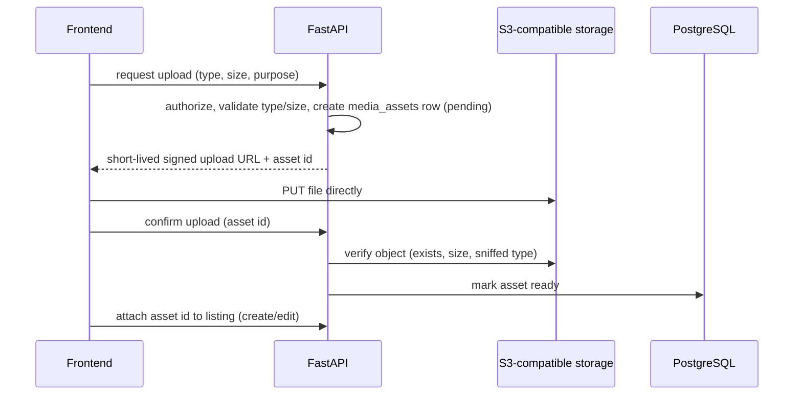

# B-17 Portal — Media Storage

**Status:** direction frozen by Phase 10A — **design only; no upload, storage or media table exists.**
**Owns:** the current image limitation, the future object-storage architecture, media metadata, the upload lifecycle direction, and provider neutrality.
**Does not own:** which listing columns reference media → [`DATA_MODEL.md`](DATA_MODEL.md) · endpoint shapes → [`API_CONTRACT.md`](API_CONTRACT.md) · hosting/secrets → [`DEPLOYMENT.md`](DEPLOYMENT.md).

## 1. Current frontend limitation

- **Seed content** references static files shipped with the app (`/images/…`, ~4 MB after Phase 9L). These are real public assets served by the frontend host.
- **User-submitted images** (listing cover, Food `menuImage`) are created with `URL.createObjectURL()` — a **browser-local `blob:` URL**, valid only in that tab/session. `ListingImageInput` accepts JPG/PNG/WEBP, stores only the URL string (never a `File`), and the image is lost on reload.
- The domain types carry `image?: string` / `menuImage?: string` — strings, no metadata (no alt text, size, dimensions, owner).

Consequence for the backend: a `blob:` URL is **meaningless server-side and must never be stored or accepted**. Until the media phase exists, the API accepts only public `https://` URLs or site-relative asset paths in the interim `image_url` columns (`DATA_MODEL.md` §1) and rejects `blob:`/`data:` values. Creating a listing with a photo therefore needs the media phase; listings without photos use the existing placeholder fallback (`CardImage`).

## 2. Target architecture

Text form: `Frontend → API (authorize, sign) → direct upload to object storage → API confirms → database stores metadata/reference`.

- **Binaries never go in PostgreSQL.** The database stores metadata and a reference only.
- **Direct-to-storage uploads** (signed URLs) keep large files off the API process; a proxy-through-API upload is an acceptable fallback for the first implementation if signing is deferred.
- **Provider-neutral:** all access goes through a small `StorageBackend` interface (sign upload, head/verify object, delete, derive public URL) with an **S3-compatible** implementation. It must work with AWS S3, Cloudflare R2, Supabase Storage or any S3-compatible provider via configuration (endpoint, bucket, region, credentials, public base URL). No provider-specific SDK features in domain code.
- **Public delivery:** listing media is public content; serve via a public bucket/prefix or CDN base URL. Private media (none planned) would use signed GET URLs.

## 3. Metadata (reserved table, created in the media phase)

`media_assets`: `id uuid`, `owner_id → users`, `storage_key` (opaque, e.g. `listings/<uuid>/<uuid>.webp` — never the user's filename), `content_type`, `byte_size`, `width`/`height` (images), `purpose` (`listing_cover|menu_image|news_cover|…`), `alt_text` (nullable; accessibility), `status` (`pending|ready|rejected|deleted`), `created_at`. Public URL = `MEDIA_PUBLIC_BASE_URL + storage_key` (derived, **not** stored, so a CDN/provider change is a config change).

Listings then reference assets (`cover_asset_id`, `menu_asset_id`, news cover) and the API **keeps returning `image` / `menuImage` as URL strings** so the frontend contract does not change; interim `image_url` columns are backfilled/migrated then.

## 4. Upload lifecycle and rules (direction)

1. Authorize (signed-in, professional/admin for listing media) and **rate-limit**.
2. Validate declared **type** (JPEG/PNG/WEBP — as the frontend picker already restricts), **size cap** (e.g. a few MB), and count limits per listing.
3. After upload, **verify server-side**: the object exists, size within limit, and the real content type is sniffed from the bytes (never trust the extension/`Content-Type` header); reject mismatches.
4. Optional processing (resize/convert to WebP, strip EXIF/GPS) — **a later optimization**; when needed it runs as an in-process/background task, not a new queue system.
5. **Orphan cleanup:** assets never attached within N hours are deleted by a periodic task; replacing/removing an image on a listing marks the old asset for deletion.
6. **Moderation:** media on an unapproved listing is not public by listing visibility; an admin takedown of a listing hides its media with it.
7. Quotas/limits are plan-aware only if a plan feature requires it (not in V1).

## 5. Security notes

Least-privilege storage credentials (the API can write/sign only its bucket/prefix; the browser only gets short-lived scoped URLs) · randomized storage keys · no executable/SVG uploads in V1 (SVG can carry script) · size and rate limits · EXIF privacy for user photos · CORS on the bucket allowing only the exact frontend origins for `PUT`.

## 6. Out of scope for now

Galleries (the Food spec explicitly excludes them), logos, per-menu-item images, video, image CDN transformations, and any upload implementation before the media phase.
